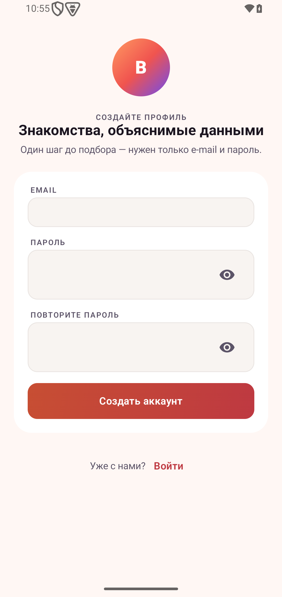
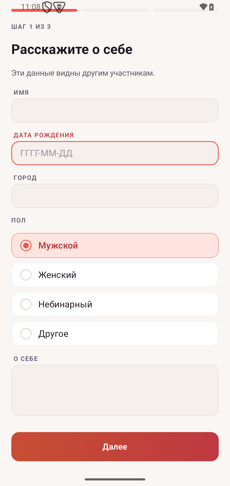
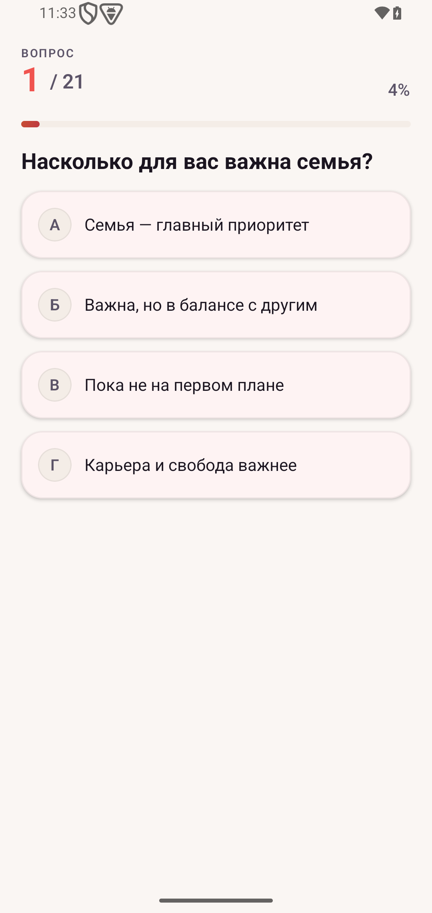
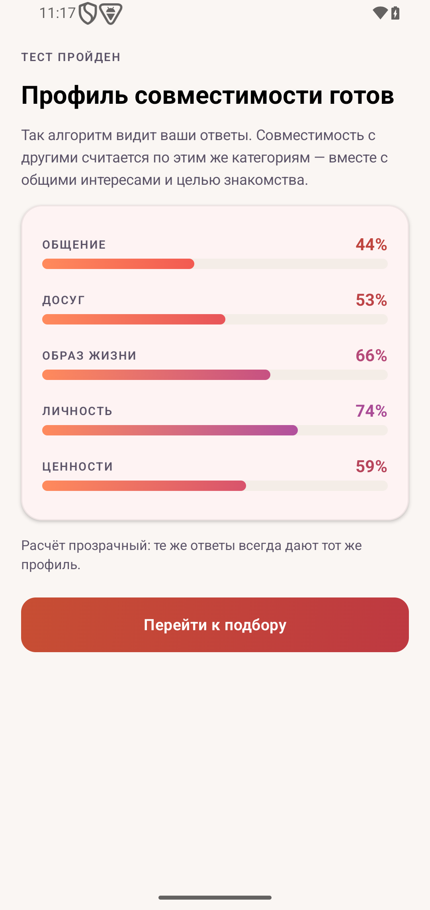
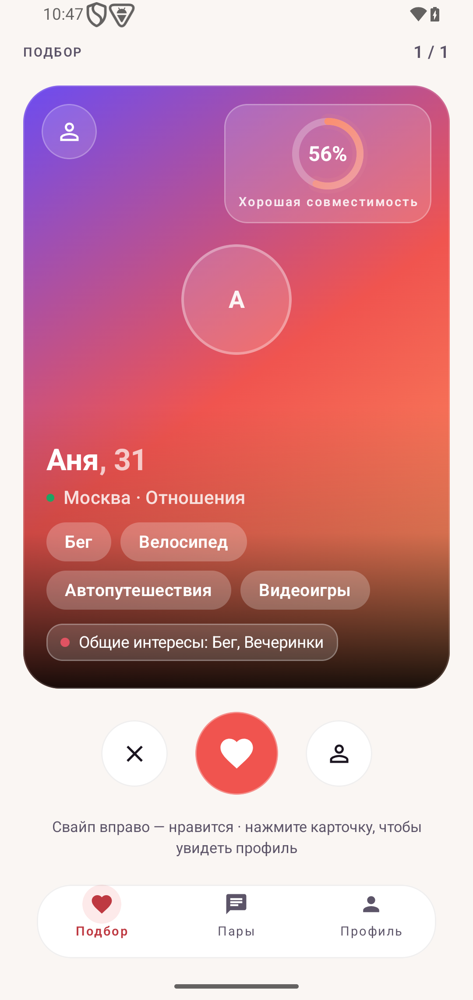
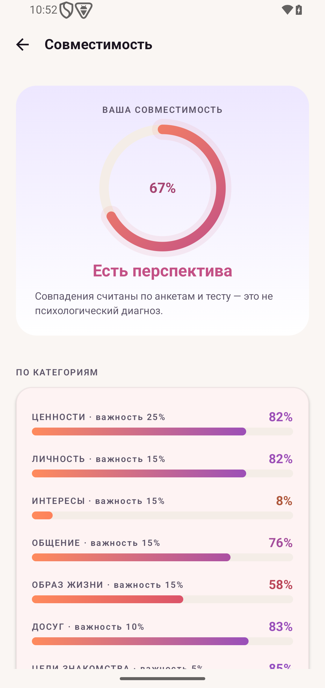
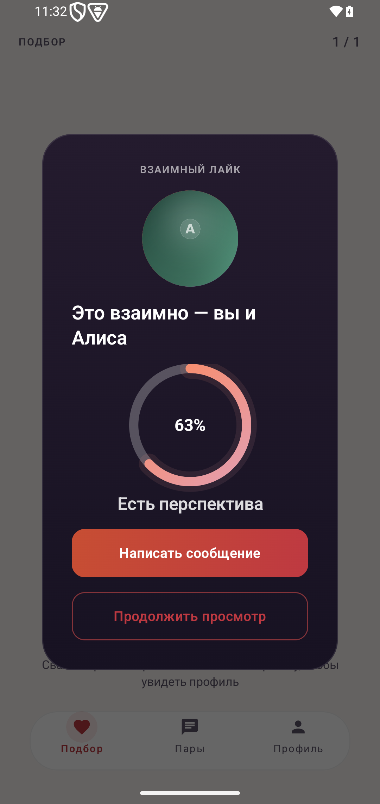
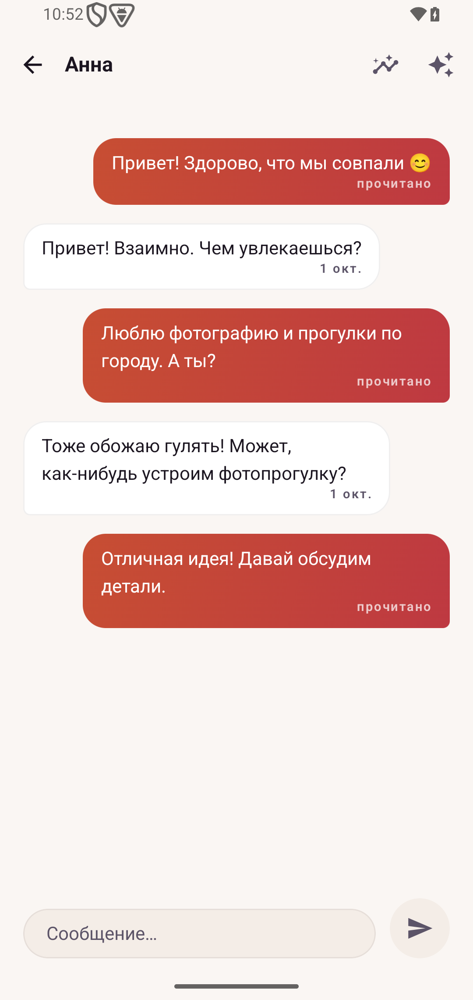
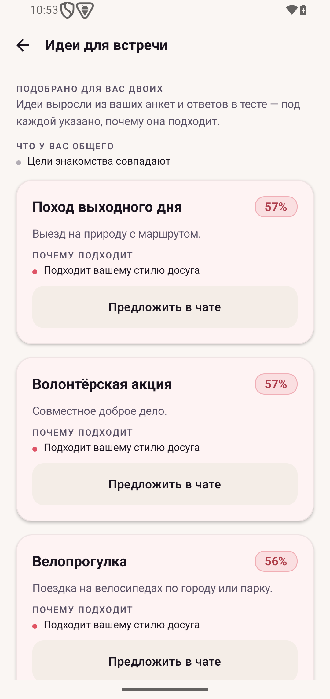
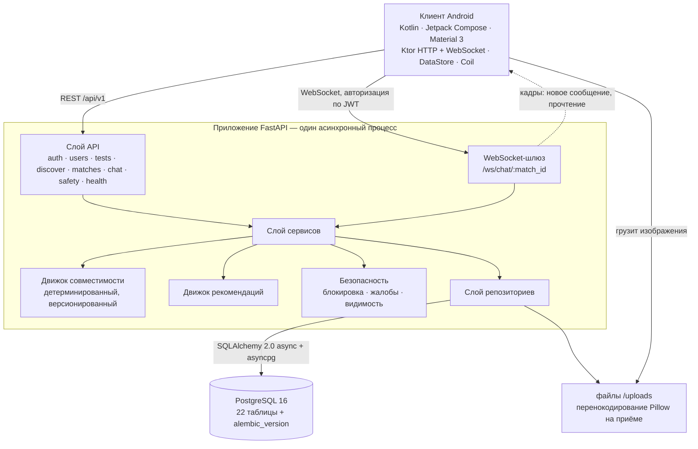

# BeFoS

**Платформа знакомств с объяснимой совместимостью**


| | | |
|---|---|---|
|  |  |  |
| Вход | Анкета | Тест |
|  |  |  |
| Результат теста | Поиск | Разбор совместимости |
|  |  |  |
| Взаимная симпатия | Чат | Рекомендации для свидания |

> BeFoS — платформа знакомств, в которой совместимость считается по семи взвешенным
> категориям и показывается человеку вместе с числом. Не «вот вам 87% и верьте на слово», а
> «вот что у вас общего, вот в чём вы разошлись, и вот чем вам двоим заняться вместе». Всё это
> вычисляется из реальных ответов профилей, детерминированно, без генерации текста.

Процент совместимости — **инженерная эвристика**, построенная на опросниках и тесте. Это не
психологическая или медицинская диагностика, и в продукте она нигде так не подаётся.

## Что это за проект

В одном репозитории два законченных артефакта:

- **`backend/`** — асинхронный FastAPI-сервис: JWT-аутентификация с ротацией refresh-токенов,
  профиль и анкета, тест из 21 вопроса, движок совместимости, поиск с хранимой колодой и
  пагинацией по курсору, пары, WebSocket-шлюз чата, рекомендации совместных активностей,
  безопасность (блокировка и жалобы), миграции Alembic поверх PostgreSQL 16.
- **`android/`** — клиент на Kotlin / Jetpack Compose (Material 3, Ktor, Navigation Compose,
  DataStore, Coil) с разбиением `data / domain / presentation`, покрывающий каждую возможность
  бэкенда выше.

В этом потоке нет заглушек: ни случайных процентов, ни фейковых профилей за интерфейсом, ни
имитации realtime-канала. Засеянные аккаунты существуют, чтобы продукт можно было показать, и
они помечены как засеянные.

## Почему BeFoS, а не очередное приложение для знакомств

Приложение для знакомств оптимизируют по времени в интерфейсе; ранжирование, которое даёт
колоду, непрозрачно, а матч ничего не говорит о том, почему случился. BeFoS переворачивает это:

- **Число объяснимо.** Каждый балл категории выведен из сохранённых ответов, и API возвращает
  разбор по категориям, точки совпадения, реальные расхождения и общие интересы — всё
  вычислено, ничего не сгенерировано.
- **Одинаковый вход даёт одинаковый выход.** Движок детерминирован и версионирован
  (`engine_version` сохраняется вместе с каждым результатом), поэтому процент можно
  воспроизвести и проверить.
- **Симметрия — проверенное свойство.** Пара получает одинаковый процент с обеих сторон; это
  утверждено тестами, а не принято по умолчанию.
- **Рекомендация применима.** Вместо «вам стоит поговорить» приложение предлагает конкретную
  активность из каталога, которая подходит обоим профилям, их городу и их ответам.
- **Отказ реальный.** Блокировка удаляет пару и её историю на сервере, в обе стороны, включая
  внутри уже открытого сокета. Это не фильтр ленты.

## Продуктовый поток

```
регистрация → профиль → интересы → тест из 21 вопроса → профиль совместимости
        → колода поиска → симпатия / пропуск → взаимный матч → чат (WebSocket)
        → разбор совместимости → рекомендация совместной активности
```

После входа маршрутизация зависит от того, насколько заполнен профиль: законченный попадает на
главную вкладку, незаполненный — обратно в анкету, а не на экран, который не может работать.

## Экраны

Сняты с работающего приложения на эмуляторе (1080×2280) против Docker-бэкенда, только на
засеянных демо-данных. Язык интерфейса — русский: продукт делался для русскоязычного рынка, а
строки экранов живут в коде Compose, а не в ресурсном бандле, поэтому переключателя локали нет.
Содержимое каталогов (интересы, вопросы, активности) по той же причине русское.

| Экран | Файл | Что на нём |
|---|---|---|
| Вход | [`01-auth.png`](screenshots/01-auth.png) | Форма входа и регистрации |
| Анкета | [`02-onboarding.png`](screenshots/02-onboarding.png) | Шаг 1 из 3: имя, дата рождения, город, пол, о себе |
| Тест | [`03-test.png`](screenshots/03-test.png) | Вопрос 1 из 21, с прогресс-баром и четырьмя вариантами |
| Результат теста | [`04-test-result.png`](screenshots/04-test-result.png) | Профиль по категориям после теста |
| Поиск | [`05-discovery.png`](screenshots/05-discovery.png) | Карточка кандидата с кольцом процента, общими интересами и причиной показа, выведенной из данных |
| Совместимость | [`06-compatibility.png`](screenshots/06-compatibility.png) | Общий процент и семь полос категорий |
| Матч | [`07-match.png`](screenshots/07-match.png) | Момент взаимной симпатии с процентом пары |
| Чат | [`08-chat.png`](screenshots/08-chat.png) | Живой диалог внутри пары |
| Рекомендации | [`09-recommendations.png`](screenshots/09-recommendations.png) | Оценённые для пары совместные активности |
| Профиль | [`10-profile.png`](screenshots/10-profile.png) | Свой профиль, состояние теста, интересы, вход в приватность |

## Что умеет

**Аутентификация и сессия.** Access-токен плюс refresh-токен; refresh хранится как SHA-256 хеш
и ротится при каждом использовании. Протухшая сессия — восстановимое состояние: неудачный
refresh очищает токены, а навигатор возвращает человека на экран входа с уже подставленной
почтой; 5xx или сетевой сбой, наоборот, сессию сохраняют и оставляют на экране, где «Повторить»
может сработать. Проверено на устройстве подменой JWT-секрета бэкенда.

**Профиль и анкета.** Три шага, валидация там, где уже находится большой палец; интересы из
каталога на 40 позиций со стабильной геометрией чипов (выбор одного не сдвигает соседей).

**Тест.** 21 вопрос в семи категориях, автопереход, автоотправка на последнем ответе, перепройти
можно в любой момент; ответы хранятся по вариантам и питают движок.

**Поиск.** Кандидаты берутся из хранимой ранжированной колоды и читаются курсором, поэтому
страницы не съезжают, пока пул меняется; тот, кто не проходил тест, не становится чьей-то
карточкой. На каждой карточке лежит `highlight`, выведенный из двух профилей, а не из шаблона.

**Пары и чат.** Взаимная симпатия создаёт пару и сохраняет процент, который движок даёт этой
паре сегодня. Сообщения уходят через REST и рассылаются в WebSocket пары, так что оба клиента
видят их без перезагрузки; повтор отправки переиспользует ключ идемпотентности, поэтому одно
касание — одно сообщение, а переподключение дозагружает пропущенный разрыв.

**Разбор совместимости.** Общий процент, семь полос категорий, сильные стороны, расхождения,
общие интересы — считается по обоим профилям.

**Рекомендации.** Активности, оценённые по обоим профилям, их городу и ответам, и обновляются,
когда меняется любой из профилей.

**Безопасность.** Блокировка (на сервере, в обе стороны, перепроверяется на каждом кадре
сокета), жалобы с пересылаемыми причинами, переключатель видимости профиля, удаление
аккаунта, которое стирает данные.

## Движок совместимости

```
Score = Σ ( normalize(component_i) × weight_i ),   Σ weight_i = 1.0
```

| Категория | Вес | Из чего считается |
|---|---|---|
| values | 0.25 | Близость черт в нормализованном векторе ответов (семья, карьера, рост, стабильность, приключения) |
| personality | 0.15 | Близость черт (экстраверсия, открытость, планирование, оптимизм) |
| interests | 0.15 | Пересечение множеств интересов — не вектора. Считается только то, что назвали оба: если хоть один из двоих не выбрал ни одного интереса, сравнивать нечего и категория читается нейтрально, а два названных набора без пересечения — расхождение, которое стоит очков |
| communication | 0.15 | Близость черт в категории общения |
| lifestyle | 0.15 | Близость черт в категории уклада жизни |
| leisure | 0.10 | Близость черт в категории досуга |
| goals | 0.05 | Совместимость двух названных целей знакомства — не вектора |

Веса лежат в `backend/app/compatibility/weights.py` и проверены на сумму 1.0. Кроме процента API
отдаёт разбор по категориям, сильные стороны, расхождения и общие интересы. Оценивание — чистая
синхронная функция двух векторов: без базы, без часов, без случайности внутри движка. Именно
поэтому тесты детерминизма и симметрии дёшевы в запуске.

У каждой полосы разбора есть признак `has_data` — с стадии 72 он выходит в ответ наравне с числом.
Нужен он потому, что нейтральная половина движка и ровно половина совпадения пишутся одними и теми
же 50: пока флага в ответе не было, экран пары не мог отличить категорию, где сравнивать было нечего,
от измеренной на середине, и заливал полосу так, будто ответ есть. Теперь клиент печатает на таком
месте «нет данных» и оставляет полосу пустой.

О номере движка (`engine_version`) стоит знать ровно одно, иначе он обещает больше, чем держит: он
записывается в каждый ответ и в каждый сохранённый вектор ответов, то есть держит форму результата,
а не каждое правило в отдельности. Стадия 60 изменила одно правило (молчание об интересах
перестало быть расхождением) и не подняла номер — потому что тот же номер штамповывает формат
вектора, а 50 001 сохранённый вектор на стенде его не меняли. Число, где прежний расчёт и вправду
остался, — сохранённый процент пары (`Match.compatibility_score`), и версии он не держит: он
пересчитывается, когда кто-то из двоих правит интересы, цель знакомства или пересдаёт тест. Оба
пункта записаны открытыми в [`CHANGELOG.md`](CHANGELOG.md).

## Архитектура



Один процесс бэкенда, одна база и одно хранилище файлов для загрузок: ни очереди, ни кэш-слоя,
ни микросервиса, которого не существует. [`docs/ARCHITECTURE.md`](docs/ARCHITECTURE.md) описывает
слои, движки и жизнь сокета; [`docs/DATABASE.md`](docs/DATABASE.md) — схему и арифметику пула;
[`docs/API.md`](docs/API.md) — каждый эндпоинт; [`docs/DEPENDENCIES.md`](docs/DEPENDENCIES.md) —
политику пинов, аудит advisory и что именно он замерил;
[`docs/SCALE_PLAN.md`](docs/SCALE_PLAN.md) — что происходит с горячими путями на объёме: замеры
тринадцати путей на 1 000, 10 000 и 50 000 анкет, к чтениям приложен план `EXPLAIN ANALYZE` (путь
завершения теста снят без планов — стадия 22 убирает обращение, а не форму запроса), парные
прогоны «до / после» для правок стадий 19, 20, 21, 22, 24, 25, 26, 27, 28, 30, 31, 32 и 33, вывод
о том, какое чтение остановится первым, и записанная честно оговорка: абсолютные медианы
этого стенда между вечерами плывут,
поэтому сравнивать можно только прогоны одной конфигурации. Стадия 23 (запись профиля) в этот
документ не просится: она сняла письма и два чтения одной строки по уникальному индексу, а проба
считает чтения на тысячах анкет, — поэтому у неё только числа обращений, без миллисекунд. Стадия
24 (страница рекомендаций пары) в него просится: снятие обращений пришлось ровно на тот путь,
который проба меряет, и тот же вечер дал парный прогон с контролем — 13 чтений стали 8, медианы
82.8 / 80.6 / 81.9 мс на 1 000, 10 000 и 50 000 упали до 58.0 / 57.8 / 58.0, а контрольный
`chat_history` за тот же вечер сдвинулся на −1.5 / −1.2 / −6.0 %. Стадия 25 (экран совместимости
пары) меряется тем же способом: 6 чтений за вызов стали 3, медианы 31.9 / 32.9 / 32.1 мс упали до
21.5 / 21.5 / 21.1 при том же контроле, сдвинутом на −5.7 / −2.1 / −0.6 %. Стадия 26 (маршрут лайка)
принесла в стенд одиннадцатый путь и сняла на нём 12 чтений до 10: медианы 83.9 / 74.5 / 70.0 мс
стали 77.9 / 65.1 / 66.1 мс, а контроль сдвинулся на +8.1 / −5.4 / −0.3 % — на 1 000 его ход оказался
больше сдвига пути, и выигрыш по времени там не утверждается. Стадия 27 (страница колоды, которой
нечего отдать) принесла в стенд двенадцатый путь и сняла на нём 9 обращений до 7: медианы
125.4 / 318.4 / 1247.0 мс стали 57.3 / 64.7 / 427.5 мс при контроле +13.3 / −11.5 / −6.0 %, и это
первая строка таблицы, у которой рост с объёмом виден напрямую — правка обращений его не снимает,
поэтому порог на него стоит в таблице «Триггеры». Стадия 28 меряется на уже стоявшем пути:
дозаполненная страница поднимала одних и тех же кандидатов дважды за запрос, на `discovery_rebuild`
16 обращений стали 13 (тестовый слушатель на одной странице показал 19 против 16), медианы
240.8 / 327.8 / 272.8 мс — 210.9 / 290.0 / 247.4 мс. Выигрыша по времени эта пара не утверждает:
контрольный `chat_history` сдвинулся на −6.0 / −9.5 / −0.6 %, а нетронутый правкой `discovery_page`
ушёл на −6.5 / +4.7 / +5.4 % — в том же порядке величины, что и сам путь. Там же записана оговорка на
прошлое: стенд стадии 20 стоял с пустой таблицей `activities`, поэтому его строка «рекомендации»
меряла не генерацию страницы. Стадия 29 (запись профиля поднимала его список интересов дважды)
остаётся за этим документом по той же причине, что и стадия 23: маршрутов записи анкеты среди
путей стенда нет, а снятое обращение выбирает строки по ведущей колонке
`uq_user_interest (profile_id, interest_id)` — не больше тридцати на анкету, то есть его цена не
зависит от числа анкет в базе. Поэтому у стадии только числа обращений, без миллисекунд. У стадии 35
(правка одного города перечитывала процент всех пар, в котором города нет) миллисекунды всё же есть,
и сняты они третьим прибором: четыре текста обращений, напечатанных слушателем на прежнем дереве,
переиграны asyncpg'ом против базы стенда на зрителе с шестьюдесятью парами — блок 14.031 / 13.610 /
14.093 мс при серверном времени самого блока 1.709 мс. Стадия 30
(страница пары поднимала каждого из двоих своими обращениями) в этот документ попросилась сама:
она принесла в стенд тринадцатый путь `match_detail` и сняла на нём 8 чтений до 5 — медианы
53.8 / 52.8 / 53.4 мс стали 47.1 / 38.0 / 44.5 мс, но контроль `chat_history` за тот же вечер
сдвинулся на +6.6 / +26.8 / +9.5 %, и на 10 000 его ход в девять раз больше сдвига пути, поэтому
выигрыша по времени прогон не утверждает: число обращений — 10 → 7 на HTTP-маршруте, снятое
слушателем. Стадия 31 (карточка по правилу колоды поднимала двоих теми же одиночными чтениями, что
и страница пары до предыдущей правки) меряется на уже стоявшем пути: `public_profile` — это тот же
`get_public_profile`, только правилом колоды, и в паре одной команды его 8 чтений стали 5, медианы
51.3 / 55.3 / 58.3 мс стали 39.5 / 34.6 / 36.1 мс, а контроль `chat_history` за тот же вечер
сдвинулся на +6.6 / −0.5 / −12.4 %. Здесь выигрыш по времени утверждается, и решает то же сравнение:
сдвиг пути больше хода контроля по модулю на всех трёх масштабах, а на 1 000 они ещё и
разнонаправлены; слушателем на HTTP-маршруте те же правки дают 9 → 6 обращений. Стадия 32
пересняла наконец сам `chat_history`, который семью прогонами был контролем: повтор вокруг открытия
чата был не в чтении, а в квитанции о прочтении — `SELECT` приносил id непрочитанных сообщений, а
`INSERT` отправлял те же id обратно. Слушателем 8 обращений стали 7, а 6 у `POST /read` стали 5;
при пустой очереди число обращений не изменилось (7 и 5), потому что прежний код на пустом списке
выходил до вставки. Прогон стенда выигрыша по времени не утверждает, и в README это записано
отдельно: медиана пути 31.7 / 30.9 / 30.8 мс стала 34.2 / 37.1 / 39.1 мс, 15 повторов на 10 000 дали
+10.9 % при нетронутых контролях +5.2 % и −6.7 %, а счётчик пробы уменьшился (6 → 5) и там, где круг
к базе не менялся, потому что проба считает только `SELECT`/`WITH`. Прямое сравнение двух форм
запроса на той же базе (60 чередующихся повторов) объясняет, где правда: прибавка 0.056…0.085 мс,
когда отмечать нечего, и снятые 2.3…4.0 мс и один круг к базе, когда ждут 4, 12 или 120 сообщений.
Стадия 33 разобрала то, что стадия 32 записала следующей очередью: список пар поднимал таблицу
`messages` дважды по одним и тем же id матчей — `distinct on (match_id)` ради последней строчки
переписки и `count(messages.id)` ради счётчика непрочитанных. Одна забота теперь умещается в одно
обращение: счётчик стал оконной агрегатной функцией поверх того же разбора по парам, и строку,
которую `DISTINCT ON` оставляет как самую свежую, он приносит вместе с собой. Слушателем 6 обращений
стали 5, и второе чтение `messages` исчезло из прогона совсем; проба на трёх масштабах даёт 4
обращения вместо 5 — здесь, в отличие от стадии 32, `SELECT` заменился `SELECT`-ом, поэтому сдвиг
её счётчика и есть настоящий сдвиг кругов к базе. Прямое сравнение двух форм запроса на той же базе
стенда (60 чередующихся повторов на аккаунте с 120 сообщениями в одной паре) даёт 6.681 → 3.634,
6.740 → 3.741 и 7.198 → 3.932 мс при двух кругах к базе против одного, то есть снятое обращение
стоит порядка 2.7–3.3 мс на вызов. Парной прогон стенда подтверждает это только на 50 000: медиана
пути 40.9 мс стала 34.3 (−16.1 %), а контроль `chat_history` за тот же вечер сдвинулся на +2.6 %;
на 1 000 и 10 000 ход контролей (−12.2 % и −21.8 % у `chat_history` и `recommendations`) больше
сдвига пути (−3.9 % и −18.1 %), поэтому выигрыша по времени эти два масштаба не утверждают.
Стадия 34 посмотрела на маршруты сессии. `POST /auth/refresh` и `POST /auth/logout` оба заканчиваются
одной записью в `refresh_tokens` и оба поднимали эту строку заранее, хотя решала её не прочитанная
строка, а сама запись: погашение — это `UPDATE … WHERE revoked is false`, чей счётчик строк и
отвечает, жив токен или уже погашен. Слушателем ротация стала 3 обращениями вместо 4, выход — 1
вместо 2, а контроль `POST /auth/login` остался на 2. На стенде эти пути не измерялись и в README
это записано отдельно: в `refresh_tokens` базы стенда 0 строк, самих маршрутов в списке наблюдаемых
нет, а снятое обращение приносит ровно одну строку по ведущей колонке `ix_refresh_tokens_token_hash`
— его цена не зависит от числа анкет. Миллисекунды сняты переигровкой обеих форм через asyncpg против
dev-базы с 642 строками токенов: 60 чередующихся повторов, медиана 7.366 → 4.745 мс, то есть
+2.621 мс на вызов; `EXPLAIN (ANALYZE, BUFFERS)` показывает, что новый `UPDATE` идёт по тому же
индексу, что и убранный `SELECT` (0.348 мс против 0.402 мс у прежнего `UPDATE` по первичному ключу),
— значит подешевел разговор с сервером, а не план. Подорожало одно: подпись, у которой строки в
таблице нет, отказывает теперь в 2 обращения вместо 1. Один текст отказа в углу (токен без строки при
деактивированной анкете) сдвинулся с «Refresh token has been revoked.» на «User no longer active.» —
снято прогоном на обоих деревьях, статус на обеих ветках 401.
Стадия 35 задала вопрос не о числе обращений внутри одного маршрута, а о том, чьи обращения там
оказались. `PATCH /users/me` трактует три поля — интересы, город и цель — одним триггером: правка
любого из них роняла кэш страницы активностей пары и перечитывала процент всех пар человека.
Процент движок строит из вектора ответов, набора интересов и цели (`app/compatibility/engine.py:19`),
и города среди его входов нет: слушатель на аккаунте с одной парой дал 11 обращений на правку одного
города, четыре из них — тот самый пересчёт, который возвращает на место прочитанное число. Стадии 26
и 34 правили «решает запись, а не чтение»; здесь решал состав входа. Появился отдельный набор
`_SCORE_FIELDS`, и веер запускается только правкой interests или цели, а город остался триггером
кэша, который он действительно меняет. Слушателем 11 → 7, и три контроля в том же прогоне не
сдвинулись: интересы 15, цель 13, одно текстовое поле 6. На объёме пара говорит то же число другим
прибором: переигровка четырёх снятых текстов против базы в 50 001 анкету на зрителе с шестьюдесятью
парами даёт блок 14.031 / 13.610 / 14.093 мс при серверном времени самого блока 1.709 мс, 877
попаданиях в кэш и нуле чтений с диска — цену правки города держит разговор с сервером, а не обход
строк. Правка вскрыла предписание: `docs/OPERATIONS.md` §16 чинил посеянный процент правкой города,
и после этой стадии оно стало бы тихой операцией без результата. Предписание переставлено на цель
отношений и проверено на живом dev-стенде против пересобранного образа: посеянные `82` правка города
оставила как были (`82` при живых `63`), правка цели, равной текущей, вернула `stored == live`, и
тот же признак после этого даёт 0 расхождений из восьми пар демо-аккаунта.
Стадия 36 сменила прибор: слушатель `before_cursor_execute` стал запоминать не только текст
обращения, но и его параметры, и печатать пары, встретившиеся внутри одного запроса дважды. На
двух маршрутах записи анкеты он дал одну и ту же пару дважды — строку профиля поднимали перед
записью и ещё раз после `commit`, ради сборки ответа; на переключателе видимости дубликата не
было, а на удалении аккаунта строка читалась один раз и до правки (20 обращений на обоих
деревьях). Прежний комментарий утверждал, что после коммита в identity map ничего не держится, и
потому считал второе чтение источником серверных значений; это опровергли сами настройки и ответ:
сессия работает при `expire_on_commit=False` (`app/core/database.py:43`) и держит записанную
строку читаемой, а в ответе нет поля, которое сервер досчитывает сам, — `age` является свойством
над `birth_date`. В таблице остался только набор интересов, и то лишь когда запрос его не называл:
запись, которая набор заменяет, читает каталог по slug'ам, чтобы его записать, и те же строки
показывает в ответе.
Слушателем на свежем аккаунте 12 обращений стало 10 на онбординге (одинаково при одном интересе и
при тридцати), 6 → 5 на правке одного поля, 11 → 9 на записи набора; контроли `GET /users/me` (4),
`POST /users/me/visibility` (3) и `DELETE /users/me` (20) не сдвинулись ни на одном дереве, причём
последние два числа `docs/API.md` нёс со стадии 23, и прогон их подтвердил, а не унаследовал. Механизм
снят переигровкой против базы стенда в 50 001 анкету: снятое чтение строки стоит 2.639 мс медианой
при серверном плане 0.067 мс, трёх попаданиях в кэш и нуле чтений с диска — дорог в нём круг к
серверу, а не обход строк. Попутно правка закрепила то, что держалось на порядке строк таблицы:
набор в ответе записи идёт `ORDER BY user_interests.interest_id`, и на стенде три формы этого
чтения принесли шесть интересов одним и тем же порядком, так что закреплено совпадающее, а не
переставленное.
Стадия 37 посмотрела на те же пути глазами клиента, и прибором был лог живого стенда: открытие
переписки на эмуляторе (прежнее дерево, пара `3ef56d4b…`, окно 22:51:19 — 22:51:20) стоит четыре
строки: `GET /matches/{id}` — 75.0 мс, два `GET /matches/{id}/messages?limit=50` — 70.3 и 32.0 мс,
и следом `POST /matches/{id}/read` — 51.0 мс.
Последнее обращение ничего не меняло: отметку о прочтении ставит то же чтение истории
(`ChatService.history` зовёт `repo.mark_read`, `app/services/chat_service.py:80`), а квитанцию
собеседнику рассылает маршрут чтения (`app/api/v1/chat.py:28-36`). Слушатель набора на двух
независимых парах дал этому второму запросу 5 обращений при `marked_read = 0`, и столько же на
переписке, где отмечать уже нечего. Вторая половина находки оказалась дефектом, а не только
экономией: вызов стоял после `when`, а не внутри ветки успеха, поэтому `loadHistory` слал отметку и
когда история не загрузилась — человек видел экран ошибки, а собеседник уже видел «прочитано».
В `ChatViewModel.kt` вызов убран, и разноска по путям держится кодом: сообщение, пришедшее по
сокету, отметку получает (`upsert`, строка 153 — за ним никакого чтения нет), а `fillGap` (строка 132)
не слал её и раньше, потому что читает ту же страницу и квитанция уходит с чтения. Держат это три
проверки `ChatViewModelTest.kt`; красное состояние снято на прежнем дереве дословно и дало
`17 tests completed, 3 failed`. Устройство подтвердило поведение: после правки в логе тех же
открытий `POST /read` нет вовсе (последний — 22:51:20, дальше до 22:59:25 ни одного), а остались те
же `GET /matches/{id}` и два `GET /messages` (32.7 / 37.8 / 23.0 мс и 40.8 / 37.0 / 22.5 мс); сокет
собеседника получил `{"type": "read", …}` ровно в момент
открытия, и то же сообщение ответом `GET` показало `is_read=false` до открытия и `is_read=true`
после. Android-набор пересчитан: 132 → 135 passed, 0 failed (замер 2026-10-09); бэкенд правка не
касается — маршрут `POST /matches/{id}/read` остался и зовётся теперь только сообщением по сокету,
а отметка сокета идёт через тот же сервис (`app/websocket/chat_ws.py:192-204`). Там же записано
найденное и не закрытое: история на открытие читается дважды — два `GET /messages?limit=50` в одну
секунду, без `before_id`, и какой из двух вызовов (`loadHistory` или `fillGap`) зовёт второй раз,
стадия не проверяла.
Стадия 38 назвала этот второй вызов и сняла его. Временные `Log.d`-пробы (жили только в ASCII-копии
дерева, в репозиторий не попали) на том же стенде дали порядок: `loadHistory call` в 23:43:46.936,
`Disconnected event, uiConnected=false` в 23:43:46.971, `Connected event, socketWasDown=true` и
`fillGap call` в одну миллисекунду 23:43:48.396. Второй читает `fillGap`, а не повторный
`loadHistory`. Причина — в самой подписке: состояние соединения живёт в
`MutableStateFlow(false)` (`ChatRepositoryImpl.kt:64`), а `StateFlow` воспроизводит текущее значение
каждому новому слушателю (`ChatRepositoryImpl.kt:75-87`) — экран подписывается до конца дозвола,
поэтому его первый кадр `Disconnected`, хотя сокет ещё ни разу не был поднят; обработчик ставил
флаг разрыва на любой `Disconnected`, и первый настоящий `Connected` считался обрывом. Разносил
это и набор: `ChatViewModelTest` давал ViewModel `MutableSharedFlow` без повтора, и на такой
подставке второго чтения не возникало вовсе. Правка — одна строка условия в `ChatViewModel.kt`
(`Disconnected` поднимает флаг, только если экран это соединение уже имел), плюс два новых случая,
которые собирают поток так же, как `ChatSocket` (`merge(connection.map { … }, frames)` при
`connection = MutableStateFlow(false)`): первый проверяет одно чтение на открытие, второй — что
настоящий обрыв по-прежнему дочитывает. Красное состояние снято дословно на прежнем дереве и дало
`19 tests completed, 2 failed` с текстом «2 matching calls found, but needs exactly 1 calls».
Устройство подтвердило обе половины: после правки открытие (23:50:01 — 23:50:03) даёт одно
`GET /messages` (27.9 мс) вместо двух и `socketWasDown=false`, а проверка с реальным `svc wifi
disable` — поднятый флаг, сообщение собеседника (код 201 в 23:50:42), возврат и `fillGap` →
`GET /messages` (34.1 мс) с появлением пузыря на экране. Android-набор пересчитан: 135 → 137
passed, 0 failed (замер 2026-10-09); бэкенд правка не касается — сервер за одно чтение по-прежнему
платит семью обращениями, экономия лежит в одном лишнем круге клиента. Записано и не закрытое:
дозвон сокета после открытия экрана занимает 1.05–1.46 с, и всё это время индикатор говорит «не
подключено», хотя история уже на экране; из чего складывается этот интервал, стадия не разделяла.
Стадия 39 этот интервал разделила и назвала его главную часть. Пробы в цикле дозвона (только в
ASCII-копии дерева) на прежнем дереве дали состав (десять открытий переписки, два прогона): предзапрос
`GET /users/me` — 67…708 мс, чтение хранилища токена — 6…24 мс, рукопожатие WebSocket — 112…289 мс,
на одном открытии 583 мс, а `toybox nc` с того же эмулятора на
тот же адрес — 559…565 мс на одно новое соединение без всякого приложения (тот же маршрут с хоста
отвечает за 5.6…6.4 мс). Секунду платит маршрут эмулятор → хост → контейнер, и платит её тот,
кто открывает соединение первым: раньше это был предзапрос, теперь — само рукопожатие. Снят при этом
не латентный артефакт, а лишнее обращение: раньше каждый дозвон слал аутентифицированный
`GET /users/me` ради поворота просроченного токена, и на четырёх открытиях стенда сервер ответил на
него четыре раза `200` (12.1…14.5 мс) при нуле `POST /auth/refresh` — токен не был просрочен, и
запрос не дал ничего. Теперь клиент смотрит `exp` в токене, который уже держит, и шлёт предзапрос
только если до истечения осталась минута или если `exp` не читается; допуск не меняется, потому что
рукопожатие переспрашивает строки пользователя и пары на сервере
(`_refusal_reason`, `app/websocket/chat_ws.py:46-62`). На собранном APK без проб три открытия
переписки дают три принятых рукопожатия и ноль `GET /users/me`, а перевод часов устройства на 35
минут вперёд возвращает предзапрос (200 за 14.0 мс) и живое сообщение собеседника всё равно
приносится по сокету. Android-набор пересчитан: 137 → 143 passed, 0 failed (замер 2026-10-09);
бэкенд правка не касается — 364 проверки пересчитывает job `backend`. Записано и не закрытое:
из чего складываются полсекунды нового соединения на стенде (разбор адреса, NAT, виртуальная сеть) —
тогда не разделялось; разложено стадией 41 (голый коннект 47…64 мс против полного обмена 573…583 мс,
и те же 564 мс у слушателя без Docker и без uvicorn), но механизм этих полсекунд не назван.
Тёплые окна до правки и после перекрываются (214…322 и 322…880 мс против
263…365 мс), поэтому утверждения о задержке на тёплом пути нет.

Стадия 40 убрала второе чтение там, где его в интерфейс не выносили: корневой экран запуска.
Пара одинаковых `GET /users/me` в одну секунду стояла в логе стенда на каждом открытии
приложения (00:30:16, 00:36:31, 00:52:46, 00:53:51, 00:57:05, 01:18:20). Пробы в ASCII-копии
дерева назвали обоих авторов: вентиль `8764458` создаёт `BeFosNavHost`, вентиль `103792039` —
заставка, и каждый сам зовёт чтение анкеты, потому что `ViewModel` попадает в хранилище той
навигационной записи, где его позвали. Правка в одну строку: заставка получает вентиль
аргументом. На истёкшем токене такой запуск стоил пять обращений вместо трёх (01:54:53 — два
`401` за 131.3 и 139.0 мс, один поворот и два `200`); после правки холодный пуск даёт один
`GET /users/me` (200 за 18.0 и 17.9 мс на сборке с пробами, 21.0 мс на финальной сборке без
проб) и доходит до «Подбора» так же, как доходил (02:09:10 — `GET /discover` 200 за 33.6 мс).
Снятое чтение — это один круг клиента и четыре обращения к базе на каждый запуск. Android-набор
пересчитан: 143 → 144 passed, 0 failed (замер 2026-10-09); бэкенд правка не касается. Записано и
не закрытое: регрессия держит форму, а не поведение (у заставки ровно один параметр
`RootViewModel`), потому что юнит-тесты модуля Compose-экраны не собирают; ветку допуска `AUTH`
живьём на этой сборке стадия не перепроходила.

Стадия 41 ушла от вопроса о соединении и нашла дефект рядом с ним. Подозрение, что холодный запуск
платит несколькими свежими соединениями, опровергается логом стенда напрямую: четыре пуска дают по
одному порту (02:25:02…02:25:05 — четыре запроса на `:42740`, 02:27:15…02:27:17 — два на `:57590`,
02:35:36…02:35:38 — два на `:46440`), то есть отдельное соединение стоит только параллельность
запросов. Полсекунды нового соединения разложены: коннект до `10.0.2.2:8000` — 47…64 мс, полный обмен
— 573…583 мс, второй запрос того же сокета — ~110 мс, а `python -m http.server` на порту хоста без
Docker и без uvicorn — те же 564 мс; весь обмен внутри гостя на loopback укладывается в 49…55 мс.
Значит их платит маршрут эмулятор → хост, а не стенд, и стенд из цены снят. Настоящий дефект оказался
в другом месте: дефолт uvicorn `--timeout-keep-alive` — 5 с, то есть короче паузы между двумя
действиями в приложении. Сырой сокет с хоста видел FIN ровно через 5000 мс после ответа, а второе
заявление на паузах 8 / 20 / 40 с не получало ответа вовсе. Правка — один флаг
(`--timeout-keep-alive 75`), и на устройстве она видна напрямую: пуск 02:59:42…02:59:45 занял
порт `36946`, и «Пары» через 41 с пришли на том же порту, тогда как до правки пуск на `57934` сменил
соединение уже через 17 с (02:46:44, порт `55658`). Пауза в 121 с соединение всё-таки теряет (порт
`45684`), и это записано: ответ те же 200, OkHttp переподключается сам. Записано и не закрытое:
механизм тех полсекунд не
назван (мерялось целое на трёх маршрутах), пул клиента и пул `Coil` не тронуты, стенд горячих чтений
правка не переснимала — ни один запрос не изменён. Бэкенд-набор пересчитан: 364 → 367 passed, 0 failed
(замер 2026-10-09); Android-набор не менялся — 144, Kotlin здесь не трогали.

Стадия 42 не нашла нового повторного чтения в маршрутах и посмотрела на сам инструмент: путь
`deck_exhausted` собирал свой стенд внутри первого замеряемого вызова — `INSERT` строки очереди на
каждую анкету и `UPDATE` ожидающих. На 50 000 этот `INSERT` стоит 11 327.9 мс, и при трёх повторах он
попадал в медиану 11 426.8 мс, которую стенд публиковал как задержку страницы; та же страница в
тишине стенда обходится 95.5…99.1 мс на семи обращениях. Правка меняет место, а не работу: у стенда
появился реестр `_build_setups()` с одним хуком, и `_measure_size` прогоняет его до временного окна и
вне захвата обращений. Парной прогон (три повтора, вечер 2026-10-09): медиана 75.5 → 50.9 мс на 1 000,
142.9 → 61.9 мс на 10 000 и 11 426.8 → 355.0 мс на 50 000 при ходе контролей `chat_history`
−0.3 / +1.7 / +22.1 % и `discovery_rebuild` +4.2 / −14.6 / −17.0 %. Число обращений на вызов и план не
изменились, поэтому порога, с которого колоде просили индекс (150 мс против 30.21 мс у строки
`Seq Scan profiles`), правка не перескакивает, и индекса под колоду по-прежнему нет. (Так было на
дереве той стадии: индекс под порядок колоды внесён позже — стадией 55, `ix_profiles_deck_order`, и
о нём ниже.) Записано и не
закрытое: максимум на 50 000 (55 118.0 мс) всё ещё платит за сброс записи подготовки, и почему он
ложится ровно на один вызов из трёх — механизм стадия не назвала (счётчики `checkpoints_timed` и
`checkpoints_req` за такой повтор не сдвинулись). Отброшена и проверенная догадка, что `INSERT` дорог
из-за подзапроса `MAX(rank)`: `EXPLAIN` обеих форм показывает `InitPlan`, а переписанная форма через
`CROSS JOIN` дала 11 477.4 мс против 11 327.9 мс. Бэкенд-набор пересчитан: 367 → 371 passed, 0 failed
(замер 2026-10-09); Android-набор не менялся — 144, Kotlin здесь не трогали.

Стадия 43 не правила ни один путь: она посмотрела на то, как стенд говорит число. `_row` складывал
все пять замеряемых вызовов в один образец и считал по нему медиану и максимум, а самый длинный
оказывался первым вызовом в 35 строках из 39 (тринадцать путей на трёх объёмах; исключения —
`login` на всех трёх объёмах, где первый вызов 481.3 / 483.8 / 501.8 мс короче максимума прогретых
повторов (499.7 / 489.8 / 502.8 мс), и `discovery_rebuild` на 10 000 — 391.1 против 404.3 мс).
Значит публиковавшаяся колонка «максимум» описывала разогрев, а не экран. После правки первый
замеряемый вызов выходит отдельным числом, а медиана и максимум считаются по остальным, и стенд
отказывается считать при `--runs` меньше двух. На 50 000 путь `deck_exhausted` даёт 54 696.2 мс
первого вызова, тогда как максимум его прогретых повторов — 305.7 мс; тот же первый вызов
воспроизведён трижды
(55 118.0 мс на дереве стадии 42, 54 966.8 мс на прежнем дереве, 54 696.2 мс на новом), а вне
последовательности пробы — на уже наполненной базе двумя циклами «слить очередь → восемь вызовов» —
ни один из шестнадцати вызовов не превышает 341.2 мс, поэтому механизм по-прежнему не назван.
(Пересъёмка стадии 58 на том же объёме: первый вызов этой строки даёт 414.3 и 366.9 мс на прежнем
движке стенда и 326.6 и 329.7 мс на новом — ни на одном из двух полуминутного вызова нет, и название
ему по-прежнему не дано.)
Парный прогон (пять повторов, обе половины, вечер 2026-10-09) не сдвинул ни одного числа,
описывающего работу: обращения на вызов совпали во всех тридцати девяти строках (1.0 / 5.0 / 13.0 /
11.0 / 4.0 / 5.0 / 3.0 / 5.0 / 8.0 / 13.0 / 9.0 / 10.0 / 7.0), как и уникальные чтения в каждом
плане. Медианы двух половин расходятся в пределах −11.7…+10.1 %, и этим сравнением правка не
доказывается: вместе с правилом агрегирования сменился и образец. Регрессию держит
`backend/tests/test_scale_probe_sampling.py` (четыре проверки, красное состояние `4 failed in 4.63 s`
снято на прежнем дереве). Бэкенд-набор пересчитан: 371 → 375 passed, 0 failed (замер
2026-10-09); Android-набор не менялся — 144, Kotlin здесь не трогали.

Стадия 44 тоже правила прибор, а не маршрут, и вопрос был третий: считает ли стенд обращением
маршрута обращение, которого маршрут не делает. Прежние прогоны сравнивали число уникальных
**текстов** чтений, и этого мало: один текст с другими параметрами законен (анкеты двоих поднимаются
одним `SELECT` дважды), поэтому проба группировала каждый захваченный вызов по тексту вместе с
параметрами. На стенде в 50 000 анкет повтор дали два пути. `answers_submit` слал `SELECT
test_options … WHERE test_options.question_id IN ($1, …, $21)` дважды в один замеряемый вызов: стенд
собирал тело запроса чтением каталога внутри окна, которое сам же и считал, тогда как
`POST /tests/answers` читает ровно названные в теле вопросы, а каталог клиент берёт экраном раньше.
Чтение перенесено в реестр `_build_setups()`, который стадия 42 завела ровно для такой работы, и
замеряемый вызов теперь — только `TestService.save_answers`: 13.0 → 11.0 обращений на вызов на 1 000,
10 000 и 50 000 анкет, уникальных чтений в плане 12 → 11. Медины этой пары (137.9 → 124.1, 154.5 →
139.2, 145.9 → 133.0 мс) правка не доказывает: сумма уникальных чтений плана упала на 0.43…0.90 мс,
остаток лежит вне SQL, а нетронутый контроль `chat_history` за тот же вечер прошёл в −6.2…+3.8 %.
Второй повтор — `like`, два чтения блокировки с одними и теми же четырьмя id, — дефектом не оказался:
первое отвечает до `pg_advisory_xact_lock`, чтобы свайп по человеку, которого нет в колоде, не вставал
в очередь на замок, второе перечитывает блокировку под ним, и оба держат тесты гонок стадий 12 и 15.
Стадия оставила их и записала проверку, что они остаются. Две строки в снимок не вошли и чисел не
меняют: колода зрителя на том стенде была слита предыдущим прогоном, поэтому `discovery_page` стенд
пропустил, а `discovery_rebuild` дал 7 обращений вместо опубликованных 13.0. Регрессию держит
`backend/tests/test_scale_probe_payload.py` (пять проверок, красное состояние `4 failed, 1 passed in
4.17 s` снято на прежнем скрипте). Бэкенд-набор пересчитан: 375 → 380 passed, 0 failed (замер
2026-10-09); Android-набор не менялся — 144, Kotlin здесь не трогали.

Стадия 45 вышла за пределы прибора и посмотрела на страницу, которая объясняет оператору, сколько
клиентов держит один процесс. `docs/OPERATIONS.md` §7 публиковал границу «30 соединений» как сумму
`pool_size + max_overflow`, а «100 минус ~10 резерва → практически 3 реплики» — как оценку на память;
ни то ни другое прогоном не снималось, а третье число — сколько ждёт запрос, пришедший 31-м, — в
коде не называлось вовсе и держалось дефолтом SQLAlchemy. Замер поставил на место все три: 45
одновременных заёмов дали ровно 30 различных `pg_backend_pid()`, остальные 15 получили
`TimeoutError` через 30.002 / 30.004 / 30.007 с; сервер этого стенда принял 100 клиентских бэкэндов,
а 101-я попытка ответила `TooManyConnectionsError` (SQLSTATE 53300); резерв суперюзера оказался 3, а
не «~10», и роль `befos` этим резервом не пользуется, потому что суперюзер, — поэтому отказ пришёл на
сотом соединении, а не на 97-м. Прежнее утверждение, что четвёртая реплика будет ошибаться refused
connection'ом, а не «базой недоступна», замер опроверг: человек видит ровно 503
`database_unavailable` с `Retry-After: 5`, refusal остаётся в логе. Нашёлся и неверный подсчёт покоя:
после пика на сервере осталось 13 соединений — 10 держит пул (`pool_size` является ещё и нижней
границей живых), 3 — контейнер, — то есть N реплик после первого пика стоят 10N простаивающих, а не
ноль. `pool_timeout=30` теперь вписан в `database.py` явно и сверяется с документом: уменьшать его
замер не советует, потому что волна, ждавшая 6.15 с при заёмах по 3 с, сегодня обслужена. Числа
пропускной способности (≈215 и ≈767 запросов/с) стадия записала как производные от замеренных
медиан — прогоном под нагрузкой они не проверялись. Держит это
`backend/tests/test_pool_capacity.py` (пять проверок, красное состояние `1 failed, 4 passed in
27.77 s` снято на прежнем дереве — падает страж документа: «§7 says None about pool_timeout, the
engine says 30»). Бэкенд-набор пересчитан: 380 → 385 passed, 0 failed (замер 2026-10-10);
Android-набор не менялся — 144, Kotlin здесь не трогали.

Стадия 46 прочитала то же обещание с другой стороны. `README.md` говорит, что ключ окна лимитера
берётся по адресу соединения, а не по `X-Forwarded-For`, и `_client_key` так и делает при
`trust_proxy_headers=false`, — но вторую половину границы держит команда запуска, которой в
репозитории не было: uvicorn по умолчанию подставляет этот заголовок вместо адреса соединения для
каждого пира из `forwarded_allow_ips`, а это по умолчанию loopback. Замер на контейнере: 300
запросов, ротирующих 30 выдуманных адресов, пришедшие с loopback самого контейнера, не получили ни
одного отказа при потолке 120 в минуту, а те же 300 через опубликованный порт — отказ с 121-м.
Контроли на том же loopback (один фиксированный адрес в заголовке, заголовка нет) дают 120 ответов и
отказ на 121-м, то есть потолок снимает именно ротация, а не адрес источника. Правка называет
границу в командах: `--no-proxy-headers` в `command` compose, в `CMD` образа и в строке запуска
README, а `TRUST_PROXY_HEADERS` проброшен из `.env` в сервис backend и записан в `.env.example`;
с ним, на том же контейнере, те же 300 отвечены все — окно за прокси объявляет оператор, а не
сервер. Держит это `backend/tests/test_rate_limit_trust_boundary.py` (четыре проверки, красное
состояние `2 failed, 2 passed in 12.65 s` снято на прежнем дереве). Бэкенд-набор пересчитан:
385 → 389 passed, 0 failed (замер 2026-10-10); Android-набор не менялся — 144, Kotlin здесь не
трогали.

Стадия 47 посмотрела на то же ожидание с другой стороны — со стороны клиента. Приложение
объявляло ровно одну фазу: connect в 5 с. Остальное доживало до дефолта движка, а комментарий в
`HttpClientFactory.kt` называл эти дефолты «~10 s each», превращающие холодный старт без сети в
минуту пустого сплэша. Замер на этой связке (JVM, Ktor 3.0.1 + OkHttp, прогон
`:app:testDebugUnitTest`): сервер, принявший соединение и замолчавший, был оборван на **10 063 мс**
с текстом отказа `socket_timeout=unknown` — границу держал движок, и ни по логу, ни тестом нельзя
было сказать, какую цифру менять; ответ, прибывающий чанком каждые 300 мс, не был оборван вовсе
(**80 034 мс** чтения) — это ровно то, что держит спиннер экрана открытым, пока соединение
производит байты; загрузка фото на канале, отдавшем 2.4 МБ за 37 с, умерла на **10 123 мс**, пока
байты ещё шли. Правка называет все три фазы — connect 5 с, сокет 10 с, потолок всего вызова 35 с;
последняя выбрана выше измеренной очереди бэкенда (30.002 / 30.004 / 30.007 с), но досидеть её не
покупает: запрос, поставленный в очередь, байтов не шлёт, поэтому первым его обрывает строка
тишины в 10 с (производное от двух замеренных чисел — прогона против выдохшегося пула стадия не
делала), а сама строка объявляет ровно те десять секунд, которые держались дефолтом и до правки,
то есть стадия меняет название границы, а не время ожидания. `ApiService.uploadPhoto` поднимает
границы на уровне запроса (60 с тишины, 600 с на вызов): длительность этой отправки — свойство
канала загрузки, а не ответа сервера. Что границы не ломают чат, проверено там же: исправленный
клиент против заглушки, которая отвечает на рукопожатие и замолкает, держал сокет всё 60 с
зависшего чтения и снял его только таймаут самого стенда (`TimeoutCancellationException` на
62 079 мс), а прежний клиент не закрывал такое соединение всё 70-секундное окно ни под
`socketTimeoutMillis = 15 s`, ни под `requestTimeoutMillis = 35 s`. Попутно тот же прогон
записывал байты, ушедшие от клиента: за минуту это 8 байт маскированного `Close` при отмене сессии
и ни одного `Ping`, хотя `pingIntervalMillis = 10_000` — со страницы снято утверждение, что
оборванное без close-фрейма TCP обнаруживается по pong-таймауту. Стадия записывает это как
найдено-не-подтверждено и поведение не меняет: подъём heartbeat-механики было бы новой функциональностью. Держит это новый
`android/app/src/test/java/app/befos/core/network/ClientTimeoutBoundsTest.kt` (три проверки;
красное состояние `2 failed` на прежнем дереве — `expected the declared socket bound in:
java.net.SocketTimeoutException Socket timeout has expired [socket_timeout=unknown]` и `a per-read
bound is missing, so the engine's unnamed default bounds this call instead`; третья проверка
фиксирует механику потолка и проходит на обоих деревьях — она отвечает за то, что вызов обрезает
именно потолок, а не стенд). Android-набор пересчитан: 144 → 147 passed, 0 failed (замер
2026-10-10); бэкенд правка не касается, его строка — прежние 389, снятые на дереве стадии 46.

Стадия 48 пересняла одно из тех чисел. Рядом с фазой connect страница стадии 47 поставила «соединение,
которое никто не принимает, обрывается на 7 598 мс» — замер, который нельзя вывести заново по тому,
что объявляет клиент. Девять прогонов того же JVM-прибора против трёх чёрных дыр (`10.255.255.1`,
`192.0.2.1`, `198.51.100.1`) оборвались на **5 007 / 5 009 / 5 013 / 5 013 / 5 015 / 5 019 / 5 021 /
5 021 мс** тёплым вызовом и на **5 614 мс** — первым вызовом свежего JVM, и в каждом отказе было
`ConnectTimeoutException: Connect timeout has expired [connect_timeout=5000 ms]` с причиной
`SocketTimeoutException: Connect timed out`. 7 598 мс не появилось
ни в одном прогоне: это wall-clock, пущенный до конструирования клиента (1 191 мс на постройку + 5 594 мс
первого вызова = 6 811 мс от постройки до отказа; тот же вызов тёплым — 5 011 мс). Правка не трогает
Kotlin: число снято из `CHANGELOG.md`, а `docs/OPERATIONS.md` теперь держит таблицу фаз, где у каждой
объявленной границы есть её замеренный конец (connect — 5 007…5 614 мс, сокет — 10 036 мс на исправленном
дереве против 10 063 мс на прежнем, где граница была безымянной, потолок вызова — 35 098 мс). Держит это
новый `backend/tests/test_client_timeout_doc_bounds.py` (две проверки; красное состояние на прежнем дереве
— `1 failed, 1 passed in 5.05 s` с текстом `docs/OPERATIONS.md names no measured end for
connectTimeoutMillis (declared 5000 ms)`, а окно по-настоящему краснеет и на опубликованном числе: строка с
7 598 мс даёт `docs/OPERATIONS.md publishes 7598 ms as an end of the connectTimeoutMillis phase, whose
declared bound is 5000 ms (window 5000-7000 ms)`). Три гипотезы этой стадии замером не подтвердились и
поэтому поведения не изменили: отказ connect доезжает до своей ветки в `friendlyNetworkMessage` —
`«Сервер недоступен. Проверьте соединение и попробуйте ещё раз.»`, цепь
`ConnectTimeoutException` → `ConnectException` → `SocketException` → `IOException`; имя, которое
разрешается и в v4, и в v6, не теряет вызов, когда v6-попытка не принята, — 200 через 658 мс против 16 мс
на v6-сервере и 12 мс на v4-литерале; соединение в пуле, сброшенное сервером, OkHttp перехватывает, и
следующий запрос отвечает 200 без единой ошибки, видимой пользователю. Наборы пересчитаны прогоном:
бэкенд 389 → **391 passed, 0 failed** (1193.59 с, прогон 01:08:37…01:28:36 UTC 2026-10-10 на ветке этой
стадии); Android правка не касается — его строка остаётся замером дерева стадии 47 (147 passed, 0 failed).

Стадия 49 спросила про то, чего стенд до этого не показывал. У `GET /api/v1/matches` потолка нет:
сервис не знает `.limit()`, маршрут не принимает query-параметров, весь список отдаётся одним
вызовом, — а прибор даёт зрителю 20 / 60 / 60 пар на трёх опубликованных масштабах и не сеет ни
одного снимка. Значит прежние строки этого пути (29.8 / 37.2 / 34.3 мс, стадия 33) сняты на коротком
списке. На стенде с 3 000 анкет длина списка и есть ось: 60 пар — 32.4 мс, 250 — 60.2 мс, 1 000 —
179.5 мс (324 377 байт ответа), 2 500 — 458.8 мс. При этом план тех же четырёх обращений при 1 000
пар — 18.1 мс, а таймер по шагам одного вызова разносит остальное: `matches_sql` 20.63 мс против
116.2 мс на три сборки объектов. Механизм лежит в схемах моделей: четыре чтения поднимали **38
колонок сущностей** на карточку (`Match` 6, `Profile` 17, `Photo` 7, `Message` 8), чтобы ответить
одиннадцатью полями. Правка сужает проекции до 13 колонок — карточка профиля читает имя, дату
рождения и город (возраст считается тем же календарём `age_years`, что и прежде), снимок отдаёт
только `url`, переписка приходит `PairLine(body, created_at, unread)`, — join по `User.is_deleted`
и порядок ведущего снимка сохранены, число обращений осталось четырьмя, JSON не изменился ни одним
полем. Парный прогон с нулевым контролем (`control` — тот же исправленный код во втором слоте) на
1 000 пар даёт 276.7 мс до и 145.8 мс после при ходе контроля в 1.5 мс, на 60 пар — 43.6 против
37.1 при шуме 0.6 мс; отличий ответа — ноль во всех четырёх конфигурациях. Ось переписки правка не
трогает: 250 пар по 200 сообщений стоят 252.5 мс, из них 231.82 мс — `Seq Scan messages` по 50 000
строк, и это записано как найдено-не-подтверждено. Прибор получил имя для этой оси: флаг
`--viewer-matches` передаёт число пар зрителя в посев, по умолчанию стоит прежняя формула, и
1 000 пар на 10 000 анкет дают медиану 99.2 мс при
4.0 обращениях за вызов против 35.9 мс на прежних 60; строка таблицы трёх масштабов переснята на
исправленном дереве и даёт 28.3 / 34.6 / 32.0 мс медианами при контроле `chat_history` 34.6 / 37.4 /
37.3 мс. Держат это девять проверок в двух файлах:
`backend/tests/test_matches_list_column_read.py` (пять; красное состояние на прежнем дереве —
`3 failed, 2 passed`) и `backend/tests/test_scale_probe_viewer_list_axis.py` (четыре; красное
состояние — `4 failed in 0.92 s` с `AttributeError: module 'scale_probe' has no attribute
'_viewer_matches'`). Потолок и пагинация ответа стадия отвергла: они меняют контракт, которого
`MatchesViewModel` и `MatchListScreen` на Kotlin не знают. Наборы пересчитаны прогоном: бэкенд
391 → **400 passed, 0 failed** (556.78 с, прогон 02:23:52…02:33:13 UTC 2026-10-10 на ветке этой
стадии); Android правка не касается — его строка остаётся замером дерева стадии 47.

Стадия 50 вернулась к переписке с другой стороны: не с записи квитанции, а с чтения страницы,
которая эту квитанцию показывает. `ChatRepository.list_messages` поднимал коллекцию `Message.reads`
вторым запросом (`selectinload`), а `ChatService._to_dto` сокращал её до одного булева на строку.
На стенде (переписка в 500 строк, страница в 50, 40 500 отметок в таблице) второй запрос нёс 51
параметр и привозил 76 строк — чтобы ответить пятьюдесятью булевыми значениями. Флаг стал
коррелированным `EXISTS (… reader_id <> sender_id)` в тексте того же чтения, которое выбирает
страницу; условие `reader_id <> sender_id` держит смысл: каждая отправленная строка уже несёт
квитанцию своего автора, и наивный `EXISTS` показал бы автору «прочитано» до того, как партнёр
открыл переписку. Открытие чата перестало спрашивать `message_reads` отдельно — слушающий
`before_cursor_execute` даёт шесть обращений вместо семи. Парный прогон трёх форм против одной и
той же базы даёт 42.5 мс до и 32.2 мс после при ходе нулевого контроля в 0.2 мс на сценарии
«прочитано всё, открытие второй раз»; на сценарии «есть что отметить» контроль (−9.4 %) ушёл
дальше самого пути (−8.5 %), поэтому время там стадия не утверждает, а отличий ответа — ноль в
обоих. Серверу работать дешевле не стало, и это записано: суммы планов 1.22 мс до против 1.19 мс
после, а выигрыш лежит в подъёме 76 объектов ORM — время вызова, не приписанное ни одному
засечённому обращению, упало с 24.04 мс до 17.09 мс. Строка `chat_history` переснята на
исправленном дереве и даёт 31.9 / 32.5 / 31.9 мс при 4.0 обращениях за вызов (было пять), но её
ход того же порядка, что ход контроля `matches_list` в том же прогоне, поэтому строка говорит о
числе обращений, а не о времени. Держат это шесть проверок: пять в
`backend/tests/test_chat_page_receipt_flag.py` (красное состояние на прежнем дереве — `3 failed,
6 passed`) и опущенный потолок стадии 32 в `backend/tests/test_chat_receipt_roundtrips.py`; на
исправленном дереве оба файла дают `9 passed in 47.46 s`. Связи `Message.reads` и
`MessageRead.message` оставлены, потолка и пагинации ответа нет, тело сообщения, которое сокет
собирает сам, правки не видит. Наборы пересчитаны прогоном: бэкенд 400 → **405 passed, 0 failed**
(1239.87 с, прогон 03:47:33…04:08:19 UTC 2026-10-10 на ветке этой стадии); Android правка не
касается.

Стадия 51 ушла от базы к процессору. Два маршрута тратили синхронное процессорное время, сидя
внутри `async def`, а приложение держит один процесс uvicorn — один событийный цикл на весь трафик
процесса. Это bcrypt при `rounds=12` (451–468 мс на хеш и на проверку) и перенкодирование снимка
Pillow (427–549 мс на холсте 3024×4032). Слушатель, который хочет просыпаться каждые 5 мс, внутри
такого вызова получал самую длинную паузу равной самому вызову — 535.5 мс паузы при вызове в
535.3 мс и четыре пробуждения за него, — а через сокет посторонний клиент в окне одного входа
успевал получить два дешёвых ответа вместо 21–22 при медианах окон 252.9…261.1 мс и худшем
ожидании 496.6 мс.
Правка — `asyncio.to_thread` из стандартной библиотеки, без новой зависимости:
`hash_password_async` и `verify_password_async` в `app/core/security.py`, `process_and_store_upload`
в `app/services/photo_service.py` над намеренно синхронным `process_and_store_photo`, и три вызова в
`app/services/auth_service.py`; снимок на диске совпадает байт в байт (`payload_mismatches: 0`),
поэтому правка перенесла конвейер целиком, а не его половину. Граница утверждения: сам вызов не
ускорился — вход стоит 492.5 мс на цикле и 505.1 мс на потоке (+2.6 %); снимается владение циклом и
сериализация, то есть ровно то, чего проба по числу обращений к базе не видит в принципе: она
меряет один вызов одного пути, а свой вызов этот путь получает и без того. Четыре входа подряд,
которые на цикле шли 1896.7 мс, теперь укладываются в 532.0 мс, а счётчик «слушатель ждал больше
100 мс» по рабочим окнам даёт 15 из 55 до правки и ноль из 319 после; холостая строка того же
прибора — 24.0 против 24.4 мс. Потолок записан как ограничение, а не как победа: на шестнадцати
одновременных входах потоки держат медиану вызова 1941.7 мс против 8678.9 мс на цикле, но медиана
слушателя поднимается до 72.1 мс, потому что на этой машине очередь держат уже шестнадцать
процессоров, а не цикл. Держат четыре проверки в
`backend/tests/test_cpu_work_returns_the_loop.py` (красное состояние на прежнем дереве —
`3 failed, 1 passed in 12.84 s`, где зелёной остаётся проверка файла на диске; на исправленном —
`4 passed in 12.25 s`). Наборы пересчитаны прогоном: бэкенд 405 → **409 passed, 0 failed** (1252.05
с, прогон 05:02:30…05:23:28 UTC 2026-10-10 на ветке этой стадии); Android правка не касается.

Стадия 52 осталась смотреть на тот же bcrypt, но с другой стороны: не кому он принадлежит, а когда
его не считают вовсе. В `AuthService.authenticate` условие `user is None or not await
verify_password_async(…)` обрывалось на первом операнде, поэтому отказ «аккаунта нет» не платил за
проверку пароля, а отказ «неверный пароль» платил — при одинаковом статусе `401` и одинаковом теле
маршрут отвечал на вопрос «есть такой адрес» временем: 24.69 мс против 476.08 мс медианой на
сокетном стенде (пять повторов, прогрев отброшен, `s52_login_oracle.json`), разрыв 451.39 мс при
нулевом контроле 14.9 мс. Это оракул перечисления, и он противоречил соседнему комментарию в том же
методе. Правка держит форму Django: обе ветки отказа платят ровно одну проверку, неизвестный адрес
сверяется с подстановочным хешем `TIMING_FILLER_HASH` (та же стойка `rounds=12`, его исходная строка
напечатана рядом, потому что этот хеш не охраняет ни одного аккаунта), а вопрос «найден ли
пользователь» возвращается уже после проверки. Разрыв стал 0.62 мс (486.37 против 486.99), нулевой
контроль не сдвинулся (14.52 мс). Цена правки тоже снята замером: максимальная анонимная пачка из
20 отказов подорожала с 1611.4 мс до 2559.6 мс, лимитер (`429` на 21-м обращении за 2.5 мс)
отказывает до проверки пароля, а живому пользователю опечатка в адресе теперь стоит около 486 мс
вместо 24.7. Канал регистрации (`409` на занятый email) стадия не закрывает намеренно — см.
`SECURITY.md`. Держат пять проверок в
`backend/tests/test_login_refusal_costs_the_same_either_way.py` (красное состояние на прежнем дереве
— `4 failed, 1 passed in 6.43 s`, зелёной остаётся проверка одинакового тела двух отказов; на
исправленном — `5 passed in 11.94 s`). Наборы пересчитаны прогоном: бэкенд 409 → **414 passed, 0
failed** (563.32 с, прогон 06:23:39…06:33:06 UTC 2026-10-10 на ветке этой стадии); Android правка не
касается.

Стадия 53 задала истории пары другой вопрос — не чем она платит, а что в ней приезжает.
`ChatRepository.list_messages` берёт `limit + 1` самых свежих строк окна и возвращает их развёрнутыми,
по возрастанию, а `ChatService.history` оставлял `lines[:limit]` — начало возрастающего списка, то есть
самую старую его часть. Отрезанной оказывалась строка, которая только что пришла, а следующая страница
начинается строго ниже самой старой показанной, поэтому эта строка не попадала ни на одну. Замер на
сокетном стенде (отдельная база, 200 анкет, пара через `POST /users/{id}/like`, 70 строк переписки,
`limit=5` и курсор `before_id` по самой старой строке страницы, `s53_page_pre.json`): 13 обращений
вернули 59 строк из 70, ни одной повторно, 11 строк не показались никогда, а самой свежей строки не
было на первой странице. При `limit=50` — размере, который просит телефон, — экран заканчивался
`sequential-8`, тогда как последняя строка таблицы и подпись карточки в `GET /matches` были
`sequential-9`. Правка — один срез (`lines[-limit:]`): тот же обход даёт 70 строк из 70, ноль
потерянных, самая свежая строка на первой странице, карточка и экран называют одно и то же
(`s53_page_fixed.json`). Число обращений, текст запроса и его план правка не тронула — контроль
слушателем `before_cursor_execute` зелёный на обоих деревьях. Гипотеза, из-за которой дефект сначала
искали не там, — ничьи по `created_at`: на стенде их нет (все 70 отметок различны, наименьший
промежуток между записями 22.35 мс при шаге часов машины ~1 мс), поэтому она записана как
неподтвердившаяся, а не как правка. Держат пять проверок в
`backend/tests/test_chat_page_keeps_its_newest_line.py` (красное состояние на прежнем дереве — `4
failed, 1 passed`, зелёной остаётся проверка стоимости; на исправленном — `5 passed`). Наборы
пересчитаны прогоном: бэкенд 414 → **419 passed, 0 failed** (825.12 с, прогон 08:28:48…08:42:39 UTC
2026-10-10 на ветке этой стадии); Android правка не касается.

Стадия 54 вернулась к той заметке и построила то, чего на стенде стадии 53 не было: переписку, где
строки делят одну `created_at`. У порядка страницы второй ключ есть (`ORDER BY created_at DESC, id
DESC`), а у среза следующей страницы его не было (`created_at < anchor.created_at`) — этого хватило,
чтобы часть ничейной группы не попала ни на одну страницу. Стенд: отдельная база, 20 000 строк на 1 000
отметок (по 20 на каждую), отметки записаны явно. Обход документированного курсора до пустого ответа
(`s54_cursor_pre.json`) при `limit=50` вернул 16 670 строк из 20 000 — ни одной повторно и **3 330
строк, которых не было ни на одной странице**; при `limit=5` 1 001-е обращение вернуло пустую страницу
с `has_more=false`, оставив 15 000 непоказанных. На тех же данных экран называл своей самой свежей
строкой `line-19998`, а `GET /matches` ставил на карточку `line-19999` — обе делят одну отметку.
Правка в одном правиле для обоих чтений: срез стал row-value сравнением `(created_at, id)`, а
`DISTINCT ON` карточки получил тот же второй ключ; после неё тот же обход отдаёт 20 000 строк из 20 000
при обоих размерах страницы, 0 потерянных, и карточка с экраном называют одно и то же
(`s54_cursor_post.json`). Новый индекс для этого не понадобился и не добавлен: `EXPLAIN (ANALYZE,
BUFFERS)` на якоре внутри ничейной группы даёт ту же форму плана (индекс `ix_message_match_created`,
61 строка против 60 по нему, 2.281 мс против 1.617), а `Incremental Sort` доупорядочивает только ничью,
не всю переписку; чтение карточки на тех же 20 000 строк осталось в той же полосе (52.856 и 69.405 мс
до, 49.338…56.667 мс после). Ничьих, которые создаёт штатная запись одного сообщения, в живой переписке
этого стенда не измерено: в базе разработчика на 51 строке 0 групп ничьей, наименьший промежуток 57.181
мс — правка держит контракт там, где равные отметки существуют (загрузка истории, backfill, строки с
явной `created_at`). Держат четыре проверки в
`backend/tests/test_chat_cursor_carries_every_line_of_a_tie.py` (красное состояние на дереве до правки —
`3 failed, 1 passed`, зелёной остаётся проверка стоимости: страница, взятая по курсору, стоит те же
семь обращений к базе; на исправленном — `4 passed`). Наборы пересчитаны прогоном: бэкенд 419 → **423
passed, 0 failed** (908.84 с, прогон 10:29:29…10:44:29 UTC 2026-10-10 на ветке этой стадии); Android
правка не касается, как и на прежних бэкенд-стадиях.

Стадия 55 вернулась к обещанию стадии 16, записанному в `docs/SCALE_PLAN.md` («Что останавливается
первым»): единственное чтение, чей рост с числом анкет виден в плане напрямую, — кандидаты колоды,
`Seq Scan profiles` 1 000 → 10 000 → 25 000 строк за проход, — и «снимается индексом или формой
подбора». Проверена первая половина фразы, и проверено собственное выражение приложения, а не
похожая SQL-заготовка: перед прогоном захвачены текст обращения `DiscoveryRepository.new_candidate_ids`
(`ORDER BY profiles.created_at DESC, profiles.user_id LIMIT 150`) и его параметры, выполняется оно на
свежем движке, чтобы план не переходил из прогона в прогон через кэш подготовленных выражений. На
стенде 50 001 анкета (`befos_scale`, PostgreSQL 16.15) кривая узости подбора даёт 43.5 мс против
5.1 мс там, где под правило подходит вся популяция, 31.0 против 5.5 на 12 522 кандидата, 23.9 против
6.4 на 4 185; план меняется с `Limit → … → Gather Merge → Sort (ключ — `created_at DESC,
`user_id`) → Parallel Seq Scan on profiles rows=25000 loops=2` — два работника распахивают всю
видимую популяцию и сортируют её, до анти-джойнов доходит голова потока — на обход этого ключа,
`Index Scan ... rows=248 loops=1` с 248 раскрытыми строками из 50 000: обход с конца, который
останавливается, когда пачка набрана, и без сортировки над ним (на прогоне кривой индекс назывался
`ix_probe_order`; миграция вносит его под именем `ix_profiles_deck_order`, и форма плана переснята
под ним отдельным прогоном внутри одной транзакции с `ROLLBACK` — 44.484 мс без ключа против 5.104
и 4.962 мс с ним, артефакт `s55_shipped_index_plan.log`, `docs/SCALE_PLAN.md`, «Приложение: Замер
индекса порядка колоды»). Тонкие формы вывод не движут: на 286 кандидатах
планировщик сам уходит на `Bitmap Heap Scan`, на нуле — на `ix_profiles_city_lower_birth`. Вызов
целиком, парной последовательностью `none → order → order → none` (зритель с 20 000 пропусков и 60
парами за спиной, колода очищена перед каждой позицией): `DiscoveryService.feed` 578.1 и 562.3 мс
без индекса против 195.3 и 196.1 мс с ним, скан кандидатов 381.2 и 381.7 против 15.0 и 15.1,
нетронутый контроль `chat` — 2.5 / 2.6 / 2.7 / 2.6 мс во всех четырёх позициях. Гипотеза, которая не
подтвердилась и записана как неподтвердившаяся: первый прогон того же пути дал для выпитой колоды
384.4 мс против 301.8 мс, но парной прогон того состояния выигрыша не показал (165.7 / 164.7 против
166.6 / 166.1), а план читается одинаково во всех конфигурациях — при выпитой колоде `~_never_queued`
отрицает все строки, и упорядоченного префикса, который можно обойти, не остаётся. Второй кандидат на
тот же рост — индекс по предпочтениям `(gender, birth_date)` — измерен и отвергнут. Правка — миграция
`f3a07c2d5b18`: частичный индекс `ix_profiles_deck_order (created_at DESC, user_id) WHERE is_hidden IS
FALSE AND onboarding_completed_at IS NOT NULL`, ключ — ровно тот порядок и ровно тот tiebreaker, что
у запроса; предикат — та половина правила видимости, которую индекс по `profiles` вообще способен
назвать (`users.is_deleted` и `users.is_active` в него войти не могут: `ERROR: cannot use subquery in
index predicate`, поэтому они остаются в джойне). Цена на записи названа рядом с выигрышем: 1 000
новых регистраций оставляют индекс на 2 039 808 байт (приращение ноль), завершение их онбординга
добавляет 49 152 байта, скрытие анкет размера не меняет вовсе — запись становится мёртвой и ждёт
VACUUM; из трёх попарно снятых операторов сдвиг, больший разброса внутри конфигурации, виден только
на скрытии 200 анкет — 18.1 мс против 20.5, ≈12 мкс на анкету внутри пачки. Держат две проверки в
`backend/tests/test_deck_orders_on_an_index_the_schema_carries.py`: обращение снимается с провода
слушателем `before_cursor_execute`, и у каталога спрашивается, есть ли индекс, чей ключ равен этому
ORDER BY колонка в колонку и направление в направление, и частичен ли он ровно по тем условиям,
которые индекс по `profiles` способен назвать (красное состояние на дереве до правки — `2 failed in
10.45 s`; на исправленном вместе с проверкой избыточности — `4 passed`). Наборы пересчитаны прогоном:
бэкенд 423 → **425 passed, 0 failed** (1278.82 с, прогон 16:47:41…17:09:00 UTC 2026-10-10 на ветке
этой стадии); Android правка не касается. Как ведёт себя индекс на живой базе приложения (291 анкета —
там план остаётся последовательным чтением) и что происходит дальше 50 000 анкет, стадия не
проверяла.

Стадия 56 задала той же строке вопрос, который стадия 55 оставила ей в наследстве: «правится формой
подбора или размером очереди». Проверены обе половины, и ни одна не объясняет опубликованную задержку.
Метод тот же — собственное выражение репозитория, снятое вместе с параметрами, пять повторов, медиана по
четырём прогретым, контроль `UserRepository.get_profile` в каждой позиции, — но сравниваются состояния
данных на одном дереве, и каждая пара меняет ровно одно: форму правила, очередь зрителя, размер таблицы
очереди. Форма (четыре написания одного обхода): 99.79 мс правило целиком и 102.31 мс тот же обход без
`ORDER BY` — упорядочивание не стоит ничего, `Sort` над пустым потоком ничего не сортирует, блоков в
корне 38 888 против 38 824; 89.52 мс счётчик с отрицанием очереди через `Hash Join` (1 968 блоков), то
есть 10 % на способе отрицания, а не на подборе; снятие же самой очереди поднимает серверное время обращения
с 61.95 до 86.63 мс, хотя `Planning Time` падает с 3.49 до 2.06 мс. Очередь зрителя (ABBA, 12 522 → 50 000 строк своего зрителя): 94.42 → 99.36 мс, +5 %
на том порядке, на который в этих же позициях гуляет контроль (3.11…3.45 мс), при неизменном плане и
неизменном числе блоков, — отысканий в дереве столько, сколько кандидатов, а не сколько строк очереди.
Множество кандидатов (4 185 → 50 000 подходящих анкет): 84.23 → 102.08 мс. Размер таблицы (чужие колоды,
слитые в ту же: 62 522 → 162 522 строк, 5 688 kB → 14 MB): у одного зрителя ровно те же 93.94 → 93.97 мс,
у другого 99.61 → 79.27 мс при 38 888 → 1 718 блоках, то есть рост таблицы обращение удешевил —
направление противоположное тому, из которого стадия исходила. Гипотеза обслуживания таблицы опровергнута
отдельным прогоном: до `VACUUM ANALYZE` и после него голое обращение отличается на меньше разброса
повторов (107.97 против 106.15 и 89.95 против 87.07 мс), а очередь там и там читается
`Seq Scan on discovery_queue rows=50000` — карте видимости в последовательном чтении взяться негде.

Цена лежит в плане, который выдаёт соединение. Сорок исполнений одного текста на одном подключении, те же
значения параметров: в `auto` второй…пятый повтор дают 65.9…68.7 мс, шестой…восьмой — 195.4…203.8 мс, и
счётчики `pg_prepared_statements` показывают ровно 35 обобщённых планов против 5 пользовательских — та
граница в пять исполнений, о которой говорит документация Postgres; `force_custom_plan` — 67.7 мс (0/40),
`force_generic_plan` — 194.6 мс (40/0). `EXPLAIN` над безымянным обращением планируется по значениям
всегда, поэтому форма плана снята отдельно, через `PREPARE` и `EXECUTE`: пользовательский — `Hash Join` +
`Seq Scan on discovery_queue rows=50000`, 1 832 блока, `EXECUTE` 67.6 мс медианой; обобщённый — `Index
Only Scan using uq_discovery_queue_pair rows=1 loops=50000`, 150 001 блок, 194.0 мс. Именно здесь размер
очереди и число кандидатов входят в цену как произведение: циклов у этого узла столько, сколько
кандидатов. Из этого заодно читаются прежние опубликованные числа этой строки: 436.82 мс переигрывания
стадии 27 — узел обобщённого плана, а 30 000 циклов в нём — кандидаты того зрителя, а не строки очереди;
медианы 355.0 мс (стадия 42) и 305.7 мс (стадия 43) того же порядка, потому что движок на прогон один, а
`discovery_rebuild`, `discovery_page` и `deck_exhausted` зовут тот же метод репозитория. Тот же текст на
соединении, которое его ещё не читало, даёт вызов в 100.5 мс медианой (первый повтор 346.6 мс; из семи
обращений правило — 65.6 мс, остальные шесть — 2.71…4.90 мс; записей в очередь ноль, как и положено на
ветке `nobody_left`). Движок приложения устроен так же: один на процесс, `pool_recycle=1800`, кэш
подготовленных выражений диалекта не переопределён.

Правки в коде нет, и это не упущение: форсировать пользовательские планы (на уровне роли, базы или пула)
или выключать автоподготовку asyncpg — значит заставить каждое обращение каждого пути платить время
планирования, которое в этом прогоне составило 6.6…15.2 мс, тогда как серверное время многих обращений
горячих путей — 2…5 мс; решением с парным замером на всех горячих путях занимается стадия 57. Поэтому у
стадии нет новой регрессии — охранять нечего, поведение кода не менялось, набор переснят на дереве до
документации (`425 passed, 2 warnings`, 571.04 с на отдельной базе `befos_s56full`), Android и APK не
тронуты. Правится текст: сноска к таблице задержек, оговорка к источнику чисел стадии 27, раздел «Что
останавливается первым» и строка «Триггеры» про `deck_exhausted` в [`docs/SCALE_PLAN.md`](docs/SCALE_PLAN.md),
куда добавлены «Парные прогоны стадии 56» и приложение с командами замера. Живую базу приложения
(291 анкета), пул другого размера, стенд на 100 000 анкет и параллельную нагрузку стадия не проверяла;
самого длинного вызова прогона (54 696.2 мс из строки стадии 43) не касалась.

Стадия 57 взяла у стадии 56 её же открытую половину — «правится не формой запроса» — и измерила цену
каждого из трёх способов это исправить, на движке приложения и настоящими методами репозитория. Движок
собирается как в продукте (`pool_pre_ping`, `pool_recycle=1800`, `pool_timeout=30`), но с `pool_size=1`
и `max_overflow=0`: одно соединение на позицию, чтобы счётчики `pg_prepared_statements` относились ему
одному, новый коннектор на каждую позицию ABBA, сорок вызовов после прогретого, стена по
`perf_counter`, серверное время обращения по слушателю `before_cursor_execute`, публикуется только
сдвиг больше разброса между двумя позициями одной конфигурации. Пустая страница колоды
(`DiscoveryService.feed` зрителя с выпитой колодой, восемь обращений на вызов): медиана 230.15 мс, когда
соединение само решает, когда ему перейти на обобщённый план, и счётчики после окна дают ровно
35 обобщённых против 5 пользовательских; правило внутри вызова стоит 65.84 мс на первых пяти исполнениях
и 192.52 мс на остальных тридцати пяти, а пятый вызов от шестого отделяют 107.24 → 238.12 мс стены. С
`plan_cache_mode = force_custom_plan` те же сорок вызовов дают 106.02 мс медианой (правило 65.25 и
65.89 мс, 0 / 40 в счётчиках). Третья конфигурация — `prepared_statement_cache_size=0`, при которой
диалект перестаёт держать именованное выражение и на каждый вызов посылает новый Parse, — держит
значения (правило 69.66 мс) и платит за это round trip'ом: 135.02 мс, то есть на 29.00 мс дороже второй
на том же пути.

На семи прочих горячих чтениях открытой колоды эта же настройка оказывается дороже, и знак у сдвига
один на всех семи: анкета зрителя 7.95 → 9.23 мс, счётчик готовности колоды 3.50 → 3.94 мс, следующий
ранг 3.41 → 3.46 мс, правило подбора 52.03 → 53.30 мс, карточка по правилу 19.93 → 21.81 мс, страница
переписки 5.11 → 5.61 мс, список пар 6.10 → 6.67 мс. За разбросом двух позиций лежат пять сдвигов из
семи; по отдельным обращениям налог ещё ровнее — +0.06…+0.94 мс, медиана +0.34 мс (24 наблюдения), а
`nocache` на тех же наблюдениях даёт +4.2…+5.95 мс. Обобщённый план ни одному из этих путей ничего не
добавил: у открытой колоды правило стоит 48.80/48.97 мс против 49.66/49.77 мс. Штраф начинается там, где
отрицание очереди становится произведением числа кандидатов и глубины дерева, — то есть на выпитой
колоде. Из этих двух чисел и сложилось решение: худший налог меньше наименьшего выигрыша в девяносто
раз, а второй кандидат дороже на всех восьми путях без исключения.

Правка — одна строка `connect_args` в [`backend/app/core/database.py`](backend/app/core/database.py),
уровень движка, а не роли или базы: это решение соединения приложения, у которого есть измеренная цена,
и платится она там же, где и выгода. Ни запрос, ни маршрут, ни схема не менялись. Проверка —
[`backend/tests/test_the_engine_plans_from_the_values_it_is_given.py`](backend/tests/test_the_engine_plans_from_the_values_it_is_given.py):
одна читает `SHOW plan_cache_mode` на заимствованном из пула соединении, вторая исполняет один текст
двенадцать раз и сравнивает счётчики сервера на движке приложения с движком, собранным без настройки
(контроль обязан показать обобщённые планы, иначе проверка ничего не доказывает). На дереве с правкой —
`2 passed`; на том же дереве без `connect_args` падают обе — `+ auto` и «the app engine kept 7 generic
plans against 5 custom». Регрессия здесь нужна особенно: правка молчит, когда её теряешь, — ничего не
ломается, просто страница колоды снова стоит вдвое дольше. Наборы пересчитаны прогоном: бэкенд
425 → **427 passed, 2 warnings** (577.05 с, прогон 20:55…21:05 UTC 2026-10-11 на ветке этой стадии,
отдельная база `befos_s57full`); Android правка не касается. Что правится в документах: «Парные прогоны
стадии 57» и приложение «Замер планов соединения на горячих путях» в
[`docs/SCALE_PLAN.md`](docs/SCALE_PLAN.md), новый подпункт «План соединения» в §7
[`docs/OPERATIONS.md`](docs/OPERATIONS.md), и три оговорки к числам стадии 56 там же, где они стояли, —
в том числе к оценке «заставит каждое обращение каждого пути платить время планирования», которую
замер перевернул в обе стороны. Чего стадия не проверяла: пути записи и входа в приложение (настройка
действует на все обращения соединения, а измерены чтения — потому что штраф найден на них), пул продукта
под параллельной нагрузкой, живую базу приложения и стенд другого размера. Опубликованная таблица
«Задержки горячих путей» остаётся замером на прежнем движке: `backend/ops/scale_probe.py` строит свой
`create_async_engine` без этой настройки, поэтому её строка `deck_exhausted` 355.0 мс описывает
`default`-план, а пересъёмки стенда стадия не делала. (Снято стадией 58: движок стенда берёт ту же
настройку, таблица переснята парной чередой, и `deck_exhausted` на 50 000 стоит в ней 326.6 мс.)

Стадия 58 закрывала не оговорку о продукте, а оговорку о приборе. Стадия 57 положила настройку в движок
приложения, а [`backend/ops/scale_probe.py`](backend/ops/scale_probe.py) продолжал строить собственный
`create_async_engine(url, pool_size=5)` без неё, то есть вся таблица «Задержки горячих путей» — те самые
«сколько стоит один вызов» — описывала соединение, которого в приложении больше нет. Вопрос «тем ли
движком мерит стенд» доказательством стадии 57 не закрывался: оно было синтетическим (один текст, сорок
вызовов, `pool_size=1`), а две вещи, которые оно не покрывало, измерили внутри самого прибора. Первая:
сколько бэкендов держит прогон. Один — `pool_size=5` это потолок при одном заимствующем, а именованные
выражения диалекта переживают закрытие сессии, так что счётчик исполнений копится на одном соединении.
Вторая: появляется ли переход в штатной последовательности из тринадцати путей. Да: правило подбора
колоды стоит 1 обобщённого плана против 5 пользовательских уже на конце `discovery_page` и 4 против 8 к
моменту, когда мерится `deck_exhausted`, — на прежнем движке; на движке приложения те же точки
0 / 3, 0 / 6, 0 / 12. Медиана самой страницы в этой пробе — 238.51 и 241.06 мс против 101.31 и 101.97,
но в таблицу эти четыре числа не пошли: проба шла по уже прогретому стенду.

Таблица переснята парной чередой: `ctl → new → ctl → new`, по полному прогону на позицию
(`--sizes 1000,10000,50000 --runs 3`), `ctl` — дерево `main` в отдельном worktree со старым голым
движком, базы у позиций разные и каждая создаётся с нуля, публикуется только сдвиг больше разброса двух
позиций одной конфигурации. Утверждаются два пути из тринадцати. `deck_exhausted` — дешевле там, где у
стадии 57 штраф обобщённого плана: медиана на 50 000 377.1 → 326.6 мс, и ни один из шести повторов
нового движка не дотянулся до худшего повтора прежнего (323.6…329.7 против 351.3…414.3), а в колонке
«максимум» на 10 000 — 2 397.1 → 89.3 мс, при том что у прежнего движка об эту цену спотыкаются два
повтора из шести: на штатном стенде штраф не редкость, а закономерность. `discovery_rebuild` — дороже
на цене планирования: 244.7 → 265.7 мс на 1 000 при разбросе позиций 4.0 мс, и это единственный путь,
который держит знак на всех трёх масштабах; у него тринадцать обращений за вызов. Остальные тридцать
шесть ячеек либо укладываются в разброс, либо меняют знак между масштабами. Полуминутного вызова
`deck_exhausted` на этот вечер нет ни на одном из двух движков (первые повторы 414.3 / 366.9 мс против
55 118.0 мс, снятых стадией 42), и стадия не утверждает, что тот механизм исчез, — только что на
доступном стенде он не воспроизводится и названия ему нет.

Правка — helper `_stand_engine()` в приборе, который берёт `PLAN_MODE_CONNECT_ARGS` у движка приложения
(в [`backend/app/core/database.py`](backend/app/core/database.py) та же строка, что внесла стадия 57,
вынесена в константу модуля — одна конфигурация на два места вместо двух, обязанных совпадать). Пул
остаётся приборным, без `pool_pre_ping` и recycling: стенд меряет один вызов, а не очередь. Проверка —
[`backend/tests/test_the_stand_harness_measures_on_the_products_plan_mode.py`](backend/tests/test_the_stand_harness_measures_on_the_products_plan_mode.py):
первая часть сравнивает `SHOW plan_cache_mode` соединения продукта и движка стенда, вторая требует,
чтобы цикл замера собирал движок только через `_stand_engine`. Отрицательная половина прогнана на этом
же дереве: без `connect_args` падает первая (`+ auto`), если вернуть движок внутрь цикла — вторая.
Наборы пересчитаны прогоном: бэкенд 427 → **429 passed, 2 warnings** (572.43 с, прогон 21:54:03…22:03:35
UTC на ветке этой стадии, отдельная база `befos_s58full`); правка стадией 58 ничего в движке продукта не
меняет, обе проверки стадии 57 проходят на новом дереве. Что правится в документах: таблица «Задержки
горячих путей», новый раздел «Парные прогоны стадии 58» и абзац о движке стенда в
[`docs/SCALE_PLAN.md`](docs/SCALE_PLAN.md), подпункт о приборе в §7
[`docs/OPERATIONS.md`](docs/OPERATIONS.md), запись 58 в [`CHANGELOG.md`](CHANGELOG.md). Чего стадия не
проверяла: параллельную нагрузку и пул продукта (`pool_size=10, max_overflow=20`) — все позиции
заимствуют по одному соединению за раз; живую базу приложения; утверждения тоньше ±20 мс, — таблица
снята тремя повторами на четырёх позициях. Расхождение числа обращений на двух строках (`discovery_page`
11 вместо 13, `test_complete` 9 вместо 12) осталось неприписанным: контроль показывает те же 11 и 9,
значит к этой правке оно не относится, а какой из прогонов 45…56 его снял — не проверено.

Стадия 59 проверяла не продукт, а оговорку к нему: стадии 57 и 58 дважды опубликовали одно и то же
ограничение — настройка движения планов измерена на одном заимствованном соединении и только на
чтениях. Из него следуют два неотвеченных вопроса. Первый — запись и вход: настройка действует на все
обращения соединения, а предсказанная ей цена — планирование на каждое исполнение, и запись платит за
него ровно так же. Семь вызовов на одном соединении, медианы прежней и охраняемой позиций: `login`
462.35 / 457.57 мс против 459.33 / 456.82, `chat_history` 37.45 / 31.54 против 32.72 / 32.38, `like`
58.28 / 59.42 против 60.48 / 59.71, `answers_submit` 144.52 / 145.48 против 146.42 / 148.99,
`test_complete` 107.94 / 101.85 против 108.84 / 104.00. Прежнее соединение уходит в обобщённый план на
всех пяти путях — один текст из одного на входе, семнадцать из девятнадцати на отправке ответов, —
охраняемое даёт ноль, а `generic + custom` на прежнем ровно равен `custom` на охраняемом (7, 35, 86,
175, 93): настройка меняет способ планирования, а не число исполнений. Штрафа калибра стадии 57
(+124 мс на правиле подбора колоды) здесь нет ни на одном пути, а два наибольших сдвига превышают
разброс двух позиций на 0.10 и 0.13 мс — на величины, которые метод парных прогонов не разрешает
публиковать.

Второй вопрос — пул продукта: `pool_size=10, max_overflow=20`, а настройка отправляется один раз при
установлении соединения; проверка стадии 57 заимствует одно, поэтому регрессия, доходящая только до
части соединений, оставалась бы зелёной. Окно из двенадцати одновременных заёмщиков движка приложения
— по восемь вызовов на трёх чтениях колоды и отдельное окно `like`, каждому заёмщику свой
непересекающийся срез анкет: прежний пул переключился на всех поднятых процессах (8 из 9, 9 из 9, 6 из
6, 8 из 8 и 6 из 7, 9 из 9, 7 из 7, 8 из 8), охраняемый даёт ноль во всех восьми окнах, например на
странице колоды — 914 планирований по значениям на восьми соединениях против 812 таких же и 223
обобщённых на девяти прежних. Побочное, полезное оператору: двенадцать сессий подняли от 6 до 10
процессов сервера, так что «10 + 20» описывает потолок, а не окно, а `pg_prepared_statements` —
представление на сессию, поэтому его читают каждым заёмщиком о своём соединении. Временем этот прогон
не отвечает: разброс двух позиций одной конфигурации на окне страницы колоды — 266.43 мс при сдвиге
66.29 мс, поэтому «дороже или дешевле страница под соседями» остаётся открытым; единственный сдвиг
окна за разбросом — `public_profile` +5.84 мс при разбросе 4.35, и это знак цены, а не её размер.

Продукт не изменён: `backend/app/core/database.py` остался с той же строкой, которую внесла стадия 57.
Изменён контроль —
[`backend/tests/test_the_plan_setting_holds_on_every_connection_of_the_pool.py`](backend/tests/test_the_plan_setting_holds_on_every_connection_of_the_pool.py):
ровно двенадцать разных pid'ов (окно, сложившееся в одно соединение, про пул ничего не доказывает),
ноль обобщённых планов и восемь пользовательских на каждом; вторая проверка поднимает пул из
двенадцати соединений без настройки и обязывает хотя бы одно переключиться — без неё ноль в первой
означал бы только то, что этот текст планировщику не нужен. Красное состояние прогнано на этом же
дереве: без `connect_args` в движке приложения падает первая и перечисляет все двенадцать pid'ов с их
счётчиками. Ни запрос, ни маршрут, ни схема, ни Kotlin не менялись. Наборы пересчитаны прогоном:
бэкенд 429 → **431 passed, 2 warnings** (1291.68 с, прогон 23:06:36…23:28:08 UTC 2026-10-11 на ветке
этой стадии, отдельная база `befos_s59full`); Android правка не касается. Что правится в документах:
раздел «Парные прогоны стадии 59» в [`docs/SCALE_PLAN.md`](docs/SCALE_PLAN.md), подпункт §7
[`docs/OPERATIONS.md`](docs/OPERATIONS.md) о проверке на живом соединении и о том, что известно о
настройке кроме чтений, запись 59 в [`CHANGELOG.md`](CHANGELOG.md) и этот файл. Чего стадия не
проверяла: задержку под параллельной нагрузкой (счётчики планов — да, время окна — нет), 31-го
заёмщика и очередь до `pool_timeout` (двенадцать — меньше потолка в тридцать, и ни разу он не
сработал), нагрузку, распределённую по разным анкетам (окно бьёт в очередь и пропуски одного зрителя,
поэтому его медиана вызова колоды 983.74…1289.41 мс против опубликованных стадией 58 72.5 мс на
одиночном соединении), и живую базу приложения (291 анкета). APK не пересобирался: правка не меняла
ничего, что клиент видит.

Стадия 60 ушла от замеров задержки к правилу, которое движок сам себе объявляет. Над
`NEUTRAL_SCORE = 0.5` в `backend/app/compatibility/engine.py` стоит строка «неполная анкета не
награждается и не наказывается»; черты ей следуют, цели следуют, интересы — только когда молчат
оба. Прежняя ветка `if not a or not b` отдавала `0.0` с `has_data=True` там, где интерес не назвал
один из двоих: пропуск шага стоил ответившему половину веса категории (интересы весят 0.15,
половина — 7.5 пункта из ста), а экран пары объяснял чужое молчание фразой «Мало общих
интересов». Это доходит до пользователя руками, а не curl'ом: `PATCH /users/me` принимает пустой
список интересов, а «Редактировать профиль» проверяет на отказ только имя и город, так что снятие
последнего чипа — уже повод. Проверено на одном и том же входе под двумя правилами (+7 там, где
молчит один: 85 → 92; 0 там, где молчат оба; 0 там, где двое назвали разное — два названных
непересекающихся набора остаются расхождением, и это половина правила, которую держит контроль),
на рабочей базе приложения (96 анкет, 2 без единого интереса, 188 пар «зритель × кандидат» с одним
молчащим, сдвиги 7 и 8 пунктов, порядок колоды меняется у всех 96 зрителей: 17…40 сдвинутых
позиций, у 2 из 5 просмотренных — состав страницы из 15 карточек) и на объёме, где правка не
меняет ничего: на обеих 50-тысячных базах анкет с пустым списком интересов ровно 0, поэтому ни
одна строка таблицы «Задержки горячих путей» её касанием не двигается — правка не меняет ни SQL,
ни число обращений, ни форму ответа. Два открытых пункта записаны вместо обещаний: сохранённый
процент пары (`Match.compatibility_score`) держит правило момента записи и лечится только ближайшей
правкой `interests`/`dating_goal` или пересдачей теста (на рабочей базе 25 пар, и пар с молчащей
стороной среди них 0, поэтому backfill не выложен), а `ENGINE_VERSION` не поднят, потому что та же
константа штамповывает формат сохранённого вектора ответов, а не только правила оценки.

Стадия 61 прошла от правила движка к данным каталога, которые это правило читает. interests-
компонента оценки карточки (`app/recommendations/engine.py`, вес 0.40 — самый большой в этой сумме)
делит покрытие пары на длину списка тегов самой активности, поэтому знаменатель обязан быть
достижимым: тег, которого нет в каталоге интересов, не может назвать ни один человек ни на одном
экране, и карточка с таким тегом остаётся ниже собственного потолка для всех пар сразу и навсегда,
и никакая правка профиля её не поднимет. Так и стояло в семи из 25 строк каталога: `nature` на
`hiking_trip`, `picnic`, `volunteering` и `dog_walk`, `food` на `cooking_class` и `food_market`, `art`
на `art_exhibition` — это три названия групп, на которые каталог из 40 интересов разложен по десяти
категориям, записанные там, где ожидался slug. На одном и том же входе — двое назвали всё выбираемое,
что карточка перечисляет, — это стоило от 10 до 20 пунктов из ста: `volunteering`, у которой из двух
тегов живым был один, получала половину веса категории — 52 вместо 72, — а на запросе к API та же
пара получала 71 вместо 91; разрыв между «назвали всё» и «не назвали ничего» был 20 пунктов там, где
вес категории — 40. Из семи списков четыре после снятия мёртвого слова состоят ровно из интересов той
же группы (`hiking` и `camping` под `nature`, `cooking` и `wine_tasting`, `coffee` и `cooking` под
`food`, `painting`, `design` и `theatre` под `art`), в двух к ним добавляется `city_walks` из группы
travel, а у `volunteering` единственный живой тег относится к `social` — мёртвое слово не описывало
и её. Ни запрос, ни число обращений, ни форма ответа не менялись: `activities.interests` читает
только движок рекомендаций, ни один маршрут этого списка не отдаёт, поэтому `ActivityDto` на Android
остался тем же, а таблица «Задержки горячих путей» этой правкой не двигается и переснимать её нечем.
Миграция `7c4f2a91be36` условила каждый `UPDATE` прежним массивом (`WHERE slug = … AND interests = …`),
поэтому список, который оператор поправил сам, она не перезаписывает, а `downgrade` возвращает ровно
те массивы, что заменила; репетиция на отдельной базе прошла в обе стороны. Снятым с `main` каталогом
падают четыре проверки из шести новых, а две контрольные остаются зелёными: карточка, покрытая не
полностью, права быть дешевле — это правило, а не дефект, — и ни один список после правки не опустел
и не повторил тег.

## Технологический стек

| Слой | Технология |
|---|---|
| Бэкенд | Python 3.12, FastAPI 0.115, Pydantic 2.10, SQLAlchemy 2.0 (async), asyncpg, Alembic 1.14 |
| База данных | PostgreSQL 16 |
| Аутентификация и безопасность | JWT (access + ротируемый refresh, refresh лежит как SHA-256 хеш), bcrypt, проверка CORS, скользящее окно rate limiting, перенкодирование изображений через Pillow |
| Realtime | WebSocket `/ws/chat/{match_id}` с авторизацией по JWT; сообщения и прочтения, отправленные по REST, рассылаются в сокет пары |
| Android | Kotlin 2.2, Jetpack Compose (BOM 2024.09), Material 3, Navigation Compose 2.8, Ktor 3.0, kotlinx-serialization, Coil 2.7, DataStore 1.1, Coroutines/Flow |
| Инфраструктура | Docker Compose, GitHub Actions, pytest, JUnit4 + MockK + Turbine |

## Безопасность

Реализовано и покрыто тестами:

- **Аутентификация на JWT**: access-токен (по умолчанию 30 минут) и refresh-токен (по
  умолчанию 30 дней), который **ротится при каждом использовании**; в покое refresh существует
  только как SHA-256 хеш, никогда — как значение, которое держит клиент.
- **Хеширование паролей bcrypt**; пароли не пишутся в логи, как и access/refresh-токены, —
  включая токен, который появляется в рукопожатии WebSocket.
- **Отказ входа не выдаёт существование адреса временем.** Ветка «аккаунта нет» не считала пароль
  вовсе, пока `or` в условии не обрывался на первом истинном операнде, и два неразличимых по телу
  `401` отвечали за 24.69 мс и 476.08 мс — по секундомеру адрес можно было перебирать. Теперь обе
  ветки отказа платят ровно одну проверку bcrypt: неизвестный адрес сверяется с подстановочным
  хешем `TIMING_FILLER_HASH` (`app/core/security.py`, тот же маркер алгоритма и та же стойка
  `rounds=12`, что у хешей в `users.password_hash`), а проверка «найден ли пользователь»
  возвращается после верификации, поэтому напечатанная рядом исходная строка этого хеша не входит
  ни под каким адресом и ни один аккаунт его не держит. Разрыв измерен заново: 0.62 мс вместо
  451.39 мс при несдвинувшемся нулевом контроле (`422` на адрес неверной формы — 14.52 мс вместо
  14.9). Канал регистрации (`409` на занятый email) правка не закрывает — это решение продукта, и он
  стоит в «Известных принятых ограничениях» `SECURITY.md`.
- **Авторизация на уровне объекта (защита от IDOR)** на каждом маршруте с идентификатором, с
  отдельным прогоном тестов, который утверждает, что чужой id отвергнут, а не просто скрыт. Сюда
  же входит видимость: `GET /users/{id}`, `POST /users/{id}/like` и `/pass` проверяют цель одним
  правилом — тем, которым колода решает, кого показывать, — поэтому спрятанный, отключённый или не
  прошедший анкету профиль отвечает 404 и на чтении, а не только в ленте. Отказ всегда один и тот
  же, `404`, включая маршруты пары: `403` подтвердил бы, что такая пара существует, и по разнице
  ответов пару можно было бы перебирать. Набор маршрутов берётся из таблицы маршрутов приложения,
  а не из списка, кто-то когда-то написанный, поэтому новый маршрут с идентификатором попадает
  под проверку в коммите, который его подключил.
- **Авторизация WebSocket**: рукопожатие проверяет JWT и принадлежность паре, и каждый кадр уже
  открытого сокета перепроверяет их, поэтому сокет не может пережить свою пару, блокировку или
  отключение аккаунта — close `1008`. Перепроверяется и кадр
  «печатает» — он доходит до экрана другого человека, значит спрашивает строки не дешевле, чем
  сообщение.
- **Ограничение частоты запросов** скользящим окном: 120 запросов в минуту на каждый маршрут
  кроме `/health`, 20 в минуту на `/auth`, 60 в минуту на `/health/db`, 30 рукопожатий в минуту
  на адрес для WebSocket и 120 кадров в минуту на аккаунт внутри соединения. Ключ берётся по
  адресу соединения, а не по `X-Forwarded-For`, который клиент подделывает сам; заголовок читается
  только там, где развёртывание объявило прокси переключателем `TRUST_PROXY_HEADERS`. Объявление
  доверия живёт в двух местах, и второе — команда запуска: uvicorn по умолчанию подставляет этот
  заголовок вместо адреса соединения для каждого пира из `forwarded_allow_ips` (а это по
  умолчанию loopback), и к приложению приходит уже подделанный «пир». Измерено на этом стенде: с
  loopback-адреса контейнера 300 запросов, ротирующих 30 выдуманных адресов, не получили ни одного
  отказа при потолке 120 в минуту; тот же заголовок через опубликованный порт — отказ с 121-го,
  потому что пир там не прокси. Поэтому команды запуска несут `--no-proxy-headers`, а подробности
  и рецепт для стенда за прокси — в `docs/OPERATIONS.md`; `/health` оставлен
  без лимита, потому что монитор, получивший 429, объявит сервис мёртвым в чужой час пик, а
  `/health/db` ограничен, потому что каждый его запрос берёт соединение из пула, который делят
  настоящие пользователи.
- **Документация API закрыта в production**: `/docs`, `/redoc` и `/openapi.json` не отвечают, а
  корневой ответ не ссылается на них. OpenAPI-документ перечисляет каждый маршрут с
  идентификатором и его параметры, а `/docs` умеет слать запросы прямо из браузера; на стенде это
  удобный способ прочитать контракт, на публичном хосте — карта для того, кто её сканирует.
- **Безопасное логирование**: структурированные логи запросов несут id запроса, маршрут, статус
  и длительность и никаких персональных данных пользователя.
- **Проверка загрузок**: изображение читается до потолка по размеру и перенокодировается через
  Pillow, поэтому файл слишком большой или испорченный отвергается как вход, а не превращается
  в 500 или decompression bomb. Декодер выбирается из списка, который принадлежит этому продукту
  (`ACCEPTED_PIL_FORMATS`), а не из байтов, которые клиент сам подписал: `Image.open` берёт
  парсер из магических чисел в теле, и без вторых ворот объявленный JPEG PSD или TIFF доезжает до
  декодера, который фото не нужен.
- **Сторонние компоненты**: runtime-зависимости запинены точно, тестовый инструментарий лежит в
  отдельном файле, чтобы рабочий образ не нёс тест-раннер, а разрешённый граф — 39 pip-артефактов
  и 165 Maven-артефактов — проверяем на аудит-базе GitHub скриптом
  `backend/ops/check_advisories.py`. Политика, список alert'ов и то, что было оставлено намеренно:
  [`docs/DEPENDENCIES.md`](docs/DEPENDENCIES.md).
- **Проверка production-конфигурации**: при `ENVIRONMENT=production` сервис не стартует на
  заглушечном или коротком JWT-секрете, на совпадающих секретах access и refresh, на wildcard-
  или `http://` CORS-origin, на `DEBUG=true`, на включённом демо-аккаунте (его пароль напечатан
  в этом репозитории, значит это общий доступ, а не удобство), на пароле базы, который репозиторий
  кладёт для разработки, и на неразпознанном значении самого `ENVIRONMENT` — опечатка в нём иначе
  молча выключила бы все остальные проверки.
- **Удаление аккаунта как жизненный цикл данных**: строка остаётся, чтобы целость ссылок и
  история пар выжили, а всё, что ещё описывает человека, стирается — ответы теста, результаты,
  вектор совместимости, привязанность к активностям, записи колоды — при этом `birth_date`, `gender`,
  `dating_goal` и предпочтения выставляются в значения, которые ни одна форма не выдаст. Строки
  загруженных фото и их файлы тоже удаляются, потому что `/uploads` — открытая статика, и скрытие
  профиля не мешает отдавать URL. Жалобы удалению переживают намеренно.
- **Блокировка и жалобы**: блокировка убирает пару и её сообщения, отвечает 404 на историю и на
  отправку в обе стороны и перепроверяется при рукопожатии сокета и на каждом кадре.
- **Проверка CORS**: wildcard-origin вместе с credentials отвергается на старте.

Этот раздел намеренно опускает детали реализации, которые облегчили бы злоупотребление;
поведенческие гарантии выше — то, что утверждает тестовый набор.

## Надёжность

- **Миграции** — ревизии Alembic, применяются при старте контейнера; `alembic check` чист
  относительно моделей, и у каждой ревизии есть работающий путь downgrade.
- **Резервные копии** оформлены как процедура с проверенным дроллем восстановления: `pg_dump`,
  отпечаток-запрос, восстановление в черновую базу, сравнение, удаление. Копия, которую не
  восстанавливали, — не резервная копия, поэтому дролл записан вместе с числами в
  [`docs/OPERATIONS.md`](docs/OPERATIONS.md).
- **Пробы здоровья**: liveness-эндпоинт и readiness-эндпоинт с проверкой базы, чтобы
  оркестратор отличал «процесс жив» от «могу обслуживать».
- **Арифметика пула** задокументирована, а не угадана: размер, overflow, `pool_timeout` и
  `pool_recycle` сверяются со значениями движка проверкой `backend/tests/test_pool_capacity.py`,
  а потолок процесса, потолок сервера и ожидание очереди сняты замером на этом стенде
  (`docs/OPERATIONS.md`, раздел 7).
- **Гонки закрыты ограничениями**: повторные симпатии, двойная отправка теста и одинаковые
  сообщения решают база данных, а не схема check-then-insert на Python. То же касается колоды:
  ранг — это шаг курсора, поэтому уникальный индекс по `(viewer_id, rank)` не даёт двум
  одновременным добивкам поставить две карточки на один шаг, из-за чего одна из них пропала бы
  из поиска молча.
- **Идемпотентность чата**: отправка несёт клиентский ключ, поэтому повтор после потерянного
  ответа сохраняет одно сообщение; переподключение подтягивает то, что пропустил сокет.
- **Наблюдаемость**: каждый запрос получает id, длительность и структурированную строку — именно
  это сделало правки задержек и N+1 измеримыми.
- **Производительность**: лента поиска и список пар перестали платить N+1; два горячих чтения,
  которые сканировали всю таблицу, сканируют страницу; поиск читает хранимую колоду вместо
  ранжирования пула на каждый запрос; вход по адресу читается индексом по выражению
  `lower(email)`, а не полным обходом таблицы — проверено планом, который до правки печатал
  `Seq Scan on users`. Потолок количества запросов утверждён тестами.
- **Целостность релиза**: release-сборку нельзя собрать против адреса эмулятора — упаковка
  падает, если явно не переданы `https://`/`wss://` адреса бэкенда, и проверка сделана по тем
  артефактам, которые действительно производит граф задач.
- **Непрерывная проверка**: пять job'ов GitHub Actions (`backend`, `migrations`, `android`,
  `advisories`, `journey`) гоняют эти же команды на чистом runner'е, так что процитированные ниже
  числа перестали быть ручными замерами. PR с регрессией становится красным.

## Тесты

Эти числа стоит перепроверить перед тем, как цитировать: финальное дерево одиннадцатой правки
стадии 72 даёт бэкенд **547/547** (замер 2026-10-13), Android **191/191** (замер 2026-10-13)
и живой путь **65/65** (замер 2026-10-12) — те же три числа публикует таблица
этого же файла, и с этой правки абзац над таблицей сверяется с ней прибором, а не
вниманием: до правки абзац держал 528, тогда как строка под ним была переснята на 534, —
тот же класс расхождения, который стадия 62 сняла в этом абзаце, а стадия 48 — в блоке
команд. Бэкенд-строка снята 2026-10-13 на финальном дереве одиннадцатой правки — **547 passed,
2 warnings** за 1493.20 с (0:24:53, `befos_test`, прогон 04:22:06…04:47:05 UTC, exit 0,
вместе с правкой, артефакт `s72_d11b_final_tree_full_suite.log`); семью проверками этой
правки — шесть о переписке распущенной пары, которая оставалась экраном с «Повторить»,
неспособным сработать: шесть обращений к распущенной паре отвечают 404
(`s72_d11_block_pair.txt`, прогон 03:17:13…03:17:16 UTC), а клиент бросал этот код, не
сохранив его; правка держит его в состоянии экрана (`ChatViewModel.kt:41`) и решает им
и открытие страницы, и её добор (`ChatViewModel.kt:112`, `ChatViewModel.kt:189`), снимает
с закрытой нити «Повторить» (`ChatScreen.kt:185`), полосу набора (`ChatScreen.kt:135`)
и пилюлю соединения (`ChatScreen.kt:153`), пишет конечную строку один раз
(`BackendErrorText.kt:18`) и называет на конечном экране остаток, а не совет отказа
(`BackendErrorText.kt:26`); седьмая проверка — об источнике 404, которым клиент держит
уехавшую пару. До неё строка держала **540 passed, 2 warnings** за 1508.28 с (`befos_test`,
прогон 02:25:51…02:51:05 UTC, вместе с правкой, артефакт `s72_d10_final_tree_full_suite.log`)
шестью проверками десятой правки — пять о карточке собеседника, которую пара не могла
открыть: маршрута `partner/{matchId}`
(`Routes.kt:29`) довольно, чтобы прочитать анкету pair-правилом
(`PublicProfileViewModel.kt:64`), жалоба и блок целят id, пришедший с карточки
(`PublicProfileViewModel.kt:48`), а жесты «Нравится» и «Пропустить» с карточки пары сняты
(`PublicProfileScreen.kt:241`); шестая проверка — об этом абзаце. До неё строка держала
**534 passed, 2 warnings** за 978.87 с (`befos_test`, прогон 23:47:07…00:03:30 UTC через
полночь, артефакт `s72_d9_tree_full_suite.log`) шестью проверками девятой правки — о том,
что чек-лист релиза, playbook восстановления и блок команд ждут ровно тех чисел, что
публикует эта таблица.
Прежняя строка держала **528 passed, 2 warnings** за 733.16 с на стенде (`befos_test`, прогон
21:55:50…22:08:07 UTC, вместе с правкой, артефакт `s72_d8_tree_full_suite.log`); семью проверками
её восьмой правки — о том, что чек-лист релиза не может требовать device-проверки, до которой
собранный клиент не доходит: ни один экран не зовёт `uploadPhoto`, ни одного выборщика файла или
камеры в сборке нет, манифест держит два интернет-разрешения, а сам маршрут `POST /users/me/photo`
жив и закрыт тремя файлами и четырнадцатью строками вызова, поэтому §8 называет недоступность, §11
держит пробел как продуктовый, и каждая `.kt:NN`-ссылка чек-листа стоит на строке с названным
символом. Прежняя строка этого вечера держала **521 passed, 2 warnings**, и первый прогон стадии
снят за 707.17 с (прогон 12:08:46…12:20:38 UTC, артефакт `s72_tree_full_suite.log`) восемью
проверками этой стадии — о том, что полоса категории, под которой нет ни одного ответа, перестаёт
уезжать на экран измеренной: движок помечает такую полосу признаком `has_data` и не помечает
заполненную, модель ответа отказывает телу без признака, маршрут пары называет пустыми ровно те пять
полос, которых второй человек не сдавал, держит на них нейтральные 50 и называет заполненными
интересы с целями, анкета собеседника переворачивает флаг, снятые одним интересы глушат только полосу
интересов, карточка кандидата несёт признак так же, а личный результат получает его истинным. Правка
лежит в
продукте — изменены `backend/app/schemas/schemas.py` (+5), `backend/app/api/v1/matches.py`
(+7 / −1), `backend/app/api/v1/tests.py` (+4) и `backend/app/services/discovery_service.py` (+4), —
и молчит по числам: признак не двигает ни процент, ни SQL, ни число обращений, поэтому 10 экранов
пары из 25 на рабочей базе, где все пять полос трейонов держат нейтральную половину без ответа
второго человека, получили надпись «нет данных» при прежних 50 (`s72_no_data_bands.txt`,
12:30:15…12:30:30 UTC), а таблица «Задержки горячих путей» её касанием не переснята. Красное
состояние снято прежним деревом — `7 failed in 8.32 s` (11:38:55…11:39:08 UTC,
`s72_red_new_tests.txt`), где падения делятся на `KeyError: 'has_data'` на теле ответа и
`DID NOT RAISE ValidationError` на прежней модели. Группа из восьми новых проверок отдельно даёт
`8 passed in 11.19 s` (11:57:22…11:57:36 UTC). Вторая правка той же стадии в бэкенд не входит — она
целиком в Kotlin, — поэтому бэкенд-счётчик на её дереве остался на 521, а полный набор переснят
финальным деревом вторично: `521 passed, 2 warnings` за 1332.70 с (прогон 15:09:26…15:31:44 UTC, тот
же стенд `befos_test`, артефакт `s72_d2_tree_full_suite.log`); это второй прогон того же вечера и
того же числа, а не нового — им переснят финал дерева после шести новых Android-проверок, а не
потому что правка добавила бэкенду проверку; таблица «Задержки горячих путей» этой правкой не
переснята. Третья правка той же стадии тоже целиком в Kotlin — она сверяет отметку выбора идеи с
ответом сервера, — поэтому бэкенд-счётчик на её дереве снова остался на 521, и полный набор переснят
третьим прогоном того же вечера: `521 passed, 2 warnings` за 1490.28 с (прогон 16:34:17…16:59:07 UTC,
exit 0, тот же стенд `befos_test`, артефакт `s72_d3_tree_full_suite.log`) — правка не добавила
бэкенду ни одной проверки, и таблица «Задержки горячих путей» её касанием не переснята. Четвёртая
правка той же стадии тоже целиком в Kotlin — она возвращает на экран карточку, которую сервер
отказался записать, — поэтому бэкенд-счётчик на её дереве остался на 521 в четвёртый раз:
`521 passed, 2 warnings` за 1494.45 с (0:24:54, прогон 17:48:57…18:13:57 UTC, exit 0, тот же стенд
`befos_test`, артефакт `s72_d4_tree_full_suite.log`). Пятая правка той же стадии тоже целиком
в Kotlin — она не даёт кадру «печатает» уносить сообщение вместе с собой, — поэтому бэкенд-счётчик
на её дереве остался на 521 в пятый раз: `521 passed, 2 warnings` за 1496.01 с (0:24:56, прогон
18:36:39…19:01:41 UTC, exit 0, тот же стенд `befos_test`, артефакт `s72_d5_tree_full_suite.log`).
Шестая правка той же стадии тоже целиком в Kotlin — она называет отказ добора страницы после
переподключения, — поэтому бэкенд-счётчик на её дереве остался на 521 в шестой раз:
`521 passed, 2 warnings` за 1503.08 с (0:25:03, прогон 19:36:02…20:01:11 UTC, exit 0, тот же стенд
`befos_test`, артефакт `s72_d6_tree_full_suite.log`); шесть прогонов одного вечера — 707.17 с,
1332.70 с, 1490.28 с, 1494.45 с, 1496.01 с и 1503.08 с, — это окна одного и того же числа, а не
ряд сравнений. Седьмая правка той же стадии тоже целиком в Kotlin — она велит чату переспросить имя
собеседника на следующем подключении, если первый добор его не принёс, — поэтому бэкенд-счётчик на
её дереве остался на 521 в седьмой раз: `521 passed, 2 warnings` за 1507.74 с (0:25:07, прогон
20:34:49…21:00:03 UTC, exit 0, тот же стенд `befos_test`, артефакт `s72_d7_tree_full_suite.log`);
семь прогонов одного вечера — 707.17 с, 1332.70 с, 1490.28 с, 1494.45 с, 1496.01 с, 1503.08 с и
1507.74 с, — это окна одного и того же числа, а не ряд сравнений. Восьмая правка той же стадии
документная — она переписывает §8 чек-листа релиза и §11 «что не сделано», а из кода добавляет
только файл проверки, — и стала первым прогоном вечера, где счётчик сдвинулся: `528 passed,
2 warnings` за 733.16 с (0:12:13, прогон 21:55:50…22:08:07 UTC, exit 0, тот же стенд `befos_test`,
артефакт `s72_d8_tree_full_suite.log`). Сам файл семи новых проверок на исправленном дереве даёт
`7 passed in 1.10s` (21:54:43…21:54:48 UTC, артефакт `s72_d8_green_v2.log`), группа четырёх файлов
— он, `test_media_pipeline.py`, `test_dependency_security.py` и регрессия стадии 70 — даёт
`67 passed in 28.91s` (21:55:03…21:55:36 UTC, артефакт `s72_d8_group.log`), а красное состояние
снято деревом `217d3a8` с прежним §8 — `5 failed, 2 passed in 1.15s` (21:53:56…21:54:02 UTC,
артефакт `s72_d8_red_v2.log`), где падение цитирует сам документ: «the checklist asks for a photo
upload that no screen can perform», «§8 cites 0 Kotlin lines». Правка не трогает ни одного файла под
`backend/app/` и под `android/`, поэтому таблица «Задержки горячих путей» её касанием не переснята, а
Android-набор локально остался числом седьмой правки. Восемь прогонов этого вечера дают 707.17 с,
1332.70 с, 1490.28 с, 1494.45 с, 1496.01 с, 1503.08 с, 1507.74 с и 733.16 с: семь первых держат одно
и то же число, восьмой держит новое, и длительности между собой не сравниваются. До стадии
строка стояла на **513 passed** — замер
2026-10-12 на дереве стадии 71 — `513 passed, 2 warnings` за 1457.14 с на стенде (`befos_test`,
прогон 03:37:20…04:01:43 UTC, вместе с правкой, артефакт `s71_tree_full_suite_v2.log`; прежний прогон
того же набора — 1456.31 с, 02:53:45…03:18:04 UTC, `s71_tree_full_suite.log`); одиннадцатью
проверками этой стадии — о том, что правка справочного каталога, до которой база уже дошла, названа
посевом, а не переписана: засеянный каталог и база, которую он засеял, расходятся в нуле мест,
уехавший тег активности назван обеими сторонами и оставлен как лежал, названной строке не пишется ни
одного `UPDATE`, названа каждая отличающаяся колонка, а не первая, переименованный интерес назван и
именем, и категорией, строка, которой каталог больше не выдаёт, названа и сохранена, отсутствующая
карточка добавляется, переформулированный вопрос назван и не переписан, варианты ответа сверяются
списком, расхождение уходит в `WARNING`, а база с расхождением доводит посев до конца. Правка
принадлежит продукту — изменён `backend/app/seed.py` (+128 / −14), — и молчит по числам маршрутов:
ни один путь продукта она не касается, а расхождение на живых базах снято вызовом её же
помощников без единой записи — ноль названных строк на `befos` и на `befos_test` и по
шестнадцати на каждой из двух баз в 50 000 анкет (`s71_scale_lines.txt`, 03:15…03:16 UTC и
`s71_scale_lines_v2.txt`, 04:25:52…04:26:00 UTC). В образе, собранном этим деревом,
`python -m app.seed --if-empty` печатает `WARNING` об одном уехавшем теге, оставляет строку
прежней и отвечает `exit 0`, а тот же прогон против чистой рабочей базы не печатает ничего
(`s71_image_seed.txt`,
03:43:48…03:45:36 UTC). Красное состояние снято прежним деревом — `11 failed in 29.43 s`
(04:11:33…04:12:08 UTC, `s71_red_prefix_tree_lines.txt`), где десять падений — `KeyError: 'drift'`, а
одиннадцатое — `assert 0 == 1` на `WARNING`, которого прежний посев не печатал. Таблица
«Задержки горячих путей» не переснята: путей продукта правка не касается. Группа девяти файлов,
читающих справочные каталоги, даёт `72 passed in 133.28 s` (03:35:01…03:37:20 UTC,
`s71_tree_group_v2.txt`). До неё строка стояла на **502 passed** — замер 2026-10-12 на дереве
стадии 70 — **502 passed, 2 warnings** за 1428.83 с на стенде (`befos_test`, прогон
01:17:23…01:41:17 UTC, вместе с правкой, артефакт `s70_tree_full_suite.log`; прежний прогон
того же набора — 1434.32 с, 00:27:44…00:51:44 UTC, `s70_final_full_suite.log`); двенадцатью
проверками этой стадии — о том, что матрица
целей знакомства сходится во все 25 клеток, что уехавшая клетка, диагональ вне 1.0 и пропущенный
столбец срывают импорт названными числами, что множество, против которого отказывает запись, — тот же
объект, что и матрица, что посев, перечисление и словарь подписей клиента называют те же пять целей,
что цель вне таблицы отказана и названа вместе со всеми пятью, что все пять принимаются и читаются
обратно, что молчание об цели стоит карточке ровно половину полосы `goal`, а названная пара держит
число таблицы. Правка принадлежит продукту — изменены `backend/app/compatibility/traits.py` (+62),
`backend/app/services/profile_service.py` (+15 / −3) и `backend/app/recommendations/engine.py` (+9), —
и молчит по числам живых карточек: прогон двух версий движка на всех парах трёх баз (625 карточек на
`befos`, 126 500 на `befos_scale`, 25 на `befos_test`) даёт ноль расхождений при нуле половин с пустой
целью, цель вне матрицы на пересобранном контейнере отвечает 422 названным значением при неподвижном
сохранённом городе, а живой путь проходит 65 из 65; группа одиннадцати файлов, читающих цель
знакомства, даёт `76 passed in 143.55 s` (прогон 01:14:54…01:17:23 UTC, артефакт
`s70_tree_group.txt`; прежние прогоны того же состава — `76 passed in 143.45 s` при
00:23:01…00:25:30 UTC, `s70_final_group.txt`, и `76 passed in 176.56 s` с `76 passed in 144.21 s` на
черновике абзаца docstring'а). Таблица
«Задержки горячих путей» не переснята: парного контроля пути `recommendations` под правкой на стенде
не было, а цена снята микрозамером (+4.60 мкс, или +1.66 %, на страницу из 25 карточек при обеих
названных целях; −6.40 мкс, или −2.33 %, при молчании одной). До неё строка стояла на **490 passed** —
замер 2026-10-11 на дереве стадии 69 — **490 passed, 2 warnings** за 652.44 с на стенде (`befos_test`,
прогон 21:36:26…21:47:23 UTC, вместе с правкой); семью проверками этой стадии — о том, что вопрос,
называющий ось, которой нет в таксономии трейонов, отказан до первой записи и называет объявленные
оси своей категории, что отказанная пачка не оставляет ни строки в `test_answers`, что уже данные
ответы и сохранённый вектор после отказа не двигаются, что объявленный трейон под необъявленной
категорией отказан так же, что уехавшая строка, на которую никто не отвечает, не мешает честной
пачке пройти, что посеянный каталог сходится с таксономией в обе стороны всеми 21 парой, и что
полный честный ответ оставляет в векторе только объявленные оси. Правка принадлежит продукту —
изменён `backend/app/services/test_service.py` (+34 / −10), — и молчит по числам принятых ответов:
тот же честный корпус на пересобранном контейнере проходит живым путём 65 из 65, а группа семи
файлов, отвечающих на вопросы и читающих вектор обратно, даёт `45 passed in 104.59 s`. Таблица
«Задержки горячих путей» не переснята: метод не выпускает ни одного обращения (медиана проверки на
21 строке — 42.7 мкс против 16.56 мс на одно чтение каталога), а парного контроля `answers_submit`
под правкой на стенде не было. До неё строка стояла на **483 passed** — замер 2026-10-11 на
дереве стадии 68 — **483 passed, 2 warnings** за 1427.78 с на стенде (`befos_test`, прогон
18:57:21…19:21:14 UTC, вместе с правкой); шестью проверками этой стадии — о том, что пять весов
движка рекомендаций складываются ровно в 1.0 и их ключи — ровно пять имён компонент, что пара,
совпавшая со всеми пятью, отдаёт 1.0 и 100, что вес, опущенный ниже суммы, срывает импорт сообщением,
в котором названо новое число, что вес, поднятый выше суммы, срывает его тоже, потому что через
оценки этот случай не поймать, и что оценка умножает тот же словарь, который проверяет guard.
Правка
принадлежит продукту — изменён `backend/app/recommendations/engine.py`, — и молчит по числам
страницы: оценки и объяснения всех 25 карточек совпадают на двух версиях движка, а таблица «Задержки
горячих путей» не переснята, потому что цена правки снята микрозамером (+9 974 нс, или +0.89 %, на
страницу из 25 карточек против медиан этой строки 63.6 / 63.7 / 63.6 мс), а не стендом. До неё строка
стояла на **477 passed** — замер 2026-10-11 на дереве стадии 67 — **477 passed, 2 warnings** за
1409.33 с на стенде (`befos_test`, прогон 17:03:21…17:26:56 UTC, вместе с правкой); тремя
проверками этой стадии — о том, что стенд сверяет
статистику планировщика после подготовки замеряемого пути и до его замеряемых вызовов, что `ANALYZE`
в приборе исполняется ровно один раз и живёт внутри этой свёрки, и что после свёрки
`pg_class.reltuples` равен числу строк, которое подготовка действительно записала. Правка лежит в
скрипте замера, а не в продукте: ни запрос, ни маршрут, ни схема, ни Kotlin не менялись, зато
переснята вся таблица «Задержки горячих путей» — `deck_exhausted` даёт 46.5 / 53.3 / 106.5 мс
медианой вместо опубликованных 66.5 / 85.8 / 326.6, потому что прежняя строка планировалась по
`pg_class.reltuples = 0` над очередью в 50 000 строк, которую тот же путь и записал. До неё строка
стояла на **474 passed** — замер 2026-10-11 на дереве
стадии 66 — **474 passed, 2 warnings** за 1390.47 с на стенде (`befos_test`, прогон
15:18:15…15:41:31 UTC, вместе с правкой); девятью проверками этой стадии — о том, что предпочтение
по полу, которого нет в `VALID_GENDERS`, отказано и названо в отказе, что отказ называет все
пропущенные значения, что он приходит до записи строки и отказанная запись оставляет сохранённое
предпочтение, что вместе с ним после отказа не применяется и остальное тело, что четыре значения
принимаются и хранятся четырьмя, а пятое отказано при тех же четырёх хранимых, что пустой список
по-прежнему снимает выбор, что значение, отличающееся регистром или пробелами, принимается, а
значение из одних пробелов — отказ, и что онбординг отказывает то же значение, что и правка профиля.
Цена молчания, снятая до правки на живом контейнере: тело `["Male"]` хранило пустой список, а
пустой список снимает фильтр подбора (`social_repo._preference_conditions` навешивает
`Profile.gender.in_(...)` только на непустой), поэтому зритель, назвавший мужчин, получал колоду из
94 карточек там, где тот же стенд отдаёт 47 на `["male"]`; после правки то же тело даёт `200` с
`['male']` и те же 47. Число обращений на принятый путь
правка не двигает: `test_profile_write_roundtrips.py` считает операторы на этих же маршрутах и на
этом дереве проходит своими прежними числами. До неё строка стояла на
**465 passed** — замер 2026-10-11 на дереве
стадии 65 — **465 passed, 2 warnings** за 1359.80 с на стенде (`befos_test`, прогон
14:08:10…14:30:50 UTC, вместе с правкой); девятью проверками этой стадии — о том, что интерес,
которого нет в каталоге, отказан, что отказ называет все пропущенные имена, что он приходит до
`DELETE`, которым набор переписывается, и отказанная запись оставляет хранившийся набор, что вместе
с набором после отказа не применяется и остальное тело, что тридцать имён принимаются и хранятся
тридцатью, а тридцать первое отказано при тех же тридцати хранимых, что пустой список по-прежнему
очищает набор, что имя, отличающееся регистром или пробелами, принимается, а имя из одних пробелов —
отказ, и что онбординг отказывает то же имя, что и правка профиля. До неё строка стояла на
**456 passed** — замер 2026-10-11 на дереве
стадии 64 — **456 passed, 2 warnings** за 601.72 с на пересобранном стенде (`befos_test`, прогон
13:01:39…13:11:40 UTC, вместе с правкой); восемью проверками этой стадии — о том, что стенд, на
котором идёт прогон, держит именно ту форму, которую описывают модели, что добавленная позднейшей
стадией колонка, сузившийся уникальный ключ и пропавшее имя индекса называются расхождением по
имени, что пересобранный заново стенд молчит, что индекс на выражении
(`ix_profiles_deck_order` ведёт `created_at DESC`) не считается расхождением, что `alembic_version`
на стенде, поднятом цепочкой миграций, — тоже не расхождение, что лишняя таблица всё-таки является
расхождением, что отказ заканчивает запуск текстом, в котором читаются и колонка, и механизм, и
выход, и что пустой список разбежек запуск не завершает. До неё строка стояла на
**448 passed** — замер 2026-10-11 на дереве
стадии 63 (`448 passed, 2 warnings` за 602.39 с на отдельной базе `befos_s63full`, прогон
05:04:14…05:14:21 UTC, до документации); шестью проверками этой стадии — о том, что нажатая карточка
возвращается отмеченной на сохранённой странице, что отметка читается нажавшему, а не собеседнику,
что её не теряет пересборка `?force=true`, что выбор для одной пары не отмечает ту же карточку на
странице другой, что повторный тап не двигает ни порядок, ни оценки страницы, и что тап, пришедший
после распада пары, отвечает 404, а не `ForeignKeyViolationError` в 500. До неё строка стояла на
**442 passed** — снят 2026-10-11 на дереве стадии 62 (442 passed, 2 warnings за 589.52 с на отдельной
базе `befos_s62full`, прогон 02:38:29…02:48:18 UTC, до документации); одной проверкой этой стадии — контролем, который держит
событийный цикл намеренно (200 мс свободного цикла, затем `time.sleep` внутри ожидаемой корутины) и
требует, чтобы прибор отверг такой вызов по пропорции паузы к вызову, а не по числу ударов: предпосылка
проверки владения циклом краснела на собственной границе длительности, снятой с одной машины, когда
runner перекодировал тот же снимок за 99.5 мс. До неё строка стояла на **441 passed** — снят
2026-10-11 на дереве стадии 61 (441 passed, 2 warnings за 1309.39 с на отдельной базе
`befos_s61full`, прогон 01:29:45…01:51:49 UTC, до документации); шестью проверками этой стадии — о
том, что каждый тег активности является интересом, который человек может выбрать, о том, что ни
один список тегов не опустел и не повторил тег (контроль: зелёный и на прежнем каталоге), о том, что лучшая собираемая
пара дотягивает interest-компоненту до 1.0 на всех 25 карточках, о том, что невыбранный тег
по-прежнему опускает карточку (контроль: зелёный на обоих каталогах), о том, что страница через API
платит покрывшей паре весь вес категории, и о том, что разрыв «назвали всё» против «не назвали
ничего» равен 40, а не 20. До неё строка стояла на **435 passed** — снят 2026-10-11 на дереве
стадии 60 (1300.30 с, база `befos_s60full`, прогон 00:25:36…00:47:22 UTC, до документации);
четырьмя проверками этой стадии — о молчании об интересах,
которое читается нейтрально и без данных, о двух названных непересекающихся наборах, которые
по-прежнему расхождение (контроль: проходит и на прежнем правиле), об объяснении, которое не
придумывает расхождение там, где никто не ответил, и об экране пары, который показывает то же число,
что и молчание обоих. До неё строка стояла на **431 passed** — снят 2026-10-11 на дереве
стадии 59 (1291.68 с, база
`befos_s59full`, прогон 23:06:36…23:28:08 UTC, до документации); двумя проверками этой стадии — о том, что двенадцать
одновременных заёмщиков движка приложения поднимают ровно двенадцать процессов сервера и ни один из
них не переходит на обобщённый план, и о контроле, который без настройки обязан переключиться. До неё
строка стояла на **429 passed** — снят 2026-10-11 на дереве стадии 58 (572.43 с, база
`befos_s58full`, прогон 21:54:03…22:03:35 UTC; две проверки — о том, что движок стенда
отвечает серверу ту же настройку движения планов, что и соединение продукта, и о том, что цикл замера
берёт движок из helper'а, а не строит его у себя). До неё счётчик стоял на **427 passed**: снят
2026-10-11 на дереве стадии 57 (две проверки — о настройке движения планов на соединении продукта и о
том, что её соединение не переходит на обобщённый план, 577.05 с на базе `befos_s57full`). До стадии 57
счётчик стоял на **425 passed**: снят 2026-10-10 на дереве стадии 55 (две проверки порядка колоды и его
индекса) и
переснят перед стадией 56 на том же дереве кода за 571.04 с на отдельной базе (`befos_s56full`, хэш
`2eda2da`) — правки кода у стадии 56 не было, поэтому счётчик не двигался и новой проверки у неё не
было; причина записана в её абзаце выше, а стадия 57 её сняла. Android-строка — 2026-10-13 на
финальном дереве одиннадцатой правки стадии 72 и переснята её же
ASCII-прогонами (191): Kotlin меняли стадии 38, 39, 40,
47, 63 и 72, и каждая добавляла свои проверки, тогда как стадии 65, 66 и 70 добавляли утверждения
внутри старых методов и набор локально не переснимали, поэтому на их деревьях число не снято; блок
команд этого же файла до девятой правки стадии стоял на 162 против 182 этой таблицы, а абзац
над этой же таблицей до десятой правки стоял на 528 против 534 — оба расхождения названы и
сняты, а не переписаны; `e2e_journey.py` не менялся с тега.

| Набор | Результат | Команда |
|---|---|---|
| Бэкенд (юнит + интеграция + security config + IDOR + perf + пагинация + наблюдаемость + надёжность БД + медиа + идемпотентность чата + квитанция о прочтении при открытии + мультисессионная рассылка read/typing + согласованность совместимости + регрессии зависимостей + race-условия колоды + границы возраста колоды + гонка взаимного like в матчме + гонка block и like + атомарность ротации refresh-токена + гонка отправки в распущенный матч + гонка прочтения в распущенный матч + гонка удаления аккаунта против writes в его матч + гонка пересбора рекомендаций против dissolve'а их матча + видимость заголовка пары при скрытом собеседнике + свойства индексов схемы + планы запросов + отказ чисел за пределами integer + один UTC-календарь возраста + по одному чтению на человека в профиле и like + round-trip'ы колоды, пропуска, списка пар, записи и пересбора страницы рекомендаций пары + round-trip'ы пачки ответов теста + round-trip'ы завершения теста + round-trip'ы записи профиля и чтения её списка интересов + round-trip'ы экрана совместимости пары и веера инвалидации процента + round-trip'ы маршрута like + round-trip'ы опустевшей колоды + round-trip'ы чтения кандидатов дозаполненной страницы колоды + round-trip'ы страницы пары + round-trip'ы карточки по правилу колоды + round-trip'ы квитанции о прочтении + round-trip'ы последней строчки и счётчика непрочитанных в списке пар + round-trip'ы маршрутов сессии (ротация refresh-токена и выход пишут строку, не поднимая её) + ответ записи профиля собирается из держимой ею строки + страж одной pytest-сессии + sweep по таблице маршрутов + потолки пробы и сокета + keep-alive соединения стенда + подготовка стенда вне замеряемого вызова + первый замеряемый вызов пути выходит отдельным числом и не входит в медиану и максимум + тело запроса готовится вне окна, в котором стенд считает обращения + ёмкость пула, ожидание очереди и форма отказа сверяются со страницей для оператора + чьим адресом лимитер считает окно и называют ли команды запуска границу доверия + опубликованный конец каждой фазы ожидания клиента + колонки, которыми отвечает карточка списка пар, и ось длины этого списка в приборе + флаг «прочитано» в тексте самого чтения страницы и квитанция автора, которая не читает его же строку + процессорная работа входа, регистрации и снимка, которая оставляет событийный цикл воркера свободным + стоимость отказа входа, которая не выдаёт существование адреса временем + страница истории пары, которая держит свою верхнюю строку, и курсор, который не пропускает строки между страницами, и курсор со связанными отметками, который режет страницу по тому же порядку, каким её сортирует, и карточка пары, которая называет ту же строку, что и экран + порядок колоды, который несёт индекс из схемы, и предикат этого индекса, сверенный с видимостью того же чтения + план, которым соединение исполняет подготовленное выражение: настройка движения планов доходит до сервера, и на движке приложения двенадцать исполнений одного текста не оставляют обобщённого плана, тогда как движок без настройки его оставляет + стенд, которым снята опубликованная таблица задержек: он планирует на той же настройке, что и соединение продукта, и собирает движок в helper'е, а не внутри цикла замера + пул продукта под окном из двенадцати одновременных заёмщиков: настройка доходит до каждого соединения, которое пул поднял, а контрольный пул без неё обязан переключиться хотя бы на одном + молчание одного из двоих об интересах, которое читает категорию нейтрально и совпадает с молчанием обоих, тогда как два названных непересекающихся набора по-прежнему расхождение (контроль, зелёный и на прежнем правиле), и объяснение, которое не выдаёт расхождения на неотвеченном вопросе, и экран пары, который показывает то же число, что и молчание обоих + тег каталога активностей, который человек вправду может выбрать (корневой инвариант: знаменатель interest-компоненты достижим; на прежнем каталоге перечисляет семи виновников), лучшая собираемая пара, дотягивающая компоненту до 1.0 на всех 25 карточках, страница через API, которая платит покрывшей паре весь вес категории, и разрыв «назвали всё» против «не назвали ничего», равный 40, а не 20, при двух контролях, зелёных на обоих каталогах + контроль, который держит событийный цикл намеренно и требует отвергнуть такой вызов по пропорции паузы к вызову, а не по числу ударов, потому что предпосылка проверки владения циклом краснела на собственной границе длительности, снятой с одной машины) + нажатие на карточку, которое читается обратно на сохранённой странице, на пересобранной `?force=true`, нажавшему, а не его собеседнику, и на второй паре того же зрителя, контроль того, что повторный тап не двигает ни порядок, ни оценки страницы, и гонка тапа с распадом пары, которая отвечает 404, а не `ForeignKeyViolationError` в 500 + стенд, который отказывается начинать прогон на своей прежней схеме и называет расхождение таблицей и колонкой: добавленная позднейшей стадией колонка, сузившийся уникальный ключ и потерянное имя индекса — при трёх контролях: молчание на пересобранном стенде, отсутствие ложного обвинения индексу, собранному на выражении, и терпимость к `alembic_version` + интерес, которого нет в каталоге, отказанный до `DELETE` и названный всеми пропущенными именами, отказ, который не двигает ни сохранённый набор, ни остальное тело того же запроса, тридцать принятых имён против отказанного тридцать первого при тех же тридцати хранимых, пустой список, который по-прежнему снимает набор, регистр и пробелы, которые выбору не мешают, и имя из одних пробелов, которое не читается как пустой ответ + предпочтение по полу, которого нет в `VALID_GENDERS`, отказанное до записи строки и названное в отказе всеми пропущенными значениями, отказ, который не двигает ни сохранённое предпочтение, ни город того же тела, четыре принятых значения против отказанного пятого при тех же четырёх хранимых, пустой список, который по-прежнему снимает выбор, регистр и пробелы, которые выбору не мешают, и значение из одних пробелов, которое не читается как пустой ответ + стенд, который сверяет статистику планировщика после подготовки замеряемого пути и до своих замеряемых вызовов: `ANALYZE` ровно один на весь прибор и живёт в этой свёрке, а после неё оценка планировщика равна числу строк, которое подготовка действительно записала + сумма пяти весов рекомендаций, проверенная при импорте тем же способом, что и сумма семи весов совместимости: убавленный вес срывает импорт названным числом, прибавленный срывает его тоже, потому что `_clamp01` прячет этот случай от оценок, и оценка умножает ровно тот словарь, который проверяет guard + на каком месте стоит сверка каталога вопросов с таксономией трейонов: пачка с вопросом, называющим ось вне неё, отказана до первой записи и называет объявленные оси своей категории, отказанная пачка не оставляет ни строки, уже данные ответы и сохранённый вектор после отказа не двигаются, объявленный трейон под необъявленной категорией отказан так же, уехавшая строка, на которую никто не отвечает, не мешает честной пачке, посеянный каталог сходится с таксономией в обе стороны всеми 21 парой, и полный честный ответ оставляет в векторе только объявленные оси + матрица целей знакомства, сверяемая при импорте тем же способом, что и сумма весов: наклонённая клетка, диагональ не 1.0 и строка без одного столбца срывают загрузку модуля названными именами и числами, множество принимаемых целей — тот же объект, что и матрица, а посев, перечисление и словарь подписей клиента называют те же пять целей, цель вне таблицы отказана и названа вместе со всеми пятью, все пять принимаются и читаются обратно, стёртое значение держится вне скорящего множества, а молчание об цели не стоит карточке ничего, тогда как названная пара держит ровно число таблицы + полоса категории, под которой нет ни одного ответа, помеченная признаком `has_data` и не уезжающая на экран измеренной: движок ставит признак, модель ответа отказывает телу без него, маршрут пары называет пустыми ровно те полосы, которых собеседник не сдавал, и держит на них нейтральные 50, а карточка кандидата и личный результат несут тот же признак + чек-лист релиза, который не требует на устройстве проверки, до которой собранный клиент не доходит: ни один экран не зовёт `uploadPhoto`, выборщиков файла и камер в сборке ноль, манифест держит два интернет-разрешения, а сам маршрут `POST /users/me/photo` жив, закрыт тестами и назван в §11 как продуктовый пробел, и каждая `.kt:NN`-ссылка чек-листа стоит на строке с названным символом + анкета собеседника, которую пара читает своим маршрутом: `partner/{matchId}` открывает карточку pair-правилом, а не правилом колоды, жалоба и блок целят id, пришедший с карточки, жесты колоды с карточки пары сняты, и абзац счётчика этого же файла сверяется с этой таблицей + переписка распущенной пары, которая кончается решением чтения: код отказа держится в состоянии экрана, закрытая нить не держит ни «Повторить», ни полосу набора, ни пилюлю соединения, конечная строка написана один раз, а её detail называет остаток, а не совет отказа, и седьмая проверка держит источник 404 | **547 passed, 0 failed** — замер 2026-10-13, финальное дерево стадии 72 (одиннадцатая правка той же стадии — `547 passed, 2 warnings` за 1493.20 s при окне 04:22:06…04:47:05 UTC, exit 0, тот же стенд `befos_test`, артефакт `s72_d11b_final_tree_full_suite.log`; сам файл семи новых проверок на исправленном дереве даёт `7 passed in 4.89s` при окне 04:55:44…04:55:54 UTC, артефакт `s72_d11b_guard_green.txt`, а его красное состояние снято прежним деревом через detached worktree — `6 failed, 1 passed in 5.40s` при окне 04:20:24…04:20:36 UTC, exit 1, артефакт `s72_d11_guard_red.txt`, где зелёной осталась ровно проверка источника 404, верная и до правки, а шесть падений называют отсутствие признака в состоянии, несохранённый код и неудержанные «Повторить», полосу набора и пилюлю; десятая правка той же стадии — `540 passed, 2 warnings` за 1508.28 s при окне 02:25:51…02:51:05 UTC, exit 0, тот же стенд `befos_test`, артефакт `s72_d10_final_tree_full_suite.log`; тот же набор на дереве этой же правки, снятый до добавления шестой проверки счётчика, — `539 passed, 2 warnings` за 1507.15 s при окне 01:31:51…01:57:04 UTC, exit 0, артефакт `s72_d10_tree_full_suite.log`; сам файл пяти новых проверок на исправленном дереве даёт `5 passed in 4.91s` при окне 01:11:16…01:11:27 UTC, артефакт `s72_d10_green.log`, а его красное состояние снято прежним деревом — `4 failed, 1 passed in 4.99s` при окне 00:59:51…01:00:02 UTC, артефакт `s72_d10_red.log`, и падения называют отсутствующие имена текстом проверки: «Routes.kt declares no partner destination for a pair to open», «BeFosNavHost.kt never navigates to the partner destination», «PublicProfileViewModel is given no way to read the pair route» и «the gesture row is drawn for a pair as well: nothing holds «Нравится» back once the two matched»; красное состояние шестой проверки снято прежним README — `3 failed, 9 passed in 5.10s` при окне 01:57:57…01:58:07 UTC, артефакт `s72_d10_counter_red.log`, где падение цитирует абзац: «the opening of README's «Тесты» names counts for []; the paragraph above the table has to promise all three suites the table measures»; прежняя правка той же стадии, документная — `534 passed, 2 warnings` за 978.87 s при окне 23:47:07…00:03:30 UTC (через полночь: начало 12-го, конец 13-го), exit 0, тот же стенд `befos_test`, артефакт `s72_d9_tree_full_suite.log`; до неё строка держала 528, и её прогон — `528 passed, 2 warnings` за 733.16 s при окне 21:55:50…22:08:07 UTC, exit 0, тот же стенд `befos_test`, артефакт `s72_d8_tree_full_suite.log` (сам файл семи новых проверок на исправленном дереве — `7 passed in 1.10s` при окне 21:54:43…21:54:48 UTC, артефакт `s72_d8_green_v2.log`, красное состояние на дереве `217d3a8` с прежним §8 — `5 failed, 2 passed in 1.15s` при окне 21:53:56…21:54:02 UTC, артефакт `s72_d8_red_v2.log`, где падение цитирует текст документа, а группа четырёх файлов — `67 passed in 28.91s` при окне 21:55:03…21:55:36 UTC, артефакт `s72_d8_group.log`); до неё строка держала 521, и её первый прогон — `521 passed, 2 warnings` за 707.17 s при окне 12:08:46…12:20:38 UTC, артефакт `s72_tree_full_suite.log`; финальное дерево той же стадии переснято вторично — те же 521 за 1332.70 s при окне 15:09:26…15:31:44 UTC, артефакт `s72_d2_tree_full_suite.log`; финальное дерево третьей правки этой же стадии переснято третьим прогоном — те же 521 за 1490.28 s при окне 16:34:17…16:59:07 UTC, exit 0, артефакт `s72_d3_tree_full_suite.log`; четвёртое дерево той же стадии переснято четвёртым прогоном — те же 521 за 1494.45 s (0:24:54) при окне 17:48:57…18:13:57 UTC, exit 0, артефакт `s72_d4_tree_full_suite.log`; пятое дерево той же стадии переснято пятым прогоном — те же 521 за 1496.01 s (0:24:56) при окне 18:36:39…19:01:41 UTC, exit 0, артефакт `s72_d5_tree_full_suite.log`; шестое дерево той же стадии переснято шестым прогоном — те же 521 за 1503.08 s (0:25:03) при окне 19:36:02…20:01:11 UTC, exit 0, артефакт `s72_d6_tree_full_suite.log`; седьмое дерево той же стадии переснято седьмым прогоном — те же 521 за 1507.74 s (0:25:07) при окне 20:34:49…21:00:03 UTC, exit 0, артефакт `s72_d7_tree_full_suite.log`; стенд `befos_test` во всех семи прогонах); восьмью проверками первой правки — о полосе категории, под которой нет ни одного ответа: движок помечает её признаком `has_data` и не выдаёт измеренной, модель ответа отказывает телу без признака, маршрут пары называет пустыми ровно те пять полос, которых собеседник не сдавал, держит на них нейтральные 50 и называет заполненными интересы с целями, снятые одним интересы глушат только полосу интересов, анкета собеседника переворачивает флаг, карточка кандидата несёт признак так же, а личный результат получает его истинным; вторая правка той же стадии целиком в Kotlin и бэкенд-счётчик не двигает — на её финальном дереве набор дал то же число, снятым вторым прогоном того же вечера; третья правка той же стадии тоже целиком в Kotlin и бэкенд-счётчик не двигает — на её дереве набор дал то же число третьим прогоном; четвёртая правка той же стадии тоже целиком в Kotlin и счётчик не двигает — на её дереве набор дал то же число четвёртым прогоном, а правка добавляет проверку экрану, а не маршруту; девятая правка той же стадии добавляет шесть проверок — о том, что чек-лист релиза, playbook восстановления и блок команд этого же файла ждут ровно тех чисел, которые публикует таблица замеров, — и правка документная: ни один маршрут, ни один запрос, ни один экран ею не тронуты; одиннадцатая правка той же стадии добавляет семь проверок — шесть о переписке распущенной пары и одна об источнике 404, которым клиент держит уехавшую пару; правка лежит в клиенте — изменены `ChatViewModel.kt` (+43 / −5), `ChatScreen.kt` (+30 / −12), `BackendErrorText.kt` (+19 / −2) и `ChatRepositoryImpl.kt` (+1 / −2), — и молчит по числам продукта: ни один маршрут, ни один запрос, ни один SQL ею не тронуты, поэтому таблица «Задержки горячих путей» и живой путь не пересняты; десятая правка той же стадии добавляет шесть проверок — пять о карточке собеседника (карточка открывается из переписки маршрутом пары, читается pair-правилом, а блок и жалоба целят id с карточки, тогда как жесты колоды с неё сняты) и одна об абзаце счётчика этого же файла; правка лежит в клиенте — изменены `Routes.kt` (+6), `BeFosNavHost.kt` (+16), `ChatScreen.kt` (+8), `PublicProfileScreen.kt` (+30 / −23) и `PublicProfileViewModel.kt` (+26 / −8), а под `android/app/src/test` добавлен `PublicProfilePartnerCardTest.kt` (123 строки, 4 проверки), и с ним `PublicProfileViewModelTest.kt` (+3 / −1): мок репозитория пар нужен и прежнему набору; в бэкенде добавлен `test_the_card_of_a_partner_has_no_way_to_be_opened_by_the_pair.py` (129 строк, 5 проверок), а проверка девятой правки выросла до 393 строк и семи проверок; правка молчит по числам продукта: ни один маршрут, ни один запрос, ни один SQL ею не тронуты, поэтому таблица «Задержки горячих путей» не переснята; красное состояние первой правки снято прежним деревом — `7 failed in 8.32 s` (11:38:55…11:39:08 UTC, `s72_red_new_tests.txt`), где падения делятся на `KeyError: 'has_data'` на теле ответа и `DID NOT RAISE ValidationError` на прежней модели, а группа восьми новых проверок даёт `8 passed in 11.19 s` (11:57:22…11:57:36 UTC); таблица «Задержки горячих путей» не переснята ни одной из трёх правок: признак не двигает ни процент, ни SQL, ни число обращений, — 10 экранов пары из 25 на рабочей базе получили надпись «нет данных» при прежних 50 (`s72_no_data_bands.txt`, 12:30:15…12:30:30 UTC). До неё — **513 passed, 0 failed** — замер 2026-10-12 (1457.14 s, прогон 03:37:20…04:01:43 UTC, стенд `befos_test`, вместе с правкой, артефакт `s71_tree_full_suite_v2.log`; прежний прогон того же набора — 1456.31 s при окне 02:53:45…03:18:04 UTC, `s71_tree_full_suite.log`, снят за абзац до финальной правки docstring'а); правка лежит в продукте — изменён `backend/app/seed.py` (+128 / −14), — и молчит по числам маршрутов: ни один путь продукта не тронут, а расхождение на живых базах снято вызовом её же помощников без единой записи (0 названных строк на `befos` и на `befos_test`, 16 на стенде в 50 000 анкет; `s71_scale_lines.txt`, 03:15…03:16 UTC), тогда как прогон по полю к полю насчитывает на том же стенде 48 расходящихся полей, из них 34 — интересы, которых на нём нет вовсе и которые прогон дописывает молча (`s71_drift.txt`, 02:28 UTC); в образе, собранном этим деревом, `python -m app.seed --if-empty` печатает `WARNING` об одном уехавшем теге, оставляет строку прежней и отвечает `exit 0` (`s71_image_seed.txt`, 03:43:48…03:45:36 UTC, образ `6e6f9b1386cd`, md5 засеваемого файла совпал с рабочим деревом), а тот же прогон против чистой рабочей базы не печатает ничего; красное состояние снято прежним деревом — `11 failed in 29.43 s` (`s71_red_prefix_tree_lines.txt`, снято `--tb=line`, 04:11:33…04:12:08 UTC), где десять падений — `KeyError: 'drift'` на словаре, которое прежняя `_seed_catalogs` возвращала без ключа расхождения, а одиннадцатое — `assert 0 == 1` на `WARNING`, которого прежний посев не печатал ни при каком расхождении (прежний снимок того же прогона без `--tb=line` — `11 failed in 29.79 s`, `s71_red_prefix_tree.log`, 04:04:55…04:05:30 UTC); на исправленном дереве одиннадцать новых проверок дают `11 passed in 29.86 s` (`s71_tree_new_tests_v2.txt`, 03:34:26…03:35:01 UTC), а группа девяти файлов, читающих справочные каталоги, — `72 passed in 133.28 s` (`s71_tree_group_v2.txt`, 03:35:01…03:37:20 UTC); таблица «Задержки горячих путей» не переснята: путей продукта правка не касается, а цена старта снята секундными отметками лога и не перерастает в миллисекундное утверждение. До неё — **502 passed, 0 failed** — замер 2026-10-12 (1428.83 s, прогон 01:17:23…01:41:17 UTC, стенд `befos_test`, вместе с правкой, артефакт `s70_tree_full_suite.log`; прежние прогоны того же набора — 1434.32 s при окне 00:27:44…00:51:44 UTC, `s70_final_full_suite.log`, и 1432.26 s при окне 23:09:53…23:33:51 UTC, `s70_full_suite_final.log` — сняты на дереве до переписанного абзаца; правка лежит в продукте — изменены `backend/app/compatibility/traits.py` (+62), `backend/app/services/profile_service.py` (+15 / −3) и `backend/app/recommendations/engine.py` (+9), — и говорит числом на карточке: прогон двух версий движка на одних и тех же парах по всему каталогу даёт 625 / 126 500 / 25 карточек и ноль расхождений (артефакт `s70_final_cards.txt`, окно 00:51:54…00:51:59 UTC; прежний снимок того же — `s70_probe_cards.txt`, 23:46:53…23:46:58 UTC), то есть правка двигает только молчание об цели; красное состояние снято прежним деревом — `7 failed, 5 passed in 11.66 s` (артефакт `s70_red_prefix_tree.log`, отметка в логе 23:04:59 UTC), где четыре падения дают `assert None is not None` на чистом импорте перечисленной матрицы, два — `AttributeError` на `validate_goal_matrix` и `GOAL_KEYS`, а одно — отсутствие названного имени в прежнем отказе; на исправленном дереве двенадцать новых проверок дают `12 passed in 11.35 s` (прогон 01:14:37…01:14:54 UTC, артефакт `s70_tree_green.txt`; прежние прогоны того же дерева — `12 passed in 11.42 s` при 00:22:18…00:22:35 UTC, `s70_final_green.txt`, и `12 passed in 11.41 s` при 23:49:39…23:49:56 UTC, `s70_green_stage70.txt`, сняты до переписанного абзаца), а группа из одиннадцати файлов, отвечающих на цели, читающих вектор и считающих карточки, даёт `76 passed in 143.55 s` с перечнем файлов в самом снимке (прогон 01:14:54…01:17:23 UTC, артефакт `s70_tree_group.txt`; прежний прогон того же состава — `76 passed in 143.45 s` при 00:23:01…00:25:30 UTC, `s70_final_group.txt`); первые прогоны того же состава на дереве до переписанного абзаца — `76 passed in 176.56 s` (23:37:26…23:40:28 UTC, `s70_group.txt`) и `76 passed in 144.21 s` (23:55:32…23:58:01 UTC, `s70_group_named.txt`); тот же честный корпус на пересобранном контейнере проходит живым путём 65 из 65 (прогон 00:27:11…00:27:19 UTC, артефакт `s70_final_journey.txt`), а образ собран с md5 тех же трёх файлов, что и дерево (`s70_final_image_md5.txt`, 00:26:46…00:26:49 UTC, образ `sha256:eb869a40…` поднят в 00:25:53 UTC); таблица «Задержки горячих путей» не переснята: цена правки снята микрозамером — принятая пара 277.90 → 282.50 мкс (+4.60 мкс, +1.66 %), молчание 275.00 → 268.60 мкс (−6.40 мкс, −2.33 %) при окне 23:47:56 UTC, а обращений на вызов правка не добавляет. До неё счётчик стоял на **490 passed, 0 failed** — замер 2026-10-11 (652.44 s, прогон 21:36:26…21:47:23 UTC, стенд `befos_test`, вместе с правкой, артефакт `s69_full_suite_final.log`; правка лежит в продукте — изменён `backend/app/services/test_service.py` (+34 / −10), — и молчит по числам принятых ответов: тот же честный корпус на пересобранном контейнере проходит живым путём 65 из 65 (прогон 22:00:39…22:00:47 UTC, артефакт `s69_journey.txt`), а группа семи файлов, отвечающих на вопросы и читающих вектор обратно, даёт `45 passed in 104.59 s` (прогон 22:02:07…22:03:57 UTC, артефакт `s69_vector_group.txt`); красное состояние снято прежним деревом — `4 failed, 3 passed, 3 warnings in 9.05 s` (артефакт `s69_red_prefix_tree.log`, отметки в логе — 21:16 UTC), где три падения дают `assert 200 == 422` с телом принятой пачки, а четвёртое — `KeyError` на отказе, которого на прежнем дереве нет; таблица «Задержки горячих путей» не переснята: метод не выпускает ни одного обращения (слушатель запросов за 2 000 вызовов — ноль операторов), медиана проверки на 21 строке — 42.7 мкс против 16.56 мс на одно чтение каталога, а парного контроля `answers_submit` под правкой этим вечером не было. Попутно правка сняла ложное утверждение комментария `backend/ops/scale_probe.py:58` о ключах трейонов вектора стенда: запрос к двум стендам в 50 000 анкет даёт семь необъявленных осей из десяти в каждом сохранённом векторе. Своим черновиком стадия сняла и своё число: первый прогон полного набора дал `490 passed, 5 warnings in 688.20 s` (артефакт `s69_full_suite.log`, завершён 21:31:21 UTC), и три лишних предупреждения принёс новый файл, импортировавший модели `TestAnswer`/`TestOption`/`TestQuestion` собственными именами. До неё счётчик стоял на **483 passed, 0 failed** — замер 2026-10-11 (1427.78 s, прогон 18:57:21…19:21:14 UTC, стенд `befos_test`, вместе с правкой, артефакт `s68_full_suite.txt`; правка лежит в продукте — изменён `backend/app/recommendations/engine.py` (+30 / −10), — и молчит по числам страницы: прогон двух версий движка на одних и тех же парах по всему каталогу даёт `scores and reasons identical on all 25 cards: True`, красное состояние снято прежним деревом — `5 failed, 1 passed in 5.18 s` (прогон 18:55:05…18:55:15 UTC, артефакт `s68_red_prefix_tree_final.txt`), где зелёной осталась ровно проверка достижимости потолка, а те же шесть вместе с `test_recommendations.py`, `test_engine_determinism.py` и регрессией стадии 61 дают `27 passed in 38.72 s` (прогон 18:55:50…18:56:34 UTC, артефакт `s68_group_final.txt`); таблица «Задержки горячих путей» не переснята — цена правки снята микрозамером +9 974 нс, или +0.89 %, на страницу из 25 карточек против медиан этой строки 63.6 / 63.7 / 63.6 мс, а контроля этого вечера под правкой на стенде нет); прежняя строка этого ряда — 477 — замер 2026-10-11 (1409.33 s, прогон 17:03:21…17:26:56 UTC, стенд `befos_test`, вместе с правкой; правка лежит в скрипте замера, а не в продукте — изменён один файл, `backend/ops/scale_probe.py`, поэтому ни запрос, ни маршрут, ни схема не двигаются, зато переснята вся таблица «Задержки горячих путей»: `deck_exhausted` даёт 46.5 / 53.3 / 106.5 мс медианой вместо опубликованных 66.5 / 85.8 / 326.6, потому что прежняя строка планировалась по `pg_class.reltuples = 0` над очередью в 50 000 строк, которую тот же путь и записал; красное состояние снято до неё: три новых проверки на дереве прибора до правки дают `3 failed in 9.28 s`, и падают все три — первая называет 323.4 мс над очередью с `reltuples = 0`, две другие не находят `_settle_statistics`; на исправленном дереве пять файлов прибора дают `20 passed, 2 warnings in 33.67 s` (прогон 18:02:46…18:03:26 UTC, артефакт `s67_probe_group.txt`)); прежняя строка этого ряда — 474 — замер 2026-10-11 (1390.47 s, прогон 15:18:15…15:41:31 UTC, стенд `befos_test`, вместе с правкой; красное состояние снято до неё: девять новых проверок на прежнем коде дают `8 failed, 1 passed in 33.48 s`, и зелёной остаётся ровно одна — про принятый путь, что пустой список снимает выбор, поэтому правка не превращает снятие выбора в отказ; на живом контейнере до неё тело `["Male"]` хранило пустой список и теряло вместе с ним фильтр подбора — колода 94 карточки там, где тот же стенд отдаёт 47 на `["male"]` у зрителя, собранного так же, после правки то же тело даёт `200` с `['male']` и те же 47, а тело `["male", "third_gender"]` даёт `422` с названным именем при прежнем сохранённом предпочтении; обращений на вызов правка не двигает — `test_profile_write_roundtrips.py` считает операторы на этих же маршрутах и проходит своими прежними числами, в паре с девятью новыми даёт `17 passed in 67.82 s`); прежняя строка этого ряда — 465 — замер 2026-10-11 (1359.80 s, прогон 14:08:10…14:30:50 UTC, стенд `befos_test`, вместе с правкой; красное состояние снято до неё: девять новых проверок на прежнем коде дают `7 failed, 2 passed in 33.05 s`, и зелеными остаются ровно две — обе про принятый путь, поэтому правка не превращает выбор в отказ, а на живом контейнере тело из трёх названных имён, двух вымышленных, стирало тридцать хранившихся до одного при HTTP 200 и молчании, после правки тот же корпус отвечает `422` с обоими именами и хранит те же три; обращений на вызов правка не двигает — `test_profile_write_roundtrips.py` считает операторы на этих же маршрутах и проходит своими прежними числами); прежняя строка этого ряда — 456 (замер 2026-10-11, 601.72 s, прогон 13:01:39…13:11:40 UTC, пересобранный стенд `befos_test`, вместе с правкой; до неё те же семь файлов на стенде, собранном до стадии 63, дали 11 failed и 4 errors за 684.09 с, а на пересобранном — 59 passed за 133.60 с, поэтому падение принадлежало стенду, а не продукту); до неё — 448 (замер 2026-10-11, 602.39 s, прогон 05:04:14…05:14:21 UTC, отдельная база `befos_s63full`); до этого ряда — 442 (замер 2026-10-11, 589.52 s, прогон 02:38:29…02:48:18 UTC, база `befos_s62full`); прежняя строка этого ряда стояла на 431 и разошлась с прозой того же файла на 441, потому что стадии 60 и 61 обновили абзац счётчика и не дописали этот ряд — расхождение двух чисел в одном документе снято здесь и записано как ошибка прошлых документаций, а не как замер | `cd backend && pytest` |
| Android unit (ViewModel и чистые функции; в `ChatViewModelTest` — один набор на открытие переписки, отсутствие отметки при незагруженной истории, отметка сообщению по сокету и одно чтение страницы при первом дозвоне сокета; в `ChatSocketPreflightTest` — дозвон с живым токеном не шлёт предзапроса; в `RootGateOwnershipTest` — у заставки ровно один корневой вентиль; в `ClientTimeoutBoundsTest` — молчащий сервер обрывается объявленной приложением границей, а не безымянным дефолтом движка, ответ, прибывающий по чанкам, упирается в потолок всего вызова, а загрузка фото несёт свои числа поверх клиентских; в `RecommendationsViewModelTest` — страница, которая сама сообщает о нажатии, открывает вкладку с отметкой, тап по такой карточке не отправляет в чат ничего, а отказ записать отметку назван предупреждением с «Повторить», который пересылает только запись и не трогает уже отправленное в чат сообщение; в `OnboardingViewModelTest` — каталог интересов, которого нет, назван состоянием экрана и получил «Повторить», а шаг онбординга не обвиняет в нём человека; в `DiscoveryViewModelTest` — отказ свайпа называет карточку, которая вернулась на экран, а не текст транспорта; в `ChatViewModelTest` — кадр «печатает», записанный в уже закрытый сокет, не уносит сообщение, отказ сервера остаётся названным, а повтор держит `client_msg_id`; в `ChatViewModelTest` — добор страницы после переподключения называет свой отказ над уже открытой перепиской и повторяется, не гася её; в `ChatViewModelTest` — имя собеседника, которого первый отказ добора не принёс, переспрашивается на каждом следующем подключении, пока не придёт, а запасное слово шапки называет человека, а не экран; в `PublicProfilePartnerCardTest` — анкета собеседника читается маршрутом пары, а не маршрутом колоды, блок и жалоба целят id, пришедший с карточки, тогда как карточка незнакомца по-прежнему открывается через колоду; в `ChatViewModelTest` — переписка распущенной пары кончается решением чтения: 404 держится признаком в состоянии, закрытая нить не предлагает «Повторить» и не держит полосу набора с пилюлей соединения, пришедшая страница открывает нить заново, а отказ одной отправки нить не заканчивает) | **191 passed, 0 failed** — замер 2026-10-13, финальное дерево одиннадцатой правки стадии 72 (27 тестовых XML-файлов, сумма времени по ним 27.82 с, прогон 04:22:06…04:23:24 UTC `:app:testDebugUnitTest --no-daemon` с копии дерева в ASCII-пути, `BUILD SUCCESSFUL in 1m 17s`, exit 0, артефакты `s72_d11b_android_full.txt`, `s72_d11b_android_window.txt` и `s72_d11b_android_counts.txt`, а `ChatViewModelTest` на этом дереве — 38 проверок при нуле отказов, пятерыми методами больше прежнего; прежний снимок — **186 passed, 0 failed** — замер 2026-10-13, финальное дерево десятой правки этой стадии (27 тестовых XML-файлов, сумма времени по ним 27.46 с, прогон 01:58:16…02:01:24 UTC `:app:testDebugUnitTest --rerun-tasks --no-build-cache` с копии дерева в ASCII-пути, `BUILD SUCCESSFUL in 3m 6s`, артефакты `s72_d10_android_ascii.log` и `s72_d10_android_ascii_counts.txt`, а новый `PublicProfilePartnerCardTest` на этом дереве — 4 проверки при нуле отказов (0.249 с, отметка 02:01:20.867Z в снимке); тот же набор этим же деревом снят ещё раз из не-ASCII пути — 186 при нуле отказов, `BUILD SUCCESSFUL in 36s`, прогон 01:29:47…01:30:24 UTC, артефакт `s72_d10_android_full.log`, — и это тот же класс ограничения, который § «Известные ограничения» описывает: из обычного запуска на не-ASCII пути worker падал `ClassNotFoundException` на каждом классе, пока daemon не собран с явным `-Dfile.encoding=Cp1251`; прежний снимок — **182 passed, 0 failed** — замер 2026-10-12, финальное дерево стадии 72, снятое её седьмой правкой, потому что восьмая и девятая правки не трогали ни одного файла под `android/` и локально набор не переснимали (26 тестовых XML-файлов, сумма времени по ним 28.74 с, прогон 21:03:54…21:05:22 UTC `:app:testDebugUnitTest --rerun-tasks` с копии дерева в ASCII-пути, `BUILD SUCCESSFUL in 1m 26s`, артефакты `s72_d7_android_full_v2.log` и `s72_d7_android_counts_v2.txt`, снятые XML в `s72_d7_android_full_v2_xml/`, сам класс на этом дереве — 33 проверки при нуле отказов, его отдельный прогон — 21:01:25…21:02:54 UTC, `BUILD SUCCESSFUL in 1m 28s`, артефакты `s72_d7_green_v2.log` и `s72_d7_green_v2_tests.xml`, а первой попыткой того же вечера (21:00:42…21:00:49 UTC) тот же прогон вернулся строкой `Task :app:testDebugUnitTest FROM-CACHE` и в публикуемые числа не входит, потому что описывает чужой уже результат; прежний снимок того же вечера — **177 passed, 0 failed** (26 файлов, сумма времени 26.85 с, прогон 19:35:07…19:35:41 UTC, `BUILD SUCCESSFUL in 33s`, артефакты `s72_d6_android_full.log` и `s72_d6_android_full_start.txt`, сам класс на том дереве — 28 проверок при нуле отказов, его отдельный прогон — 19:34:24…19:34:44 UTC) — снят деревом шестой правки этой стадии, а не финальным; прежний снимок того же вечера — **172 passed, 0 failed** (26 файлов, сумма времени 26.96 с, прогон 18:44:19…18:44:56 UTC, `BUILD SUCCESSFUL in 36s`, артефакты `s72_d5_android_full_v3.log` и `s72_d5_android_counts_v3.txt`) — снят деревом пятой правки этой стадии, а не финальным; прежний снимок того же вечера — **168 passed, 0 failed** (26 файлов, сумма времени 26.64 с, прогон 17:48:05…17:48:39 UTC, `BUILD SUCCESSFUL in 33s`, артефакт `s72_d4_android_window.txt`) — снят деревом четвёртой правки этой стадии, а не финальным; тот же набор этим деревом снят ещё дважды тем же вечером — 172 при нуле отказов (27.37 с, 18:36:45…18:37:20 UTC) и 172 при нуле отказов (26.84 с, 18:39:07…18:39:44 UTC), первый до вентиля отмены, второй до последней правки комментария, и ни один из них число не двигает; у того же набора есть прогон этой же минуты без стартовой отметки — `s72_d4_android_full.log`, `BUILD SUCCESSFUL in 33s`, конец 17:47:36 UTC, — и в публикуемое число он не входит, потому что окна прогона у него нет; прежний снимок того же вечера — **162 passed, 0 failed** (26 файлов, сумма времени 26.73 с, прогон 16:59:44…17:00:18 UTC, `BUILD SUCCESSFUL in 33s`, артефакты `s72_d3_android_full_v2.log` и `s72_d3_android_counts_v2.txt`) — снят деревом третьей правки этой стадии, а не финальным; прежний снимок — **156 passed, 0 failed** (те же 26 файлов, сумма времени 27.12 с, прогон 15:04:13…15:05:16 UTC, `BUILD SUCCESSFUL in 54s`, артефакты `s72_d2_android_full.log` и `s72_d2_android_counts.txt`) — снят деревом второй правки этой стадии, а не финальным; потому что Gradle test worker на Windows не собирает не-ASCII classpath); шестью новыми методами `OnboardingViewModelTest` добавлена вторая правка той же стадии — каталог, который не загрузился, назван признаком `interestsFailed`, а не пустым списком, экран получает «Повторить», шаг различает «не загрузилось» и «выберите ещё», а повтор не трогает уже введённое; шестью новыми методами `RecommendationsViewModelTest` добавлена третья правка той же стадии — отказ записать отметку назван, «Повторить» пересылает только запись, карточка остаётся отмеченной, страница, которая сама сообщает отметку, снимает предупреждение, а тап по другой идее его не закапывает; красное состояние снято прежним деревом — `BUILD FAILED in 1m 2s` с одним падением (окно с 15:01:57 UTC, артефакты `s72_d2_red.log` и `s72_d2_red_tests.xml`), давшим `ComparisonFailure: expected:<[Список интересов не загрузился. Повторите попытку].> but was:<[Выберите минимум 3 интереса].>`, и только этот метод дошёл до падения: пять остальных ссылаются на новый публичный `loadInterests()` и на новый признак, поэтому на прежнем дереве они не компилируются, а не падают; красное состояние третьей правки снято прежним деревом — `6 tests completed, 1 failed` с `java.lang.AssertionError` на `assertNotNull(vm.uiState.value.selectError)` (окно 16:25:36…16:26:01 UTC, `BUILD FAILED in 24s`, артефакты `s72_d3_red.log` и `s72_d3_red_tests.xml`), где падает ровно якорная проверка, а пять прежних того же класса зелёны; шестью новыми методами `DiscoveryViewModelTest` добавлена четвёртая правка той же стадии — отказ свайпа собирает фразу «Ответ не записан — карточка вернулась.» вместе с текстом транспорта и называет карточку признаком `rejectedCard`, а экран, которому принадлежит `dragX`, возвращает её той же пружиной, какой возвращается недотянутый свайп; красное состояние четвёртой правки снято прежним деревом — `14 tests completed, 1 failed` с `ComparisonFailure: expected:<[Ответ не записан — карточка вернулась. ]Нет соединения> but was:<[]Нет соединения>` на `DiscoveryViewModelTest.kt:83` (окно 17:44:23…17:44:38 UTC, `BUILD FAILED in 14s`, артефакты `s72_d4_red.log` и `s72_d4_red_tests.xml`), где падает ровно якорная проверка, а тринадцать прежних методов того же класса зелёны — остальные пять новых ссылаются на `rejectedCard`, которого на прежнем дереве нет, и против него не собираются; четырьмя новыми методами `ChatViewModelTest` добавлена пятая правка той же стадии — `sendTypingHint` переотправляет `CancellationException` и глотает отказ кадра, поэтому сообщение, текст в поле и строка отказа доходят до экрана, а повтор держит то же `client_msg_id`; красное состояние пятой правки снято прежним деревом — `23 tests completed, 4 failed` (окно 18:34:55…18:35:21 UTC, `BUILD FAILED in 25s`, артефакты `s72_d5_red.log` и `s72_d5_red_tests.xml`), и красны ровно четыре новых метода: в отличие от второй, третьей и четвёртой правок, ни один из них не ссылается на имена, которых нет на прежнем дереве, поэтому все четыре против него собираются, а девятнадцать прежних зелёны; пятью новыми методами того же класса добавлена шестая правка стадии — добор страницы после переподключения, который не пришёл, назван `historyError` и показан строкой с «Повторить» над уже открытой перепиской, повтор над ней не поднимает скелетон, а пузыри, прилетевшие по сокету, заметку не снимают; красное состояние шестой правки снято прежним деревом — `28 tests completed, 4 failed` (окно 19:32:10…19:32:29 UTC, `BUILD FAILED in 18s`, артефакты `s72_d6_red.log` и `s72_d6_red_tests.xml`), где у двух проверок из четырёх падение стоит на предпосылке «заметка должна появиться», а пятая новая прежнему дереву зелёна: она держит регрессию, а не правку; пятью новыми методами `ChatViewModelTest` добавлена одиннадцатая правка той же стадии — 404 открытия и добора держится признаком `gone`, закрытая нить не предлагает «Повторить» и не держит полосу набора с пилюлей соединения, пришедшая страница открывает нить заново, а отказ одной отправки нить не заканчивает; красное состояние снято прежним деревом — сборка нового набора не проходит: `e: ChatViewModelTest.kt:808:37 Unresolved reference 'gone'`, `BUILD FAILED in 40s` (`s72_d11_red_compile.txt`, отметка файла 03:36:12 UTC); прежний снимок того же вечера — **150 passed, 0 failed** (25 тестовых XML-файлов, сумма времени по ним 26.97 с, прогон 12:31:10…12:34:20 UTC, артефакты `s72_android_unit.log` и `s72_android_categoryreadout.xml`) — снят деревом стадии 72 после её первой правки и описывает то дерево, а не это; двумя новыми методами `CategoryReadoutTest` добавлена стадия 72 — измеренная полоса печатает свой процент, а полоса без данных печатает «нет данных», и вместе они не могут дать одну надпись, — в отличие от стадий 65, 66 и 70, которые добавляли утверждения внутри старых методов и локально набор не переснимали; до неё 148 — **148 passed, 0 failed** — замер 2026-10-11 (24 тестовых XML-файла, сумма времени по ним 52.43 с, прогон 05:22:54…05:25:56 UTC `:app:testDebugUnitTest --rerun --no-build-cache` с копии дерева в ASCII-пути, потому что Gradle test worker на Windows не собирает не-ASCII classpath; до неё 147 — замер 2026-10-10, дерево стадии 47); число 148 описывало дерево стадии 63: стадия 65 добавила утверждения в два существующих метода `BackendErrorTextTest` — по строке на каждый новый отказ маршрута об интересах и контроль, что отказ не читается как «попробуйте ещё раз», — новых методов не заводила; стадия 66 добавила утверждения в те же два метода (случай о пустом значении и два отказа о предпочтениях по полу, с контролем, что отказ о поле не читается как «попробуйте ещё раз»), тоже без новых методов; стадия 70 добавила одно утверждение в тот же метод `parameterised messages match on their constant prefix` (отказ о цели знакомства читается по-русски, и он же не читается как «попробуйте ещё раз»), тоже без нового метода; локально набор ни одна из них не пересняла, поэтому их числа на их деревьях не сняты; стадия 72 пересняла его своими одиннадцатью ASCII-прогонами — 150 после первой правки, 156 после второй, 162 после третьей, 168 после четвёртой, 172 после пятой, 177 после шестой, 182 после седьмой, 186 после десятой и 191 после одиннадцатой, причём на дереве пятой правки тот же набор снят трижды (18:37:20, 18:39:44 и 18:44:56 UTC — концы прогонов), — и строка описывает финальное дерево этой стадии. Job `mobile tests and debug build` набор проверяет, но сумму не печатает: снято стадией 68 по логам двух его прогонов (хэш pull request той стадии и слияние стадии 67), где `:app:testDebugUnitTest` взята из Gradle-кэша (`FROM-CACHE`), а отчёт тестов публикуется только при отказе (снято стадией 68) | `cd android && ./gradlew :app:testDebugUnitTest` |
| Живой продуктовый путь против работающего Docker-бэкенда, два настоящих аккаунта | **65 / 65 проверок** — замер 2026-10-12 против пересобранного образа этого дерева (прогон 23:41:48…23:41:56 UTC, артефакт `s72_d9_journey_final.txt`, образ `sha256:59048c6b8fd0` поднят в 23:40:03 UTC, md5 пяти файлов продукта стадии 71 и 72 в образе совпадают с деревом — `s72_d9_image_md5.txt`, 23:41:30…23:41:34 UTC; тот же путь на образе стадии 70 — прогон 00:27:11…00:27:19 UTC, артефакт `s70_final_journey.txt`; контейнер поднят в 00:25:53 UTC, и md5 трёх изменённых стадией 70 файлов в образе совпадают с деревом — `s70_final_image_md5.txt`, 00:26:46…00:26:49 UTC; прежний прогон того же пути на образе с тем же содержимым продукта — 23:44:30…23:44:38 UTC, `s70_journey.txt`; с тега путь нёс 64 проверки, шестидесятую добавила стадия 63, а прежнее число снималось прогоном 05:29:59…05:30:07 UTC на дереве стадии 63) | `cd backend && python e2e_journey.py` |
| Запуск на устройстве | вручную, полный поток: регистрация → анкета → тест → поиск → матч → чат → совместимость → рекомендации → пары → профиль → настройки → выход → повторный вход | AVD `befos_avd` (pixel_4, 540×1140 / плотность 220), headless |

Бэкенд-набор создаёт собственную базу `befos_test` против Docker Postgres на
`localhost:5432`, поэтому единственное предусловие — работающий `docker compose up -d`; целевой
кластер переопределяется через `BEFOS_TEST_PG_HOST/PORT/USER/PASSWORD` и имя базы —
`BEFOS_TEST_DB`.

Набор держит базу по одной сессии: `conftest.py` берёт advisory-лок на время прогона, и вторая
сессия против той же базы получает отказ старта с указанием причины, а не 13 падений, которые
выглядят как регрессии. Так сделано потому, что фикстура `client` вычищает доменные таблицы перед
каждым тестом, и две параллельные сессии стирают строки друг друга; замер 2026-10-06 — второй
прогон против уже занятой базы был отказан, тогда как без охраны он дал `13 failed / 229 passed`
на дереве, которое проходит целиком.

E2E-путь ведёт всю цепочку создания ценности двумя настоящими аккаунтами — регистрация, анкета,
тест, поиск, взаимная симпатия, матч, чат через сокет, совместимость, рекомендации,
блокировка/видимость, refresh, выход, повторный вход, удаление аккаунта — плюс негативные
проверки безопасности, включая причину показа карточки, выведенную из данных.

Геометрия и ввод измеряются, а не оцениваются на глаз: матрица адаптивности 320/360/411/540 dp при
масштабе текста до 1.3, клавиатура/IME на каждом текстовом экране и геометрия чипов интересов
(касание не сдвигает ни одного из шести соседей; область касания чипа — ровно 48 dp).

## История разработки

Шесть дней истории, сохранённые целиком, а не сплющенные — вытесненные версии по-прежнему
адресуются коммитом. Пересчитать в любой момент: `git rev-list --count HEAD`.

| Этап | Когда | Что изменилось |
|---|---|---|
| Фундамент | 2026-10-01 | Бэкенд с движком совместимости, клиент на Compose, первые тесты, первые документы |
| Realtime, правила сессий, производительность | 2026-10-02 | WebSocket-чат, маршрутизация сессий, fail-fast конфигурация, набор IDOR, удаление N+1, подпись релиза |
| Визуальный редизайн | 2026-10-02 | Система токенов и пересборка компонентов, перенос каждого экрана |
| Качество UX | 2026-10-03 | Честные состояния отказа, скелетоны, состояние навигации, голос текстов |
| Adversarial QA, надёжность | 2026-10-04 | Лимитер по подделанному заголовку, гонки, жизнь сокета, лимиты медиа, наблюдаемость, идемпотентность |
| Доступность, приватность, согласованность движка | 2026-10-05 | Матрица клавиатуры/IME, контраст, цикл удаления, симметричные проценты, production-стражи |
| Готовность к запуску | 2026-10-06 | Правила gitignore, база только на loopback, сторож за shipped-паролем, лицензия, скриншоты |
| Усиление зависимостей | 2026-10-06 | 40 alert'ов закрыты четырьмя пинами, белый список декодеров, двухстадийный non-root образ, инструмент аудита advisory, 44 новые регрессии |
| Конвейер и проверки на runner'е | 2026-10-06 | Пять job'ов GitHub Actions, executable-бит `gradlew`, Dependabot, шаблоны issue и PR, еженедельный пересмотр графов и CodeQL по Python |
| Пять правок первой очереди | 2026-10-06 | Лимитер на всех маршрутах кроме `/health`, видимость на путях симпатии и пропуска, сброс колоды и процентов после анкеты, уникальный ранг в колоде с миграцией, индекс под `lower(email)` |
| Аудит таблицы маршрутов | 2026-10-06 | Один 404 на маршрутах пары вместо 403-оракула, правило колоды на чтении чужого профиля, окна для пробы базы и для сокета, перечитывание авторизации на `typing` и `read`, закрытая в production документация, набор проверок, выведенный из `create_app().routes` |
| Adversarial-разбор: чат, колода, сокет | 2026-10-07 | Квитанция «прочитано» при открытии чата через `GET /messages`, строгая нижняя граница возраста колоды и кламп дня на 29 февраля, рассылка read/typing по пользователю, а не по одному сокету (PR #7, PR #9) |
| Гонка взаимного like | 2026-10-07 | `like` берёт транзакционную advisory-блокировку на паре: два like в один миг перестают терять пару (PR #10) |
| Гонка block и like | 2026-10-07 | `block` берёт тот же pair-лок, а `like` перечитывает блокировку под локом: блок в один миг с like больше не оставляет заблокированную пару сматченной (PR #11) |
| Гонка ротации refresh | 2026-10-07 | отзыв refresh-токена стал условным `UPDATE ... WHERE revoked = false`: один токен, пришедший дважды в один миг, ротируется один раз и даёт одну сессию, а не две (PR #12) |
| Гонка отправки в распущенный матч | 2026-10-07 | `send` берёт тот же pair-лок и перечитывает наличие матча через запрос по id-колонке, а не через карту идентичности: сообщение в матч, только что снесённый блоком, отвечает 404, а не 500, и не оставляет сироты (PR #13) |
| Гонка прочтения в распущенный матч | 2026-10-07 | `history` и `mark_read` берут тот же pair-лок перед вставкой квитанции: открытие чата в матч, только что снесённый блоком, отвечает пустой лентой или 404, а не 500, а WebSocket-`read` идёт через тот же сервис (PR #14) |
| Гонка удаления аккаунта против writes в его матч | 2026-10-07 | `purge_social_graph` берёт тот же pair-лок, что и `block`/`like`, в каноническом порядке по всем партнёрам пары: послание в матч, чистимый delete_account собеседника, отвечает 201 или 404, а не 500, а `like` перечитывает показульность цели под локом, поэтому удалённый аккаунт даёт 404, а не Match-строку на soft-deleted пользователя (PR #15) |
| Гонка пересбора рекомендаций против dissolve'а их матча | 2026-10-07 | `_require_match` в cache-miss ветке `for_match` берёт тот же pair-лок, что и `block`/`delete_account`, и перечитывает наличие матча через `select(Match.id)` вместо карты идентичности: `force=true` во время блока или удаления аккаунта собеседника отвечает 200/404, а не 500 на `recommendations_match_id_fkey` (PR #16) |
| Заголовок пары при скрытом собеседнике | 2026-10-07 | `GET /matches/{id}` резолвил собеседника через `get_showable_profile` — правило колоды, где `is_hidden` стоит в `WHERE`: «Скрыть из подбора» давало 404 на заголовке пары, которая осталась и в списке пар, и в чате, и в `/compatibility`. Участник читает свою пару через запрос без `is_hidden` (`get_match_peer_profile`), `GET /users/{id}` и пути `like`/`pass` правило колоды сохраняют, `is_deleted`/`is_active`/незавершённая анкета отсекаются и для участника (PR #17) |

Подробности по этапам, с доказательствами коммитов для каждой строки:
[`docs/DEVELOPMENT_HISTORY.md`](docs/DEVELOPMENT_HISTORY.md).

## Локальный запуск

### Бэкенд в Docker (рекомендуется)

```bash
cp .env.example .env        # при желании поменяйте секреты
docker compose up --build
```

Compose поднимает PostgreSQL и бэкенд, применяет миграции (`alembic upgrade head`), засевает
каталоги и демо-данные (`python -m app.seed --if-empty`) и отдаёт API на
`http://localhost:8000`. Интерактивная документация: `http://localhost:8000/docs`.

Посев дописывает справочники в непустую базу и называет расхождение (`WARNING | Catalogue
drift: …`), но не переписывает строку, которая в базе уже есть: перенести правку каталога в
существующую базу — задача отдельной ревизии данных, путь описан в
[`docs/OPERATIONS.md`](docs/OPERATIONS.md), §17.

Development-файл compose публикует PostgreSQL только на `127.0.0.1:5432`, поэтому случайный
`docker compose up` на машине с маршрутизируемым интерфейсом базу не выставляет наружу.

### Бэкенд без Docker

```bash
cd backend
python -m venv .venv && source .venv/Scripts/activate   # Windows, Git Bash
pip install -r requirements-dev.txt                      # runtime + тестовый инструментарий
cp ../.env.example .env                                  # направьте DATABASE_URL на свою PostgreSQL
alembic upgrade head
python -m app.seed
uvicorn app.main:app --reload --port 8000 --no-proxy-headers
```

`requirements.txt` ставится в контейнер — только runtime, запиненный точно.
`requirements-dev.txt` подтягивает этот файл и добавляет `pytest`, `pytest-asyncio` и `httpx`,
которые в образ не попадают. Пины и причины за ними:
[`docs/DEPENDENCIES.md`](docs/DEPENDENCIES.md).

Команда выше несёт дефолт uvicorn — `--timeout-keep-alive 5`, то есть соединение умирает раньше, чем
клиент успеет сделать следующее действие (замер и правка — в `docker-compose.yml` и
`docs/SCALE_PLAN.md`). Для локальной разработки с одного устройства это незаметно, но стенд, к которому
ходят с эмулятора, стоит поднимать через `docker compose up`.

Флаг `--no-proxy-headers` в той же команде — вторая половина границы лимитера, и на запуске с хоста
она не косметическая: сервер по умолчанию подставляет `X-Forwarded-For` вместо адреса соединения для
всех, кто пришёл с адреса из `forwarded_allow_ips`, а слушатель на хосте принимает соединения именно
с loopback, то есть каждый локальный клиент считается доверенным. Без флага ротация выдуманных
адресов в этом заголовке покупает отдельное окно на каждый из них (замер на контейнере: 300 ответов
при потолке 120), и приложение уже не может отличить подделку — оно видит «адрес пира», которым
клиент сам записал заголовок.

### Android

Откройте `android/` в Android Studio или соберите из CLI:

```bash
cd android
./gradlew :app:assembleDebug     # app/build/outputs/apk/debug/app-debug.apk
```

Эмулятор достаёт до хоста через `10.0.2.2`, поэтому бэкенд на `localhost:8000` не требует
дополнительной конфигурации (см. `API_BASE_URL` в `android/app/build.gradle.kts`). Физическое
устройство может использовать `adb reverse tcp:8000 tcp:8000`.

### Release-сборка

```bash
cd android
export BEFOS_API_BASE_URL="https://api.example.com/" BEFOS_WS_BASE_URL="wss://api.example.com/"
# подпись по желанию: скопируйте android/keystore.properties.example в android/keystore.properties
# (вне git). Без неё сборка честно производит неподписанный APK/AAB — никогда debug-ключ.
./gradlew :app:assembleRelease :app:bundleRelease
```

Без этих двух переменных упаковка падает с понятным сообщением: случайный release, указывающий
на HTTP-адрес эмулятора, невозможен. Адрес должен быть `https://`/`wss://`, не содержать
credentials и не быть `localhost`/`10.0.2.2`. Подпись, проверка артефактов через `apksigner`,
R8-маппинг и чек-лист перед публикацией — в [`docs/RELEASE.md`](docs/RELEASE.md).

### Тесты

```bash
cd backend && pytest                                   # 547
cd android && ./gradlew :app:testDebugUnitTest         # 191
cd backend && python e2e_journey.py                    # 65 проверок, нужен поднятый Docker-бэкенд
```

Числа в комментариях этого блока написала стадия 48, и бэкенд-строка расходилась с таблицей выше:
блок стоял на 391, тогда как таблица на том же дереве называла 442 — стадии 49…62, обновляя таблицу,
до этого блока не дописали (расхождение того же рода, что стадия 62 сняла в абзаце счётчика). Число
Android до этой стадии совпадало с таблицей (147), и оба обновлены прогоном стадии 63, а не
переписыванием: цифры в блоке — те, что дают переснятые наборы. Стадия 64 пересняла бэкенд-цифру
этого блока своим прогоном (456), стадия 65 — 465, стадия 66 — 474, стадия 67 — 477, стадия 68 —
483, а стадия 69 — 490, стадия 70 — 502, стадия 71 — 513, стадия 72 — 521 на её первых семи деревьях
(первый прогон, `s72_tree_full_suite.log`, переснятый финал её же дерева,
`s72_d2_tree_full_suite.log`, финал её третьей правки, `s72_d3_tree_full_suite.log`, и четыре
следующих слияния этой же стадии — `s72_d4_tree_full_suite.log`, `s72_d5_tree_full_suite.log`,
`s72_d6_tree_full_suite.log` и `s72_d7_tree_full_suite.log`), 528 на её восьмой правке, 534 на
её девятой и 540 на её десятой — прогоне, который этот блок и обновляет
(`s72_d10_final_tree_full_suite.log`,
02:25:51…02:51:05 UTC; 2026-10-13).
Android-строка блока до девятой правки стояла на 162 и расходилась с таблицей этого же файла на 20:
таблица пересняла набор ASCII-прогонами стадии 72 до 182 на её седьмой правке, а до блока команд
эта правка не дописала — расхождение того же рода, что стадия 48 нашла в бэкенд-строке и стадия 62
в абзаце счётчика. Девятая правка снимает его и не переснимает набор: Kotlin она не трогает,
поэтому число там было перенесено, а не измерено. Десятая правка набор меняет: под `android/`
изменены пять файлов, и набор переснят её же прогоном 01:58:16…02:01:24 UTC на 186 (`BUILD
SUCCESSFUL in 3m 6s`, `s72_d10_android_ascii.log`). Стадия 72 пересняла набор своими десятью
ASCII-прогонами — числа 150, 156, 162, 168, 172, 177, 182 и 186, причём два прогона на
дереве пятой правки числа не двигают;
стадии 65, 66 и 70 добавляли утверждения внутри существующих методов и локально набор
не переснимали, поэтому их деревья своего числа не имеют. Job `mobile tests and debug
build` набор проверяет, но суммы не печатает: `:app:testDebugUnitTest` взята из Gradle-кэша
(`FROM-CACHE`), а отчёт тестов публикуется только при отказе (снято стадией 68 по логам двух его
прогонов).

Зависимости проверяются так же, как наборы тестов — запуском чего-то, а не доверием бейджу:

```bash
docker exec befos_backend python -m pip freeze | python backend/ops/check_advisories.py --pip-stdin
```

Скрипт спрашивает аудит-базу GitHub про *разрешённый* граф и возвращает 1 при любом попадании;
[`docs/DEPENDENCIES.md`](docs/DEPENDENCIES.md) содержит команду для Gradle-стороны и замер
2026-10-06.

## Демо

При `DEMO_ENABLED=true` (значение по умолчанию в `.env.example`, в production отвергается):

```
email:    demo@befos.app
password: Demo12345
```

Посев создаёт ещё 50 очевидно вымышленных демо-персон с синтетическими ответами, чтобы поиску,
матчингу и рекомендациям было на чём считать. При `DEMO_ENABLED=false` посев грузит только
каталоги (интересы, вопросы, активности) и никого не выдумывает.

[`DEMO.md`](DEMO.md) — сценарий на 5–10 минут по всей цепочке создания ценности (шаги 0–17 в том
порядке, в котором продукт показывают), включая проверку realtime-кадров и два необратимых
действия, которые делают на одноразовом аккаунте.

## Состояние проекта

Работает и проверено: всё, что описано в потоке выше, на текущем дереве, на эмуляторе и против
Docker-бэкенда — плюс три набора тестов и живой путь.

Не сделано, сказ прямо:

- **Нет развёртывания.** Сервис работает локально или в Docker Compose на одном хосте; внешнего
  запущенного инстанса, терминирования TLS и настоящего боевого окружения нет. Конвейер поднимает
  собранный образ и ведёт живой путь на runner'е, но это проверка, а не запуск: среда живёт
  столько, сколько длится job, и наружу ничего не выставлено.
- **Нет push-уведомлений.** Дизайн относительно существующих швов записан
  (`docs/ARCHITECTURE.md`), реализации нет — намеренно: она требует ключ сервиса Firebase Cloud
  Messaging, а своего проектного ключа в этом репозитории нет и придумать его нельзя.
- **Нет панели администратора.** Жалобы сохраняются и переживают удаление аккаунта автора, но
  читать и разбирать их сейчас значит SQL (`docs/OPERATIONS.md` §14).
- **Разблокировки в приложении нет.** Для клиента блокировка окончательна; снятие —
  задокументированная SQL-операция, которая не восстанавливает пару и её историю.
- **Загрузить свой снимок из приложения нельзя.** Маршрут `POST /users/me/photo` работает,
  клиентский путь до него собран (`ApiService.kt:115`, `ProfileRepositoryImpl.kt:26`,
  `Repositories.kt:46`), но ни один экран `presentation/` его не вызывает: Discovery, список пар
  и профиль снимки только читают. Новый человек поэтому листает колоду и подбирается без единой
  фотографии — это пробел продукта, а не поломка, и правкой стадии он не закрыт: ни камера без
  согласованного поведения, ни удаление работающего маршрута не были выбраны.
- **Резервные копии ручные.** Есть проверенный дролл, а не планировщик, и нет копии вне хоста.
- **Одна база, без реплики.** Тяжёлый отчёт выполняется на рабочих соединениях.
- **`/uploads` — неаутентифицированная статика.** Приватность там держится на непредсказуемых
  именах файлов и на удалении файла вместе с аккаунтом, а не на проверке прав.
- **Юнит-тесты Android требуют ASCII-пути на Windows.** Из директории с не-ASCII символами
  Gradle test worker умирает с `ClassNotFoundException` на каждом классе
  (`sun.jnu.encoding=Cp1251`): argfile воркера пишется в UTF-8, а launcher читает его в
  кодовой странице консоли. Тот же набор проходит из ASCII-пути — так снята Android-строка
  таблицы выше, и ни одно публикуемое число набора не снято из не-ASCII пути обычным
  запуском. Десятая правка стадии сняла его из не-ASCII пути дважды: первая попытка упала на
  всех классах, а запуск с явным `-Dfile.encoding=Cp1251` дал то же число, что ASCII-прогон;
  способ назван в строке таблицы, а не здесь, чтобы абзац не держал второго числа. Сборки
  приложения это не касается.
- **Клонируйте Android без `--depth`.** Из shallow-клона этого репозитория граф задач Gradle не
  разрешается: `Could not determine the dependencies of task ':app:testDebugUnitTest'` с
  `java.io.IOException`, — тогда как тот же коммит из полного клона собрался и прогнал набор
  целиком. Бэкенд и контейнерный образ от способа клона не зависят.

## Дорожная карта

В том порядке, в котором перечисленные пробелы реально что-то блокируют:

1. Выставить бэкенд за TLS с настоящими секретами и доказать production-стражи на живом
   окружении, а не на локальном.
2. Push-уведомления по уже записанному дизайну (хранение токена устройства, правила доставки по
   парам, отказ от рассылок) — как только появится ключ сервиса FCM.
3. Загрузка своего снимка из приложения: маршрут `POST /users/me/photo` и клиентский путь к нему
   работают, экрана, который их зовёт, нет, — поэтому анкета нового человека приходит в колоду без
   фотографии. Реализация на этой стадии не выбрана, потому что требует согласованного продуктового
   поведения: сколько снимков, какого размера и кто их стирает.
4. Читалка жалоб для модерации, чтобы у претензии был адресат, отличный от приглашения `psql`.
5. Плановые резервные копии с копией вне хоста и периодически повторяемым дроллом восстановления;
   PITR после этого.
6. Разблокировка в приложении с явным утверждением, что она не воскресает удалённую пару.
7. Подписанная дистрибуция релиза (закрытый трек Play) и политика версионирования поверх
   существующих release-ворот.

## Лицензия

Проприетарная. **All Rights Reserved** — см. [`LICENSE`](LICENSE).

> © 2026 Andrew Kolesnikov. All rights reserved.
> The repository is published for portfolio, educational review and demonstration purposes.
> No license is granted to copy, redistribute, modify, sublicense or commercially use the
> source code without explicit written permission.

Отсутствие open-source лицензии — не забывчивость: разрешение на открытое использование здесь не
выдаётся, и **использовать код нельзя** — это касается и переноса движка совместимости, и
заимствования модуля, и встраивания APK, и хостинга копии. Читать код и историю и собирать его
локально без изменений для ревью или учёбы — можно, как и короткие цитаты с указанием авторства;
точные условия — в `LICENSE`. Сторонние компоненты остаются под своими лицензиями и перечислены в
[`THIRD_PARTY_NOTICES.md`](THIRD_PARTY_NOTICES.md). Это прямое изложение намерений автора, а не
юридическая консультация.

BeFoS ведётся как проприетарный portfolio/product-проект. **Внешние вклады сейчас не
принимаются** — `CONTRIBUTING.md` нет, pull request'ы не мёржатся. Запросить разрешение можно
через GitHub-профиль автора (Andrew05812).
