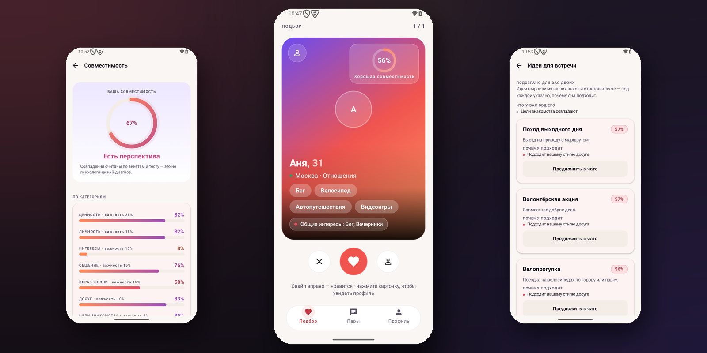
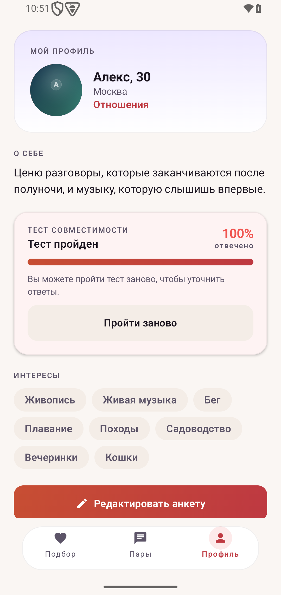

<h1 align="center">BeFoS</h1>

<p align="center"><strong>Совместимость, которую можно объяснить</strong></p>

<p align="center">
  Мобильное приложение для знакомств: процент считается по реальным ответам анкеты и теста,<br>
  разбор показывается вместе с числом, а договорённость о встрече входит в переписку пары.
</p>

<p align="center">
  
</p>

<p align="center">
  <a href="#возможности">Возможности</a> ·
  <a href="#экраны">Экраны</a> ·
  <a href="#технологии">Технологии</a> ·
  <a href="#запуск">Запуск</a> ·
  <a href="docs/API.md">API</a> ·
  <a href="docs/ARCHITECTURE.md">Архитектура</a>
</p>

> Совместимость здесь — **инженерная эвристика** над сохранёнными ответами, а не психологическая или
> медицинская диагностика. Так же это сформулировано и в самом приложении.

## About

BeFoS отвечает на вопрос «почему именно эти два процента», а не только показывает число. Движок
детерминирован и версионирован: одинаковый вход даёт одинаковый выход, и результат можно воспроизвести
по сохранённым ответам. Там, где сравнивать не с чем, полоса категории помечена как «нет данных», а не
как измеренные пятьдесят процентов.

Работает весь путь: регистрация → анкета → тест → подбор → взаимный матч → чат → разбор совместимости
и карта пары → идея совместной активности → согласованный час. Заглушек в этом потоке нет — ни случайных
процентов, ни фейковых профилей за интерфейсом, ни имитации realtime-канала.

## Возможности

**Разбор совместимости.** Семь взвешенных категорий: ценности, личность, интересы, общение, уклад,
досуг, цели знакомства. Кроме общего процента API отдаёт точки совпадения, названные расхождения и
общие интересы — всё вычислено из двух профилей, ничего не сгенерировано.

**Анкета и тест.** 21 вопрос в пяти категориях; две оставшиеся оси сравнения — интересы и цели
знакомства — читаются из анкеты. Тест идёт по категориям, продолжается с того места, где его бросили, а
часть вопросов задаётся шкалой. Незаполненный раздел анкеты назван и ведёт в него.

**Свой снимок.** Страница профиля открывает системный выборщик фотографий, отправляет выбранный файл на
`POST /users/me/photo` и показывает то, что сервер принял: маршрут перекодировал снимок, назвал файл сам
и вернул весь список снимков, где новый стоит первым. Отказ читается по-русски — размер, формат, испорченный
файл, — и прежний снимок при этом остаётся на месте. Рядом с каждым принятым снимком лежат три решения,
которые человек принимает сам: удалить его, спросив подтверждение (`DELETE /users/me/photo/{id}`), сделать
главным (`POST /users/me/photo/{id}/primary`) или переставить (`PATCH /users/me/photo/order`). Маршруты
принадлежат владельцу: чужой номер снимка отвечает 404 той же строкой, что и отсутствующий, поэтому
проверить чужую анкету этим путём нельзя. Порядок и главный снимок записываются одним проходом по всему
ряду, поэтому не разъезжаются; удаление главного передаёт роль следующему по порядку, а удаление
последнего — это профиль без снимков, а не ошибка.

**Подбор.** Кандидаты берутся из хранимой ранжированной колоды и читаются курсором, поэтому страницы не
съезжают, пока пул меняется. На карточке лежит объяснение, выведенное из двух профилей, а не из шаблона.

**Чат и карта пары.** Сообщения уходят по REST и рассылаются в WebSocket пары; повтор отправки
переиспользует ключ идемпотентности, прочтение считается квитанцией, а переподключение дозагружает
пропущенный разрыв. Compatibility Universe носит тот же разбор по узлам и отвечает, насколько уверенным
является каждый из них.

**Идеи для встречи.** Каталог из 25 активностей оценивается под оба профиля и их город; выбор виден
рядом с выбором партнёра, отклонённая идея не возвращается на свою страницу, согласованный час входит в
переписку карточкой, а час, который прошёл, назван прошедшим.

**Отказ, который что-то делает.** Блокировка удаляет пару и её историю на сервере в обе стороны и
перепроверяется на каждом кадре сокета. Это не фильтр ленты.

## Экраны

<p align="center">
  
  
  
</p>

<p align="center">
  
  
  
</p>

<p align="center"><sub>Анкета · тест из 21 вопроса · профиль совместимости · матч · чат пары · свой профиль</sub></p>

Кадры сняты 6 октября 2026 года на дереве публичного релиза `v0.1.0-beta` (эмулятор, 1080×2280).
Шапка — монтаж из тех же кадров: снимки сложены в одну картинку, интерфейс на них настоящий.
Карта пары, согласованный час встречи, возобновляемый тест и ряд снимков профиля с его удалением,
главным и перестановкой появились позже этого дерева, на этих кадрах их нет; пересъёмка — отдельная правка
с устройством, а не нарисованная картинка.

## Технологии

- **Клиент** — Kotlin 2.2, Jetpack Compose (Material 3), Navigation Compose, Ktor (HTTP + WebSocket),
  Coil, DataStore, Coroutines/Flow; разбиение `core / data / domain / presentation`.
- **Сервер** — Python 3.12, FastAPI, Pydantic 2, SQLAlchemy 2.0 (async), asyncpg, Alembic; один
  асинхронный процесс, без очереди, кэш-слоя и микросервисов.
- **Данные** — PostgreSQL 16 (22 таблицы), загрузки в `/uploads` с перенкодированием Pillow на приёме.
- **Защита** — JWT с ротируемым refresh, bcrypt, скользящий rate limiting, авторизация на уровне
  объекта с отказом `404`, проверка production-конфигурации на старте.
- **Сборка и проверки** — Docker Compose, GitHub Actions (пять job'ов плюс фильтр CodeQL), pytest,
  JUnit4 + MockK и живой продуктовый путь двумя аккаунтами.

## Запуск

```bash
cp .env.example .env
docker compose up --build
```

Compose поднимает PostgreSQL и бэкенд, применяет миграции, засевает каталоги и демо-данные и отдаёт API
на `http://localhost:8000`; интерактивная документация — `/docs`. Клиент:

```bash
cd android && ./gradlew :app:assembleDebug
```

Без Docker бэкенд поднимают из `backend/` — своя venv, `pip install -r requirements-dev.txt`,
`alembic upgrade head` и `python -m app.seed` перед этим:

```bash
cd backend
uvicorn app.main:app --reload --port 8000 --no-proxy-headers
```

Флаг `--no-proxy-headers` — не косметика: слушатель на хосте принимает соединения с loopback,
который uvicorn по умолчанию считает прокси, поэтому ротация выдуманного `X-Forwarded-For` покупает
отдельное окно лимитера на каждый адрес.

Репозиторий клонируют **без `--depth`**: из shallow-клона граф задач Gradle не разрешается. Эмулятор
достаёт до хоста через `10.0.2.2`, поэтому бэкенд на `localhost:8000` не требует дополнительной
конфигурации. Демо-доступ при `DEMO_ENABLED=true` (значение по умолчанию): `demo@befos.app` /
`Demo12345`.

Тесты, релизная сборка и разбор задержек — в
[`docs/OPERATIONS.md`](docs/OPERATIONS.md) и [`docs/VERIFICATION.md`](docs/VERIFICATION.md).

## Структура

```
backend/    FastAPI: api/v1, services, repositories, models, compatibility, recommendations, tests
android/    Kotlin / Jetpack Compose: core, data, domain, presentation
docs/       архитектура, API, база, пользовательские пути, операции, релиз, замеры
screenshots/ кадры приложения
assets/     материалы страницы
```

## Документы

| Документ | О чём |
|---|---|
| [`docs/ARCHITECTURE.md`](docs/ARCHITECTURE.md) | слои, движки, жизнь сокета, Android-разбиение |
| [`docs/API.md`](docs/API.md) | каждый эндпоинт с контрактом ответов |
| [`docs/DATABASE.md`](docs/DATABASE.md) | схема, индексы, арифметика пула |
| [`docs/USER_FLOWS.md`](docs/USER_FLOWS.md) | маршруты клиента и пользовательские сценарии |
| [`docs/OPERATIONS.md`](docs/OPERATIONS.md) | развёртывание, резервные копии, лимитер за прокси |
| [`SECURITY.md`](SECURITY.md) | что держится проверками и что оставлено открытым намеренно |
| [`docs/VERIFICATION.md`](docs/VERIFICATION.md) | чем снято каждое публикуемое число |
| [`CHANGELOG.md`](CHANGELOG.md) | история работы по стадиям |

## Чего в проекте нет

Сказано прямо, чтобы страница не обещала лишнего.

- **Боевого окружения нет.** Сервис работает локально или в Docker Compose на одном хосте.
- **Push-уведомлений нет.** Реализация требует ключ сервиса Firebase Cloud Messaging, а своего
  проектного ключа в репозитории нет и придумать его нельзя. Напоминание о часе, о котором пара
  договорилась, при этом живёт на самом устройстве: страница планов ставит будильник на
  `AlarmManager`, передвинутый час заменяет его, отменённый теряет, а проснувшись, будильник сначала
  перечитывает план: о часе, которого пара уже не держит, он молчит, вечер, который пара передвинула,
  сам встаёт на часы устройства под тем же id плана, а о часе, который перечитать не удалось, говорит
  прямо. Без разрешения показывать уведомления страница говорит об этом открыто вместо того, чтобы
  обещать молча.
- **Панели модерации жалоб нет.** Обращения сохраняются и переживают удаление аккаунта автора, но
  читать их сейчас значит SQL.
- **Снимками своего профиля человек распоряжается сам, а числа его никто не держит.** Страница профиля
  выбирает файл из системного выборщика и отправляет его на `POST /users/me/photo`, а дальше удаляет
  снимок по подтверждению, ставит его главным и переставляет весь ряд (`ApiService.kt`,
  `ProfileRepositoryImpl.kt`, `Repositories.kt`, `ProfileViewModel.uploadPhoto`,
  `ProfileViewModel.confirmDeletePhoto`); права для этого не нужны — выборщик отдаёт одну читаемую строку.
  Камеры в приложении нет. Потолка у ряда тоже нет: маршрут принимает кадр, пока человек его присылает, и
  живому пути `backend/e2e_journey.py` снимок до сих пор не нужен — управление рядом проверяют два
  тестовых набора, а не он.

## Лицензия

Проприетарная, **All Rights Reserved** — [`LICENSE`](LICENSE). Читать код, историю и собирать его
локально для ревью можно; копировать, модифицировать, встраивать и хостить — нет. Внешние вклады сейчас
не принимаются.
