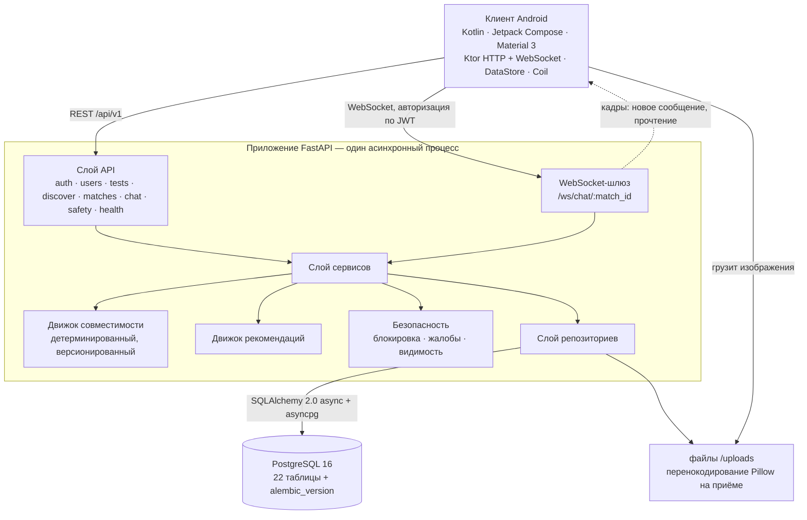

# BeFoS

**Знакомства, в которых процент совместимости можно объяснить**


<table>
  <tr>
    <td align="center"><br><sub>Поиск: кольцо процента, общие интересы и причина показа</sub></td>
    <td align="center"><br><sub>Разбор: общий процент и семь полос категорий</sub></td>
    <td align="center"><br><sub>Чат пары поверх WebSocket</sub></td>
  </tr>
  <tr>
    <td align="center"><br><sub>Идеи для встречи, оценённые под двоих</sub></td>
    <td align="center"><br><sub>Профиль после теста</sub></td>
    <td align="center"><br><sub>Свой профиль, интересы, приватность</sub></td>
  </tr>
</table>

> Кадры сняты 6 октября 2026 года на дереве публичного релиза `v0.1.0-beta`. Карта пары,
> договорённость о часе встречи и тест, который продолжается с брошенного места, появились позже
> этого дерева и на этих кадрах их нет; пересъёмка стоит в списке незакрытого ниже.

> BeFoS — приложение для знакомств, в котором совместимость считается по семи взвешенным категориям
> и показывается человеку вместе с числом. Не «вот вам 87% и верьте на слово», а «вот что у вас
> общего, вот в чём вы разошлись, и вот чем вам двоим заняться вместе». Всё это вычисляется из
> реальных ответов профилей, детерминированно, без генерации текста.

Процент совместимости — **инженерная эвристика** на основе анкеты и теста. Это не психологическая
или медицинская диагностика, и в продукте она нигде так не подаётся.

## Что это за проект

В одном репозитории два законченных артефакта:

- **`backend/`** — асинхронный FastAPI-сервис: JWT-аутентификация с ротацией refresh-токенов,
  профиль и анкета, тест из 21 вопроса в семи категориях, движок совместимости, поиск с хранимой
  колодой и курсорной пагинацией, пары, WebSocket-шлюз чата, карта совместимости пары, рекомендации
  совместных активностей с согласованным часом, безопасность (блокировка, жалобы, видимость,
  удаление аккаунта), миграции Alembic поверх PostgreSQL 16 — 22 таблицы.
- **`android/`** — клиент на Kotlin / Jetpack Compose (Material 3, Ktor, Navigation Compose,
  DataStore, Coil) с разбиением `data / domain / presentation`, покрывающий каждую возможность
  бэкенда.

В этом потоке нет заглушек: ни случайных процентов, ни фейковых профилей за интерфейсом, ни имитации
realtime-канала. Засеянные аккаунты существуют, чтобы продукт можно было показать, и они помечены
как засеянные.

## Чем BeFoS отличается

- **Число объяснимо.** Каждый балл категории выведен из сохранённых ответов, и API возвращает разбор
  по категориям, точки совпадения, реальные расхождения и общие интересы — всё вычислено, ничего не
  сгенерировано. Карта пары (`Compatibility Universe`) носит тот же разбор по узлам и отвечает,
  насколько уверенным является каждый из них.
- **Одинаковый вход даёт одинаковый выход.** Движок детерминирован и версионирован
  (`engine_version` сохраняется вместе с каждым результатом), поэтому процент можно воспроизвести и
  проверить. Симметрия пары — проверенное тестами свойство, а не молчаливое допущение.
- **Расхождение называется, а не сглаживается.** Полоса категории, где движку не с чем сравнивать,
  помечена `has_data` и печатается на экране как «нет данных», а не как измеренные пятьдесят
  процентов. Незаполненный раздел анкеты назван и ведёт в него.
- **Симпатия и несходство работают вместе.** Оценка считает и пересечение интересов, и названное
  расхождение: два списка без общих позиций стоят очков, а промолчавший об интересах человек не
  превращается в чужое расхождение.
- **Доведено до реальной встречи.** Вместо «вам стоит поговорить» приложение предлагает конкретную
  активность из каталога на 25 позиций, подходящую обоим профилям и их городу, принимает выбор с
  обеих сторон, согласует час и приносит договорённость строкой в переписку пары. Час, который уже
  прошёл, назван прошедшим и предлагает паре договориться о новом.
- **Отказ реальный.** Блокировка удаляет пару и её историю на сервере, в обе стороны, включая внутри
  уже открытого сокета. Это не фильтр ленты.

## Продуктовый поток

```
регистрация → профиль → интересы → тест из 21 вопроса → профиль совместимости
        → колода поиска → симпатия / пропуск → взаимный матч → чат (WebSocket)
        → разбор совместимости и карта пары → идея совместной активности → согласованный час
```

После входа маршрутизация зависит от того, насколько заполнен профиль: законченный попадает на
главную вкладку, незаполненный — обратно в анкету, а не на экран, который не может работать.

## Экраны

Язык интерфейса — русский: продукт делался для русскоязычного рынка, а строки экранов живут в коде
Compose, а не в ресурсном бандле, поэтому переключателя локали нет. Содержимое каталогов (интересы,
вопросы, активности) по той же причине русское.

| Экран | Кадр | Что на нём |
|---|---|---|
| Вход | [`01-auth.png`](screenshots/01-auth.png) | Форма входа и регистрации |
| Анкета | [`02-onboarding.png`](screenshots/02-onboarding.png) | Шаг 1 из 3: имя, дата рождения, город, пол, о себе |
| Тест | [`03-test.png`](screenshots/03-test.png) | Вопрос 1 из 21, с прогресс-баром и четырьмя вариантами |
| Результат теста | [`04-test-result.png`](screenshots/04-test-result.png) | Профиль по категориям после теста |
| Поиск | [`05-discovery.png`](screenshots/05-discovery.png) | Карточка кандидата с кольцом процента, общими интересами и причиной показа, выведенной из данных |
| Совместимость | [`06-compatibility.png`](screenshots/06-compatibility.png) | Общий процент и семь полос категорий |
| Матч | [`07-match.png`](screenshots/07-match.png) | Момент взаимной симпатии с процентом пары |
| Чат | [`08-chat.png`](screenshots/08-chat.png) | Живой диалог внутри пары |
| Рекомендации | [`09-recommendations.png`](screenshots/09-recommendations.png) | Оценённые для пары совместные активности |
| Профиль | [`10-profile.png`](screenshots/10-profile.png) | Свой профиль, состояние теста, интересы, вход в приватность |

Экранов, которые выросли после этих съёмок и ещё не сняты, три: **Compatibility Universe** (карта
пары в трёх режимах — обзор, углублённый разбор, история), **страница идей пары с согласованным
часом** (карточка договорённости в переписке и её статус) и **тест, идущий по категориям**, с
возобновлением с брошенного вопроса и шкалой вместо карточек ответов.

## Что умеет

**Аутентификация и сессия.** Access-токен плюс refresh-токен; refresh хранится как SHA-256 хеш и
ротится при каждом использовании. Протухшая сессия — восстановимое состояние: неудачный refresh
очищает токены, а навигатор возвращает человека на экран входа с уже подставленной почтой; 5xx или
сетевой сбой, наоборот, сессию сохраняют и оставляют на экране, где «Повторить» может сработать.

**Профиль и анкета.** Три шага, валидация там, где уже находится большой палец; интересы из каталога
на 40 позиций со стабильной геометрией чипов (выбор одного не сдвигает соседей). Анкета считается
закрытой по разделам, а не по последнему шагу, и незакрытый раздел назван.

**Тест.** 21 вопрос в семи категориях, идёт по категориям и продолжается с того места, где его
бросили; часть вопросов задаётся шкалой, а не вариантами. Перепройти можно в любой момент, а
результат называет свои оси, а не только пять полос.

**Поиск.** Кандидаты берутся из хранимой ранжированной колоды и читаются курсором, поэтому страницы
не съезжают, пока пул меняется; тот, кто не проходил тест, не становится чьей-то карточкой. На
каждой карточке лежит объяснение, выведенное из двух профилей, а не из шаблона, и пустая полоса
совместимости чужого профиля подписана тем же словом, что на экране пары, и ведёт в свой раздел
анкеты.

**Пары и чат.** Взаимная симпатия создаёт пару и сохраняет процент, который движок даёт этой паре
сегодня. Сообщения уходят через REST и рассылаются в WebSocket пары, так что оба клиента видят их
без перезагрузки; повтор отправки переиспользует ключ идемпотентности, поэтому одно касание — одно
сообщение, а переподключение дозагружает пропущенный разрыв. Прочтение считается квитанцией, а не
кадром набора текста.

**Compatibility Universe.** Карта пары, собранная из того же разбора, что и экран совместимости:
узел категории несёт свой ответ, степень уверенности и связанные вопросы теста, а три режима чтения
(обзор, углублённый разбор, история) стоят на одном и том же проценте пары. Вопрос с узла
передвигается в чат, а из карты есть выход к идеям для встречи.

**Рекомендации и договорённость.** Активности оценены по обоим профилям, их городу и ответам и
обновляются, когда меняется любой из профилей; выбор партнёра виден рядом с выбором человека,
отклонённая идея не возвращается на её страницу, а паре с разъехавшимися уровнями идея называет это
вместо молчания. Согласованный час входит в переписку отдельной строкой той же таблицы сообщений и
на экране пары держится карточкой через всю полосу, а не чьим-то пузырём; прошедший час назван
прошедшим и предлагает паре договориться о новом.

**Разбор совместимости.** Общий процент, семь полос категорий, сильные стороны, расхождения, общие
интересы — считается по обоим профилям.

**Безопасность.** Блокировка (на сервере, в обе стороны, перепроверяется на каждом кадре сокета),
жалобы с пересылаемыми причинами, переключатель видимости профиля, удаление аккаунта, которое
стирает данные человека, оставляя целость ссылок.

## Движок совместимости

```
Score = Σ ( normalize(component_i) × weight_i ),   Σ weight_i = 1.0
```

| Категория | Вес | Из чего считается |
|---|---|---|
| values | 0.25 | Близость черт в нормализованном векторе ответов (семья, карьера, рост, стабильность, приключения) |
| personality | 0.15 | Близость черт (экстраверсия, открытость, планирование, оптимизм) |
| interests | 0.15 | Пересечение множеств интересов — не вектора. Считается только то, что назвали оба: если хоть один из двоих не выбрал ни одного интереса, сравнивать нечего и категория читается нейтрально, а два названных набора без пересечения — расхождение, которое стоит очков |
| communication | 0.15 | Близость черт в категории общения |
| lifestyle | 0.15 | Близость черт в категории уклада жизни |
| leisure | 0.10 | Близость черт в категории досуга |
| goals | 0.05 | Совместимость двух названных целей знакомства — не вектора |

Веса лежат в `backend/app/compatibility/weights.py` и проверены на сумму 1.0. Кроме процента API
отдаёт разбор по категориям, сильные стороны, расхождения и общие интересы. Оценивание — чистая
синхронная функция двух векторов: без базы, без часов, без случайности внутри движка. Именно поэтому
тесты детерминизма и симметрии дёшевы в запуске.

О номере движка (`engine_version`) стоит знать ровно одно, иначе он обещает больше, чем держит: он
записывается в каждый ответ и в каждый сохранённый вектор ответов, то есть держит форму результата,
а не каждое правило в отдельности. Число, где прежний расчёт и вправду остался, — сохранённый процент
пары (`Match.compatibility_score`), и версии он не держит: он пересчитывается, когда кто-то из двоих
правит интересы, цель знакомства или пересдаёт тест. Оба пункта записаны открытыми в
[`CHANGELOG.md`](CHANGELOG.md).

## Архитектура



Один процесс бэкенда, одна база и одно хранилище файлов для загрузок: ни очереди, ни кэш-слоя, ни
микросервиса, которого не существует. Подробности — в документах ниже, а не здесь:

| Документ | О чём |
|---|---|
| [`docs/ARCHITECTURE.md`](docs/ARCHITECTURE.md) | слои, движки, жизнь сокета, Android-разбиение, наблюдаемость |
| [`docs/API.md`](docs/API.md) | каждый эндпоинт с контрактом ответов |
| [`docs/DATABASE.md`](docs/DATABASE.md) | схема, индексы, арифметика пула |
| [`docs/USER_FLOWS.md`](docs/USER_FLOWS.md) | карта маршрутов клиента и пользовательские сценарии со следом, что держит каждый из них и чего он не видел |
| [`docs/SCALE_PLAN.md`](docs/SCALE_PLAN.md) | горячие пути на объёме 1 000 / 10 000 / 50 000 анкет с `EXPLAIN ANALYZE` |
| [`docs/OPERATIONS.md`](docs/OPERATIONS.md) | развёртывание, резервные копии и дролл восстановления, лимитер за прокси |
| [`docs/RELEASE.md`](docs/RELEASE.md) | релизный чек-лист и список того, что не сделано |
| [`docs/DEPENDENCIES.md`](docs/DEPENDENCIES.md) | политика пинов и аудит advisory |
| [`docs/VERIFICATION.md`](docs/VERIFICATION.md) | чем снято каждое публикуемое число |

## Технологический стек

| Слой | Технология |
|---|---|
| Бэкенд | Python 3.12, FastAPI 0.115, Pydantic 2.10, SQLAlchemy 2.0 (async), asyncpg, Alembic 1.14 |
| База данных | PostgreSQL 16 |
| Аутентификация и безопасность | JWT (access + ротируемый refresh), bcrypt, проверка CORS, скользящее окно rate limiting, перенкодирование изображений через Pillow |
| Realtime | WebSocket `/ws/chat/{match_id}` с авторизацией по JWT; сообщения и прочтения, отправленные по REST, рассылаются в сокет пары |
| Android | Kotlin 2.2, Jetpack Compose (BOM 2024.09), Material 3, Navigation Compose 2.8, Ktor 3.0, kotlinx-serialization, Coil 2.7, DataStore 1.1, Coroutines/Flow |
| Инфраструктура | Docker Compose, GitHub Actions, pytest, JUnit4 + MockK + Turbine |

## Быстрый старт

Нужны Docker с Compose-плагином (для основного пути) либо Python 3.12 + PostgreSQL 16, и JDK 17 для
клиента. Репозиторий клонируют **без `--depth`**: из shallow-клона граф задач Gradle не разрешается.

### Бэкенд в Docker (рекомендуется)

```bash
cp .env.example .env        # при желании поменяйте секреты
docker compose up --build
```

Compose поднимает PostgreSQL и бэкенд, применяет миграции (`alembic upgrade head`), засевает каталоги
и демо-данные и отдаёт API на `http://localhost:8000`; интерактивная документация — `/docs`.
Development-файл публикует PostgreSQL только на `127.0.0.1:5432`, поэтому случайный `docker compose
up` на машине с маршрутизируемым интерфейсом базу наружу не выставляет.

### Бэкенд без Docker

```bash
cd backend
python -m venv .venv && source .venv/Scripts/activate   # Windows, Git Bash
pip install -r requirements-dev.txt                      # runtime + тестовый инструментарий
cp ../.env.example .env                                  # направьте DATABASE_URL на свою PostgreSQL
alembic upgrade head
python -m app.seed
uvicorn app.main:app --reload --port 8000 --no-proxy-headers
```

Флаг `--no-proxy-headers` — не косметика: uvicorn по умолчанию подставляет `X-Forwarded-For` вместо
адреса соединения для каждого пира из `forwarded_allow_ips`, а слушатель на хосте принимает
соединения с loopback, то есть считает доверенным каждого локального клиента. Без флага ротация
выдуманных адресов в этом заголовке покупает отдельное окно лимитера на каждый из них. Подробности и
рецепт для стенда за прокси — [`docs/OPERATIONS.md`](docs/OPERATIONS.md).

### Android

```bash
cd android
./gradlew :app:assembleDebug     # app/build/outputs/apk/debug/app-debug.apk
```

Эмулятор достаёт до хоста через `10.0.2.2`, поэтому бэкенд на `localhost:8000` не требует
дополнительной конфигурации (см. `API_BASE_URL` в `android/app/build.gradle.kts`); физическое
устройство — через `adb reverse tcp:8000 tcp:8000`. Release-сборка требует `https://`/`wss://`
адреса бэкенда в `BEFOS_API_BASE_URL` и `BEFOS_WS_BASE_URL` и падает без них, чтобы случайный релиз
не указывал на эмулятор: [`docs/RELEASE.md`](docs/RELEASE.md).

### Демо-доступ

При `DEMO_ENABLED=true` (значение по умолчанию в `.env.example`, в production отвергается):
`demo@befos.app` / `Demo12345`. Посев добавляет ещё 50 очевидно вымышленных демо-персон с
синтетическими ответами; при `DEMO_ENABLED=false` грузятся только каталоги. Сценарий показа на
5–10 минут по всей цепочке создания ценности — [`DEMO.md`](DEMO.md).

### Тесты

```bash
cd backend && pytest                                   # юнит + интеграция + security + производительность
cd android && ./gradlew :app:testDebugUnitTest         # ViewModel и чистые функции
cd backend && python e2e_journey.py                    # живой путь, нужен поднятый Docker-бэкенд
```

Все три набора зелёные на дереве замера 2026-10-15: бэкенд 758 проверок, Android 372, живой путь 102
из 102. Чем снято каждое из этих чисел, с артефактом прогона и окном в UTC, — в
[`docs/VERIFICATION.md`](docs/VERIFICATION.md); там же история пересъёмов. Бэкенд-набор создаёт
собственную базу `befos_test` против Docker Postgres на `localhost:5432` и держит её advisory-локом
на время прогона, поэтому вторая параллельная сессия получает отказ старта с указанием причины, а не
падения, похожие на регрессии.

Конвейер GitHub Actions гоняет эти же команды на чистом runner'е пятью job'ами (`backend`,
`migrations`, `android`, `advisories`, `journey`) плюс фильтр CodeQL, поэтому PR с регрессией
становится красным, а не остаётся договорённостью на слово.

## Структура репозитория

```
backend/
  app/
    api/v1/          маршруты: auth, users, tests, discover, matches, chat, safety, health
    compatibility/   движок совместимости, веса, карта пары (universe)
    recommendations/ движок рекомендаций и согласование часа
    services/ repositories/ models/   логика, доступ к данным, 22 таблицы
    auth/ websocket/ core/ schemas/ seed_data/
  alembic/           ревизии схемы, у каждой есть работающий downgrade
  tests/             pytest-набор, включая приборы на задержки и проверку IDOR
  e2e_journey.py     живой продуктовый путь двумя аккаунтами
  ops/               аудит разрешённого графа зависимостей
android/
  app/src/main/java/app/befos/
    core/            сеть, хранилище, дизайн-система
    data/            ApiService и репозитории
    domain/          модели и use-case
    presentation/    экраны Compose, навигация, ViewModel
docs/                архитектура, API, база, пользовательские пути, операции, релиз, замеры
screenshots/         кадры приложения
.github/workflows/   ci.yml
```

## Что держится проверками, а не обещаниями

- **Аутентификация на JWT** с ротацией refresh-токена; пароли — bcrypt; токены, включая токен
  рукопожатия сокета, в логи не пишутся.
- **Отказ входа не выдаёт существование адреса временем**: обе ветки отказа платят ровно одну
  проверку bcrypt, поэтому по секундомеру адрес не перебрать.
- **Авторизация на уровне объекта (защита от IDOR)** на каждом маршруте с идентификатором; отказ
  всегда один и тот же — `404`, включая маршруты пары, потому что `403` подтвердил бы существование
  пары. Набор маршрутов берётся из таблицы маршрутов приложения, поэтому новый маршрут попадает под
  проверку в коммите, который его подключил.
- **WebSocket спрашивает заново каждый кадр**: сокет не может пережить свою пару, блокировку или
  отключение аккаунта — close `1008`.
- **Rate limiting скользящим окном** (120 запросов в минуту на маршрут, 20 на `/auth`, 30
  рукопожатий в минуту на адрес для сокета), ключ — адрес соединения, а не подставляемый клиентом
  заголовок.
- **Документация API закрыта в production**: `/docs`, `/redoc` и `/openapi.json` не отвечают, а
  корневой ответ на них не ссылается.
- **Проверка production-конфигурации на старте**: сервис не поднимется на заглушечном JWT-секрете,
  на wildcard- или `http://` CORS-origin, на `DEBUG=true`, на включённом демо-аккаунте и на
  developmentном пароле базы.
- **Загрузки**: изображение читается до потолка по размеру и перенокодировается Pillow, а декодер
  выбирается из списка, принадлежащего продукту, а не из байтов, которые клиент сам подписал.
- **Гонки закрыты ограничениями базы**: повторные симпатии, двойная отправка теста, одинаковые
  сообщения и два шага курсора колоды решает PostgreSQL, а не схема check-then-insert на Python.
- **Наблюдаемость**: каждый запрос получает id, длительность и структурированную строку — именно это
  сделало правки задержек измеримыми.
- **Целостность релиза**: release-сборку нельзя собрать против адреса эмулятора, и проверка сделана
  по тем артефактам, которые действительно производит граф задач.

Полный список гарантий и то, что оставлено открытым намеренно, — [`SECURITY.md`](SECURITY.md); пробы
здоровья, резервные копии и арифметика пула — [`docs/OPERATIONS.md`](docs/OPERATIONS.md). Детали
реализации, которые облегчили бы злоупотребление, здесь опущены намеренно.

## Состояние проекта

Работает и проверено: весь поток от регистрации до согласованного часа, на текущем дереве, на
эмуляторе и против Docker-бэкенда, плюс три набора проверок и живой путь.

Не сделано, сказ прямо:

- **Нет развёртывания.** Сервис работает локально или в Docker Compose на одном хосте; внешнего
  запущенного инстанса, терминирования TLS и настоящего боевого окружения нет. Конвейер поднимает
  собранный образ и ведёт живой путь на runner'е, но это проверка, а не запуск.
- **Нет push-уведомлений.** Дизайн относительно существующих швов записан
  (`docs/ARCHITECTURE.md`), реализации нет — намеренно: она требует ключ сервиса Firebase Cloud
  Messaging, а своего проектного ключа в этом репозитории нет и придумать его нельзя.
- **Нет панели администратора.** Жалобы сохраняются и переживают удаление аккаунта автора, но читать
  и разбирать их сейчас значит SQL (`docs/OPERATIONS.md` §14).
- **Разблокировки в приложении нет.** Для клиента блокировка окончательна; снятие —
  задокументированная SQL-операция, которая не восстанавливает пару и её историю.
- **Загрузить свой снимок из приложения нельзя.** Маршрут `POST /users/me/photo` работает,
  клиентский путь до него собран (`ApiService.kt:118`, `ProfileRepositoryImpl.kt:26`,
  `Repositories.kt:48`), но ни один экран `presentation/` его не вызывает: Discovery, список пар
  и профиль снимки только читают. Новый человек поэтому листает колоду и подбирается без единой
  фотографии — это пробел продукта, а не поломка, и правкой стадии он не закрыт: ни камера без
  согласованного поведения, ни удаление работающего маршрута не были выбраны.
- **Кадры экрана отстают от дерева.** Десять снимков выше сделаны 6 октября 2026 года на дереве
  публичного релиза; карты пары, согласованного часа и возобновляемого теста на них нет. Переснять их
  на этом стенде нельзя: сборка клиента здесь не проходит, а эмулятор не запускался, поэтому новый
  кадр будет добавлен отдельной правкой с устройством, а не нарисован.
- **Резервные копии ручные.** Есть проверенный дролл, а не планировщик, и нет копии вне хоста.
- **Одна база, без реплики.** Тяжёлый отчёт выполняется на рабочих соединениях.
- **`/uploads` — неаутентифицированная статика.** Приватность там держится на непредсказуемых именах
  файлов и на удалении файла вместе с аккаунтом, а не на проверке прав.

### Дорожная карта

В том порядке, в котором перечисленные пробелы реально что-то блокируют:

1. Выставить бэкенд за TLS с настоящими секретами и доказать production-стражи на живом окружении.
2. Push-уведомления по уже записанному дизайну — как только появится ключ сервиса FCM.
3. Загрузка своего снимка из приложения: маршрут и клиентский путь к нему работают, экрана, который
   их зовёт, нет.
4. Читалка жалоб для модерации, чтобы у претензии был адресат, отличный от приглашения `psql`.
5. Плановые резервные копии с копией вне хоста и периодически повторяемым дроллом; PITR после этого.
6. Разблокировка в приложении с явным утверждением, что она не воскресает удалённую пару.
7. Подписанная дистрибуция релиза (закрытый трек Play) и политика версионирования.
8. Пересъёмка кадров экрана на дереве, которое уже умеет карту пары и договорённость о часе.

История работы по стадиям, с коммитами и замерами, живёт не здесь: [`CHANGELOG.md`](CHANGELOG.md)
и [`docs/DEVELOPMENT_HISTORY.md`](docs/DEVELOPMENT_HISTORY.md).

## Лицензия

Проприетарная. **All Rights Reserved** — см. [`LICENSE`](LICENSE).

> © 2026 Andrew Kolesnikov. All rights reserved.
> The repository is published for portfolio, educational review and demonstration purposes.
> No license is granted to copy, redistribute, modify, sublicense or commercially use the
> source code without explicit written permission.

Отсутствие open-source лицензии — не забывчивость: разрешение на открытое использование здесь не
выдаётся, и **использовать код нельзя** — это касается и переноса движка совместимости, и
заимствования модуля, и встраивания APK, и хостинга копии. Читать код и историю и собирать его
локально без изменений для ревью или учёбы — можно, как и короткие цитаты с указанием авторства;
точные условия — в `LICENSE`. Сторонние компоненты остаются под своими лицензиями и перечислены в
[`THIRD_PARTY_NOTICES.md`](THIRD_PARTY_NOTICES.md).

BeFoS ведётся как проприетарный portfolio/product-проект. **Внешние вклады сейчас не принимаются** —
`CONTRIBUTING.md` нет, pull request'ы не мёржатся. Запросить разрешение можно через GitHub-профиль
автора (Andrew05812).
